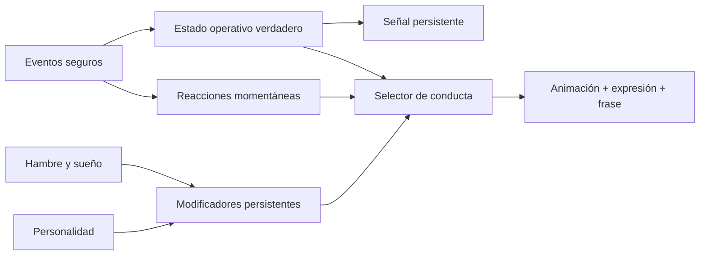

# Sistema de reactividad de Mascotas v0

## Estado

- Naturaleza: propuesta de diseño pendiente de validación.
- Prioridad de producto: reactividad expresiva profunda, confirmada.
- Alcance: eventos seguros, arbitraje, cuidado ligero y frases contextuales.
- Contrato técnico o API: todavía no definido.
- Lectura de prompts, código, archivos o resultados completos: excluida.
- Capacidades de agente: excluidas.

Los identificadores de este documento son nombres semánticos provisionales. Sirven
para diseñar y comparar paquetes de conducta; todavía no comprometen una
API concreta de la aplicación anfitriona ni una implementación de Comunity Hub.

## Objetivo

La mascota debe sentirse conectada con el ritmo del trabajo sin convertirse en un
indicador técnico disfrazado ni en otro agente. La profundidad proviene de combinar
eventos seguros, repertorio, continuidad, personalidad y timing.

El sistema debe preservar dos verdades simultáneas:

1. la persona entiende con claridad qué ocurre en la sesión agéntica;
2. la mascota expresa ese contexto de una manera propia, variada y reconocible.

## Modelo de cuatro capas

### 1. Estado operativo verdadero

Representa la situación actual del anfitrión. Permanece visible aunque la mascota
esté ejecutando una reacción breve, comiendo o durmiendo.

| Estado | Significado | Prioridad agregada |
|---|---|---:|
| `needs_input` | El anfitrión requiere aprobación, respuesta o decisión | 1 |
| `blocked` | Una actividad falló o encontró un error del sistema | 2 |
| `ready` | Existe actividad terminada todavía no revisada | 3 |
| `running` | Al menos una actividad continúa trabajando | 4 |
| `idle` | No existe actividad operativa pendiente | 5 |

Los primeros cuatro estados conservan el orden publicado en la
[documentación oficial de Pets](https://learn.chatgpt.com/docs/pets). `idle` completa
el modelo de conducta cuando no existe trabajo activo. Si hay varias actividades, el
anfitrión calcula el estado agregado; la mascota no inspecciona chats para decidirlo.

### 2. Reacciones momentáneas

Son respuestas breves a una transición o acción concreta: comenzar una tarea,
terminarla, alimentar a la mascota o volver después de una ausencia. Pueden interrumpir
un loop ambiental, pero al finalizar regresan al estado operativo vigente.

### 3. Modificadores persistentes

Hambre, sueño y personalidad cambian **cómo** se representa un evento, nunca **qué**
significa. Una mascota cansada puede celebrar con menos energía; no puede representar
un error como éxito ni ocultar una aprobación pendiente.

### 4. Salida expresiva

Una regla de conducta puede coordinar tres salidas:

- animación o transición corporal;
- expresión visual;
- frase contextual opcional.

Las tres se seleccionan como una respuesta coherente. El texto o audio no opera como
un sistema conversacional separado.

## Vocabulario central de eventos

### Estado y trabajo

| Evento provisional | Cuándo ocurre | Resultado conductual esperado |
|---|---|---|
| `status.changed` | Cambia el estado operativo agregado | Actualizar inmediatamente la señal persistente |
| `work.started` | Comienza una actividad | Reacción de entrada y transición a trabajo |
| `work.resumed` | Continúa una actividad pausada o atendida | Reacción breve de reanudación |
| `work.needs_input` | Aparece una decisión o aprobación pendiente | Solicitar atención sin insistencia repetitiva |
| `work.completed` | Una actividad termina correctamente | Celebración proporcional y luego estado vigente |
| `work.blocked` | Una actividad falla o queda bloqueada | Reacción clara que no trivializa el problema |
| `work.cancelled` | La persona detiene una actividad | Cierre neutral, sin celebrar ni dramatizar |

### Presencia y relación

| Evento provisional | Cuándo ocurre | Resultado conductual esperado |
|---|---|---|
| `presence.idle_entered` | Comienza un período sin actividad | Entrar al repertorio ambiental |
| `presence.returned` | La persona vuelve a la superficie | Saludo variado; el cuidado no se deterioró en ausencia |
| `relationship.first_meeting` | Se aplica la mascota por primera vez | Presentación breve y memorable |
| `relationship.renamed` | Cambia el nombre de la instancia | Reconocimiento corto del nuevo nombre |
| `interaction.petted` | La persona interactúa directamente | Feedback inmediato y expresivo |

### Cuidado ligero

| Evento provisional | Cuándo ocurre | Resultado conductual esperado |
|---|---|---|
| `care.hunger_band_changed` | Hambre cambia de franja | Ajustar repertorio; una reacción ocasional como máximo |
| `care.sleep_band_changed` | Sueño cambia de franja | Ajustar energía, reposo y probabilidad de siesta |
| `care.fed` | La persona alimenta a la mascota | Respuesta inmediata y actualización de hambre |
| `care.tucked_in` | La persona la arropa o manda a descansar | Transición voluntaria al descanso |
| `care.woken` | La persona la despierta | Despertar breve y regreso al contexto vigente |

### Extensiones opcionales

Un runtime puede exponer eventos más específicos, por ejemplo `work.retrying`,
`work.multiple_completed` o `presence.long_session`. Todo evento opcional debe declarar
un estado o evento central de respaldo. Una mascota que no lo implemente continúa
funcionando sin comportamiento muerto.

## Contexto permitido

Un evento puede incluir solamente datos abstractos necesarios para modular la
reacción:

- cantidad aproximada: una actividad o varias;
- duración por franja: breve, normal o prolongada;
- origen: anfitrión, usuario o sistema de cuidado;
- estado operativo vigente;
- franjas de hambre y sueño;
- repetición reciente del mismo evento;
- identificador opaco para agrupar transiciones de una misma actividad.

El evento no incluye:

- texto del prompt o de la respuesta;
- nombres ni contenido de archivos;
- fragmentos de código;
- títulos de chats o proyectos;
- credenciales, rutas locales o secretos;
- una explicación inventada del resultado.

## Prioridades de reacción

El estado operativo y las reacciones usan arbitrajes separados. Una animación breve
puede cambiar sin que desaparezca la señal de `needs_input` o `blocked`.

| Prioridad de reacción | Clase | Ejemplos |
|---:|---|---|
| 1 | Acción directa del usuario | acariciar, alimentar, arropar, despertar |
| 2 | Nueva necesidad de atención | aprobación pendiente, bloqueo nuevo |
| 3 | Resultado terminal | completado, cancelado, error |
| 4 | Transición de trabajo | comenzar, reanudar |
| 5 | Cambio de cuidado | pasar a hambriento, cansado o descansado |
| 6 | Conducta ambiental | idle, rarezas, pequeños gestos espontáneos |

### Reglas de arbitraje

1. La señal operativa verdadera nunca se oculta ni cambia de significado.
2. Una acción directa siempre recibe feedback visible e inmediato.
3. `needs_input` y `blocked` interrumpen conducta ambiental y reacciones de baja
   prioridad.
4. Una celebración se pospone o suaviza si el estado agregado continúa en
   `needs_input` o `blocked` por otra actividad.
5. Eventos repetidos en una ráfaga se agrupan; la mascota no reproduce una reacción
   completa por cada actividad.
6. Una reacción caduca si perdió relevancia antes de ejecutarse.
7. Al finalizar una reacción, la mascota vuelve al estado operativo **actual**, no al
   que existía cuando comenzó.
8. Hambre y sueño modifican selección, energía y timing; no compiten por prioridad
   con el trabajo.
9. La expresión verbal tiene cooldown propio y puede omitirse aunque la animación se
   reproduzca.
10. Reducir movimiento o desactivar frases cambia la salida, no el significado del
    evento.

## Selección de conducta

Ante cada evento, el runtime sigue este orden conceptual:

1. actualiza el estado operativo y los modificadores persistentes;
2. conserva o actualiza la señal técnica visible;
3. reúne las reacciones compatibles declaradas por el paquete de conducta;
4. descarta opciones bloqueadas por prioridad, cooldown, repetición o preferencias;
5. aplica personalidad, hambre, sueño, intensidad y rareza como modificadores;
6. elige una respuesta evitando repetir la última alternativa cuando existan otras;
7. coordina animación, expresión y frase;
8. vuelve al loop correspondiente al estado vigente.

El selector favorece diversidad controlada, no aleatoriedad sin intención. Un paquete
puede ser tímido, efusivo o sarcástico sin alterar la semántica del evento.

## Franjas de cuidado

### Hambre

- `sated`: acaba de comer; mayor probabilidad de reacciones satisfechas;
- `okay`: franja normal, sin protagonismo especial;
- `hungry`: modifica reposo y habilita recordatorios ocasionales.

### Sueño

- `rested`: energía normal;
- `tired`: menor intensidad y mayor presencia de bostezos o pausas;
- `sleepy`: habilita siestas automáticas durante idle y la acción de arropar.

No existen franjas de emergencia. Cambiar de franja puede generar una reacción una
vez; permanecer en ella no produce recordatorios repetitivos. `presence.returned` no
reduce ninguna necesidad por el tiempo transcurrido fuera de la aplicación
anfitriona.

## Intenciones verbales básicas

El paquete de conducta escribe variantes para intenciones semánticas, no respuestas
libres. Estos textos son ejemplos ilustrativos, no copy final:

| Intención | Evento asociado | Ejemplo neutro |
|---|---|---|
| `greet` | primer encuentro o regreso | “¡Volviste!” |
| `work_start` | comienzo o reanudación | “Me pongo con eso.” |
| `attention` | necesita input | “Te necesito un segundo.” |
| `success` | actividad completada | “Listo por acá.” |
| `problem` | bloqueo | “Algo se trabó.” |
| `petted` | interacción directa | “Je, otra vez.” |
| `hungry` | cambio a hungry | “¿Comemos algo?” |
| `sleepy` | cambio a sleepy | “Me vendría bien una siesta.” |
| `fed` | alimentación | “Eso estaba buenísimo.” |
| `goodnight` | arropada | “Nos vemos en un rato.” |
| `wake` | despertar | “Ya estoy.” |

Una frase nunca afirma detalles que el evento no contiene. La personalidad modifica
el tono y el vocabulario, pero conserva la intención verdadera.

## Escenarios de concurrencia

### Una tarea termina mientras otra queda bloqueada

La señal persistente muestra `blocked`. El éxito puede producir una reacción breve y
moderada o agruparse para más tarde; no reemplaza la indicación del problema.

### La persona alimenta a la mascota mientras el agente trabaja

`care.fed` recibe respuesta inmediata. La señal `running` permanece visible y, al
terminar la comida, la mascota vuelve a su repertorio de trabajo.

### El agente necesita aprobación durante una siesta

La mascota sale del reposo, muestra la señal `needs_input` y usa una reacción de
atención. Despertarse no modifica artificialmente su franja de sueño.

### La persona vuelve después de varios días

`presence.returned` elige un saludo. Hambre y sueño conservan el estado pausado al
cerrar la aplicación anfitriona; la mascota no reclama por la ausencia.

### Varias tareas terminan casi juntas

Los eventos se agrupan y modulan una sola celebración. No se forma una cola de
animaciones obsoletas.

## Requisitos de profundidad para la demo

La primera demostración debe permitir comprobar que:

- los loops de alta frecuencia —idle, running y espera— tienen la mayor variedad;
- un mismo evento produce respuestas diferentes sin perder significado;
- hambre y sueño cambian comportamiento sin apropiarse de toda la experiencia;
- las frases aparecen con moderación y coinciden con evento, estado y personalidad;
- una acción directa siempre recibe feedback;
- atención y errores permanecen comprensibles durante cualquier animación;
- eventos simultáneos no generan spam ni reacciones contradictorias;
- las reglas y alternativas pueden inspeccionarse y editarse desde la fuente;
- un remix puede cambiar conducta y copy sin reemplazar el personaje o el runtime.

## Decisiones abiertas

- disponibilidad real de eventos en la aplicación anfitriona y sus adaptadores;
- cantidad mínima de alternativas por evento de alta y baja frecuencia;
- valores exactos de timing, cooldown y agrupación;
- texto, audio o ambas modalidades para las frases;
- personalidad concreta de la primera mascota de demostración.

La validación de esta propuesta se organiza en el
[alcance de la demo](../demo-scope-v0.md).
