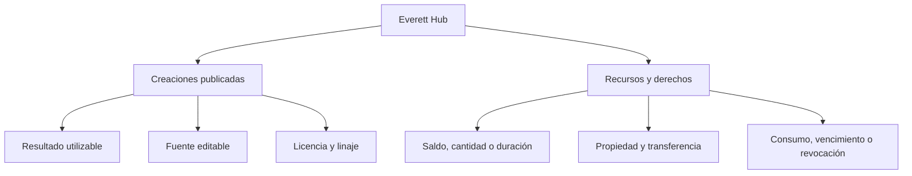

# Modelo de dominio v0

## Estado

- Separación entre creaciones y recursos/derechos: confirmada.
- Resultado utilizable + fuente editable para creaciones: confirmado.
- Creaciones compuestas, componentes y dependencias: confirmados.
- Mascotas como runtime + personaje + conducta: confirmado.
- Política objetiva de publicación: confirmada.
- Implementación técnica: fuera de alcance en esta etapa.

## Las dos familias principales

Everett Hub reúne cosas que pueden parecer similares en una tienda, pero tienen
comportamientos fundamentalmente distintos.

## Creaciones publicadas

Una creación publicada tiene dos caras inseparables:

1. **Resultado utilizable:** lo que una persona juega, instala, ejecuta, aplica,
   duplica o consulta.
2. **Fuente editable:** los materiales y el contexto necesarios para inspeccionar,
   abrir en el espacio de trabajo, forkear, remixar, integrar o expandir esa creación.

La licencia define los usos permitidos; el linaje conserva procedencia, autoría y
relaciones entre originales y derivados.

### Creaciones compuestas y dependencias

El resultado utilizable puede estar compuesto por piezas con autoría, procedencia y
derechos distintos. Que una persona pueda inspeccionar una pieza no implica que pueda
redistribuirla o incluirla en un remix.

Por eso, la fuente editable debe incluir un manifiesto de componentes que distinga al
menos:

- código y configuración;
- modelos, sprites, animaciones, audio y otros assets;
- procedencia y licencia de cada componente distribuido;
- dependencias sobre otros runtimes, plugins o creaciones;
- qué piezas fueron modificadas en un fork o remix.

Una creación también puede depender de otra creación publicada. Por ejemplo, un
runtime de mascotas puede ser una creación instalable y un paquete de personaje otra
creación compatible con ese runtime. Everett Hub puede ofrecer una instalación
conjunta, pero debe conservar identidad, versión, permisos, licencia y linaje
separados.

El repositorio de [Persona](https://github.com/xikhar/persona) demuestra el problema:
su código usa MIT, mientras los modelos y animaciones requieren procedencia y licencia
propias. Su manifiesto bloquea la distribución cuando esos derechos no están
completos. Everett Hub debe tratar ese comportamiento de cierre seguro como parte
del modelo común, no como una excepción exclusiva de Mascotas.

### Ejemplos

| Tipo                   | Resultado utilizable           | Fuente editable                                                                      |
| ---------------------- | ------------------------------ | ------------------------------------------------------------------------------------ |
| Juego                  | Build jugable                  | Proyecto, código, assets y dependencias                                              |
| Aplicación o sitio web | Resultado en ejecución         | Proyecto, componentes, datos de ejemplo y configuración                              |
| Plugin                 | Capacidad instalable           | Manifiesto, código, skills, prompts y conectores                                     |
| Automatización         | Flujo activable                | Pasos, reglas, prompts, horarios y conexiones                                        |
| Plantilla              | Sistema duplicable             | Estructura, componentes y contenido base                                             |
| Mascota                | Compañero aplicable y reactivo | Modelo o sprites, animaciones, conducta, manifiesto de componentes y archivos fuente |
| Tema                   | Apariencia aplicable           | Tokens, estilos, assets y configuración                                              |
| Prompt o skill         | Comportamiento reutilizable    | Instrucciones, contexto, archivos auxiliares y pruebas                               |

### Verbos comunes

- descubrir;
- usar;
- inspeccionar;
- abrir en el espacio de trabajo;
- guardar;
- forkear;
- remixar;
- integrar;
- expandir;
- versionar;
- publicar un derivado;
- compartir o comercializar según licencia.

### Propiedades comunes provisionales

- identidad y tipo;
- creador y colaboradores;
- descripción del resultado;
- versión y compatibilidad;
- fuente editable;
- dependencias y permisos;
- licencias del conjunto y de sus componentes;
- manifiesto de procedencia y redistribución;
- señales de confianza;
- historial y changelog;
- linaje de forks, remixes y derivados.

Los requisitos mínimos se definen en
[`policies/publication-v0.md`](policies/publication-v0.md).

## Recursos y derechos

Los recursos y derechos no representan algo que se pueda abrir como proyecto o
remixar. Representan capacidad de uso, propiedad o autorización.

### Ejemplos

- resets;
- créditos o tokens de uso;
- cuotas y capacidad computacional;
- acceso por tiempo;
- suscripciones;
- licencias de uso;
- alquiler temporal de una creación.

### Verbos comunes

- adquirir;
- poseer;
- transferir;
- regalar;
- alquilar;
- consumir;
- renovar;
- revocar;
- dejar vencer.

### Propiedades comunes provisionales

- emisor;
- titular;
- cantidad o saldo;
- duración o vencimiento;
- reglas de transferencia;
- divisibilidad;
- estado de consumo;
- registro de operaciones;
- restricciones regionales o de cuenta.

## Cómo se relacionan ambas familias

Una misma experiencia comercial puede combinar objetos de ambas familias sin
confundirlos.

Por ejemplo, una mascota es una **creación** con sprites y archivos fuente. El
derecho a usarla durante treinta días es un **derecho temporal** asociado a esa
creación. El objeto creativo puede versionarse y remixarse; el derecho puede
comprarse, transferirse, vencer o revocarse.

Del mismo modo, un plugin es una creación instalable. Una licencia empresarial para
usarlo en cien cuentas es un derecho asociado, no parte del código fuente.

## Definición pendiente en Mascotas

Precisar qué reglas de cuidado pertenecen al paquete publicado de la mascota y qué
estado —nombre, hambre, sueño y vínculo— pertenece a la relación particular de cada
usuario con su instancia.
