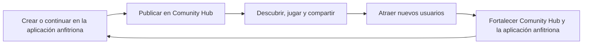

# Fundación de producto v0

## Estado

- Etapa: descubrimiento de producto.
- Nombre de trabajo: **Comunity Hub**.
- Marca final: abierta.
- Encaje confirmado: producto integrado dentro de una aplicación de escritorio
  propia para codificación agéntica.
- Implementación y stack: todavía no iniciados.

El contexto fuente aprobado se conserva en
[`context-recovered.md`](context-recovered.md). Esta fundación reúne la visión y los
principios vigentes. Las definiciones específicas se mantienen en los documentos
enlazados en cada sección.

## Territorio del producto

Comunity Hub es un punto de convergencia integrado en una aplicación de escritorio
para codificación agéntica. Permite que personas, creadores y organizaciones
interactúen con lo que otros construyen sin depender conceptualmente de un único
proveedor, modelo o marca.

Descubrimiento, publicación, comunidad y comercio forman el núcleo de Comunity Hub.
La aplicación anfitriona aporta el espacio de trabajo desde el que una creación
puede utilizarse, inspeccionarse y continuarse.

Las interacciones imaginadas incluyen:

- descubrir y explorar;
- probar, instalar y usar;
- guardar y organizar;
- publicar y mantener;
- adaptar, combinar y reutilizar;
- seguir, comentar y recomendar;
- comprar, vender, intercambiar o alquilar cuando el objeto y la plataforma lo
  permitan.

## Misión de trabajo v0

> Crear un espacio compartido dentro de la herramienta de codificación agéntica
> donde lo construido pueda descubrirse, utilizarse, organizarse, inspeccionarse,
> mejorarse, compartirse y, cuando corresponda, comercializarse.

La formulación de la misión sigue pendiente de validación.

## Ambición confirmada

El objetivo eventual es una demo navegable, bien diseñada e interactiva que vuelva
esa posibilidad tangible. La primera demo puede usar datos ficticios y representar
capacidades futuras, siempre que se declare claramente como concepto y mantenga una
lógica interna coherente.

La primera demo tendrá forma de **T**: una Home amplia y una vertical profunda
centrada provisionalmente en **Mascotas**. El alcance, los criterios de evaluación
y el siguiente paso de la demo se mantienen en
[`demo-scope-v0.md`](demo-scope-v0.md).

## Familias de objetos ya presentes en la visión

- Aplicaciones y sitios web.
- Mascotas, temas y otros activos visuales.
- Plugins, automatizaciones y mini sistemas.
- Prompts y plantillas.
- Juegos 2D y 3D creados con la aplicación anfitriona o con herramientas
  compatibles.
- Skills, agentes, conectores y componentes como candidatos.
- Recursos o derechos de uso, como resets, bajo hipótesis futuras de
  transferibilidad.
- Creaciones compuestas por componentes o dependencias de otras creaciones.

El modelo distingue creaciones publicadas y recursos o derechos de uso, definidos en
[`domain-model-v0.md`](domain-model-v0.md).

## Juegos

**Juegos** es una sección confirmada que vincula la experiencia jugable con su
proyecto editable. Su definición, acciones y requisitos se mantienen en
[`areas/games.md`](areas/games.md).

## Mascotas

La vertical provisional combina reactividad expresiva profunda, cuidado ligero y
frases contextuales básicas, con identidad persistente. Su definición y límites se
mantienen en [`areas/mascots.md`](areas/mascots.md); la propuesta de conducta, en
[`areas/mascots-reactivity-v0.md`](areas/mascots-reactivity-v0.md).

## Principios confirmados

### Ecosistema abierto

Cualquier persona puede crear y publicar si cumple la política de publicación.

### El descubrimiento se gana

Publicar no garantiza distribución. La utilidad, calidad, relevancia,
mantenimiento, confianza y respuesta de la comunidad ayudan a determinar qué
emerge.

La publicación solo aplica barreras objetivas de integridad, seguridad, procedencia
y derechos. La calidad subjetiva se evalúa después mediante uso, comunidad y
descubrimiento. La política completa vive en
[`policies/publication-v0.md`](policies/publication-v0.md).

Toda publicación válida se indexa y entra en una escalera de visibilidad: Publicada,
Nueva, Recomendable y Destacada. La política completa vive en
[`policies/discovery-v0.md`](policies/discovery-v0.md).

La reputación del creador aporta contexto de confianza. Cada publicación atraviesa
la etapa Nueva y construye evidencia propia de utilidad, compatibilidad y
mantenimiento.

### Exploración clara

Comunity Hub debe seguir siendo comprensible aunque contenga millones de objetos.
La experiencia inicial necesita categorías claras, jerarquía fuerte, pocas
tarjetas, contenido seleccionado y comprensión sin onboarding.

### La confianza se demuestra

Las decisiones deben apoyarse en señales descriptivas: mantenimiento,
compatibilidad, permisos, adopción, procedencia, verificación y reconocimiento de
la comunidad.

### La exploración también tiene valor

Entrar sin una necesidad concreta y descubrir qué está ocurriendo en el ecosistema
forma parte de la experiencia del Hub.

### Diseñar antes de cerrar requisitos

Las decisiones se tomarán de a una, traduciendo intuiciones en principios y usando
ejemplos concretos cuando una elección afecte navegación, experiencia o algoritmo.

## Tensiones que Comunity Hub debe resolver

El diseño debe resolver las siguientes tensiones:

- publicación abierta frente a descubrimiento curado;
- variedad extrema frente a claridad;
- exploración libre frente a resolución eficiente de una necesidad;
- objetos muy distintos frente a un sistema coherente;
- señales de confianza frente a oportunidades para creadores nuevos;
- comunidad y participación frente a comercio y transacción;
- visión futura frente a capacidades disponibles hoy;
- una experiencia rica frente a una interfaz limpia;
- jugar una obra terminada frente a inspeccionarla, forkearla o remixarla.

## Áreas de Comunity Hub ya imaginadas

Áreas contempladas en la visión, con alcance por definir:

- Home o Explore.
- Catálogo, búsqueda, categorías y recomendaciones.
- Fichas de objetos con evidencia de confianza.
- Perfiles e identidad de creador.
- Biblioteca, favoritos, compras, instalaciones y actualizaciones.
- Colecciones y curación.
- Publicación, mantenimiento y estadísticas.
- Comunidad, seguimiento, comentarios y reputación.
- Juegos para publicar, descubrir y jugar creaciones 2D y 3D.
- Comercio, licencias, propiedad e intercambio.
- Integración, instalación y composición de capacidades.

## Hipótesis de crecimiento comunitario

Publicar creaciones en Comunity Hub puede convertir el trabajo hecho en la
aplicación anfitriona o en herramientas compatibles en un canal orgánico de
distribución. Los creadores obtienen audiencia; quienes exploran o usan reciben
contenido; y la comunidad tiene más motivos para volver, compartir y crear.

Esta hipótesis requiere validación con comportamiento real.

## Estructura común confirmada

Una **creación publicada** ofrece un resultado utilizable y su fuente editable,
con licencia y linaje. Los **recursos y derechos** representan capacidad de uso,
propiedad o autorización. Las propiedades, ejemplos y relaciones entre ambas
familias se definen en
[`domain-model-v0.md`](domain-model-v0.md).

## Dirección de experiencia provisional

La última síntesis propuesta en la conversación fue:

> Una Home curiosa dentro de una estructura tranquila; un ecosistema confiable que
> comunica posibilidad; espacios específicos para inspirarse y crear.

Esta dirección sigue pendiente de validación.

## Decisiones todavía abiertas

- Cambio principal que Comunity Hub debería producir en el ecosistema de la
  aplicación anfitriona.
- Modelo económico y condiciones de comercialización.
- Actores prioritarios y primer mercado.
- Procedimientos de revisión, moderación y respuesta a reportes.
- Arquitectura de información y navegación.
- Dirección visual.
- Relación entre las capacidades de Comunity Hub y las de la aplicación anfitriona.
- Relación entre funciones conceptuales futuras y capacidades construibles hoy.
