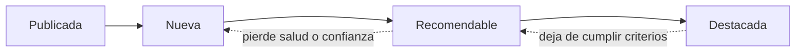

# Política de descubrimiento v0

## Estado

- Escalera Publicada → Nueva → Recomendable → Destacada: confirmada.
- Indexación inmediata de publicaciones válidas: confirmada.
- Separación entre reputación del creador y evidencia de la creación: confirmada.
- Umbrales y fórmulas de ranking: abiertos.

## Principio

> Publicar concede una oportunidad real de ser encontrado; la promoción se gana.

La política separa cuatro superficies que suelen confundirse:

- **Existencia:** la creación tiene una página pública y puede compartirse.
- **Indexación:** puede encontrarse mediante búsqueda y navegación por categoría.
- **Recomendación:** el sistema puede proponerla activamente a usuarios relevantes.
- **Destaque:** recibe reconocimiento comunitario, editorial o externo verificado.

## Escalera de visibilidad

### 1. Publicada

Una creación que supera la política de publicación obtiene inmediatamente:

- página pública;
- enlace directo;
- indexación en búsqueda;
- presencia en su categoría y etiquetas;
- posibilidad de guardarse, compartirse y recibir interacción.

No recibe automáticamente posiciones privilegiadas ni recomendaciones.

### 2. Nueva

Las publicaciones sin historial participan en espacios rotativos de novedades. La
etapa existe para resolver el problema de arranque: ninguna creación puede demostrar
valor si nadie tiene oportunidad de verla.

La rotación debe:

- reservar exposición real para creadores nuevos;
- evitar que volumen de publicaciones equivalga a más visibilidad;
- representar categorías y nichos distintos;
- limitar repetición ante una misma persona;
- excluir temporalmente contenido con señales de riesgo abiertas.

La duración no depende solo del tiempo. Puede considerar una cantidad mínima de
exposiciones útiles para que publicaciones de nicho no agoten su oportunidad antes
de alcanzar a la audiencia correcta.

### 3. Recomendable

Una creación recomendable puede aparecer en Home, resultados personalizados,
colecciones automáticas y sugerencias relacionadas. La elegibilidad considera grupos
de señales, no una puntuación única:

- **Utilidad:** uso real, finalización de la acción principal y recurrencia.
- **Salud:** mantenimiento, compatibilidad, respuesta a fallos y versiones.
- **Confianza:** permisos, procedencia, reportes, seguridad y claridad de licencia.
- **Relevancia:** coincidencia con intención, intereses y contexto del usuario.
- **Diversidad:** evitar repetición de creadores, tipos e ideas dominantes.

Popularidad ayuda a comprender adopción, pero no reemplaza salud, confianza ni
relevancia.

### 4. Destacada

El destaque expresa una forma concreta de reconocimiento. La interfaz debe indicar
su origen en lugar de fusionarlo en una insignia genérica:

- elegida por la comunidad;
- selección editorial;
- recomendada por una organización o maintainer verificado;
- destacada dentro de una categoría o evento;
- reconocida por expertos identificados.

Una creación puede ser muy usada sin estar destacada y puede ser destacada por
innovación sin ser todavía masiva.

## La visibilidad puede retroceder

La escalera representa estado actual, no un premio permanente. Una creación puede
perder elegibilidad para recomendaciones si:

- deja de ser compatible;
- acumula fallos sin respuesta;
- cambia permisos de forma relevante;
- recibe reportes graves verificados;
- abandona mantenimiento necesario;
- su licencia o procedencia dejan de ser claras.

La pérdida de promoción no elimina automáticamente la publicación. Retirar o
bloquear una creación requiere una infracción de la política de publicación o un
riesgo que justifique esa acción.

## Resistencia a manipulación

Descargas, likes o reseñas aisladas no deben controlar la visibilidad. El sistema
necesita distinguir interacción auténtica de spam, granjas, instalaciones vacías y
campañas coordinadas. Los detalles técnicos quedan abiertos, pero ninguna señal
fácil de comprar debe decidir por sí sola el ranking.

## Transparencia para creadores

El creador debe comprender:

- en qué etapa está su publicación;
- qué superficies puede ocupar;
- qué señales de salud faltan;
- si existe una restricción o reporte;
- qué acción concreta puede realizar para corregir un problema.

No se revela una fórmula explotable de ranking, pero tampoco se entrega una caja
negra sin explicación.

## Reputación del creador y evidencia de la creación

La confianza construida por un creador aporta contexto, pero no se transfiere como
reputación de cada creación nueva. Son dos historiales relacionados y separados.

Las señales del creador pueden incluir:

- identidad verificada;
- historial de proyectos mantenidos;
- respuesta a problemas y reportes;
- cumplimiento de licencias, atribución y seguridad.

Las señales propias de una creación pueden incluir:

- utilidad observada;
- compatibilidad y estabilidad;
- claridad de permisos y procedencia;
- respuesta a fallos específicos;
- continuidad de mantenimiento.

Un creador confiable puede mostrar una insignia contextual y evitar comprobaciones
de identidad redundantes. Ese historial no permite que su creación:

- omita la etapa Nueva;
- herede usos, reseñas o calificaciones de otras creaciones;
- entre automáticamente en recomendaciones o destacados;
- desplace la oportunidad inicial de una persona desconocida.

Cada creación construye evidencia propia. La reputación del creador ayuda a
interpretar quién está detrás, no demuestra de antemano la calidad del resultado.

## Aplicación pendiente en Mascotas

Aplicar esta política al recorrido provisional de Mascotas y decidir qué señales de
una mascota deben aparecer en su ficha y en las superficies de descubrimiento.
