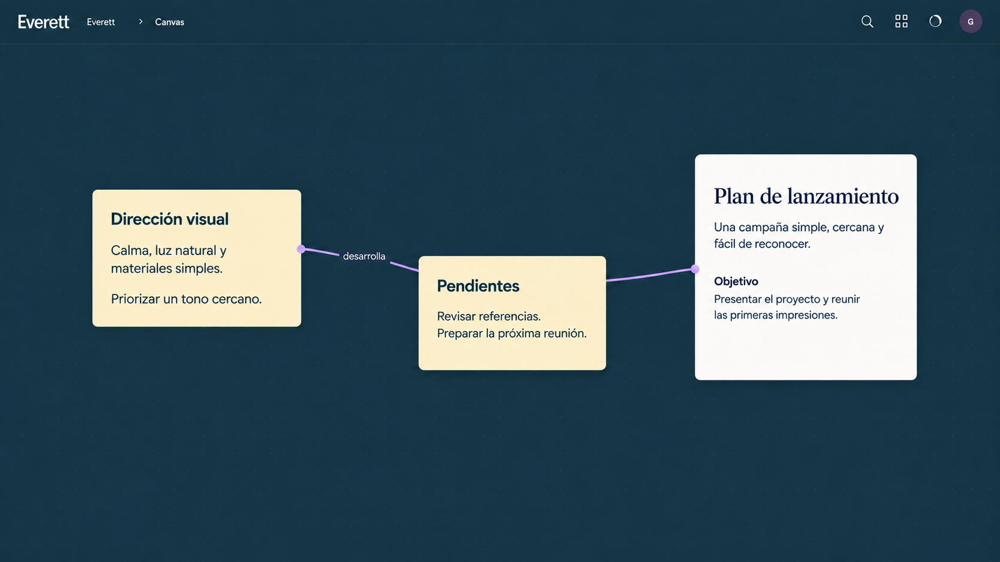

# Everett 0.8 — definición de Canvas

## Consulta de contenido web — 0.8.16 y correcciones 0.8.17

**C08-WEB-01.** La dirección aprobada permite entrar con zoom en lectura web guardada, con origen, estructura, texto seleccionable, scroll local y regreso espacial. Alt acopla la navegación cuando la rueda tiene una acción local. Seguir un enlace añade un nivel de lectura; el regreso espacial y una única flecha compacta vuelven primero a la página anterior y después al Canvas, conservando su cámara. Abrir original usa un botón de icono con nombre accesible. Se retira Actualizar contenido de la consulta habitual; un fallo sin lectura ofrece Reintentar lectura y nunca sustituye una copia válida por un error. Readability selecciona artículos; DOMPurify sanitiza el contenido. Los índices y aplicaciones sin contenido extraíble explican la limitación, sin simular una lectura. Las ilustraciones conservadas utilizan bytes locales.

Una URL directa de imagen o video se incorpora con su formato real, bytes locales, proporción y origen, reutilizando el importador; los límites son 12 MiB para imágenes y 32 MiB para videos, con decodificación real antes de confirmar. YouTube y Vimeo utilizan sus reproductores oficiales al activar la consulta; conservar título, referencia y portada no implica guardar el video offline. Los demás proveedores conservan su enlace. Resolver errores, foco, pausa al salir, teclado y convivencia con navegación espacial. Conservar identidad, alias manual, posición, capas, propiedad, historial y datos ante respuestas tardías.

Pegar desde teclado o el menú del fondo incorpora imágenes o URLs; los editores conservan su pegado local. Si el navegador deniega la lectura del portapapeles, ofrecer un campo compacto para pegar con Ctrl+V. El permiso del navegador pertenece al host; no simularlo ni solicitarlo en bucle. El formulario acepta dominios con HTTPS implícito, explica entradas inválidas y usa una X compacta. El renombre confirma con Enter y cancela con Esc sin confirmación redundante. Cerrar formularios comunes sale directamente. El borrado de materiales requiere un diálogo local compacto: Cancelar a la izquierda con foco inicial, Eliminar a la derecha, Tab retenido, Esc cancela, foco restaurado y Undo conservado. Las conexiones mantienen su eliminación ágil aprobada. La rueda del Canvas confirma directamente el gesto alrededor del cursor, sin la cola de interpolación del Universo; el encuadre de selección puede ampliar hasta el máximo de cámara.

C08-U30–U33 y C08-B94–B107 verifican estructura, extracción vacía, límites, formatos/proveedores, identidad, historial, pegado nativo, lectura persistida, errores y gestos. Imágenes y videos comparten esquinas discretamente redondeadas y una cabecera compacta. El visor de imagen reutiliza Panzoom para rueda local, paneo, ajuste, tamaño original y rotación de consulta sin modificar bytes. Los reproductores oficiales se montan al entrar, sin pantalla previa de Everett, con autoplay sujeto al navegador. El video externo conserva controles oficiales y recoge el desplazamiento encadenado del iframe para salir con la rueda; su comportamiento se verifica dentro del iframe, no solo sobre el margen. La flecha permanece alcanzable si el proveedor consume el gesto. Los controles repetidos iniciados con teclado responden sin animación; los menús conservan el origen de su disparador y los botones ofrecen respuesta al presionarlos. Los datos externos se comprueban también sin título, con texto largo o multilingüe, al 200 % de texto y con imágenes 20:1 y 1:20 a 320 px. El gate completo sigue siendo obligatorio. Las dependencias adoptadas y su ejecución permanecen en Desarrollo.

La definición está confirmada y la implementación está en curso en `feat/canvas-0.8`.
La revisión de 0.8.13 autoriza las correcciones de 0.8.14 indicadas al final; el estado del gate se mantiene en [Tareas](../../TAREAS.md).
Este documento conserva los contratos aprobados y su evidencia. El alcance completo de materiales, herramientas,
zonas, propuestas y comentarios permanece en [Alcance del prototipo](../alcance-prototipo.md).

Base: reconstrucción oficial de 0.7.5 aprobada e integrada en `dev`. Aplicar
[Arquitectura](../arquitectura.md), [Desarrollo](../desarrollo.md) y el gate de
[Validación](../validacion-prototipo.md). La candidata requiere el gate completo y la revisión
del usuario antes del cierre y la integración.

## Conversaciones: decisiones confirmadas

| Requisito   | Decisión                                                                                                                                                                                                                                           |
| ----------- | -------------------------------------------------------------------------------------------------------------------------------------------------------------------------------------------------------------------------------------------------- |
| C08-CHAT-01 | Conservar Quick Chat y chat anclado. Retirar Room como modo de Canvas.                                                                                                                                                                             |
| C08-CHAT-02 | Cada conversación conserva su identidad al cambiar de presentación o superficie. Una sesión transversal no obliga a reunir todo el proyecto en una única conversación.                                                                             |
| C08-CHAT-03 | Incorporar historial local real: crear varias conversaciones, guardar su registro y recuperar las anteriores entre visitas. Las respuestas de los agentes pueden seguir simuladas.                                                                 |
| C08-CHAT-04 | Abrir el historial mediante un chevron reconocible junto al nombre de la conversación. El historial aparece en un desplegable y conserva visible la superficie del chat. El acceso debe ser claro y operable por teclado.                          |
| C08-CHAT-05 | Mantener un único botón para crear una conversación nueva, en el encabezado del chat. No repetirlo dentro del historial.                                                                                                                           |
| C08-CHAT-06 | Resaltar la conversación activa mediante el fondo de su fila. Eliminar el chip «Actual». Conservar la legibilidad del texto.                                                                                                                       |
| C08-CHAT-07 | Mantener el desplegable compacto y acotado al espacio disponible. Los nombres largos permanecen en una línea y terminan en puntos suspensivos; no ensanchan el menú. El nombre completo debe ser consultable y tener un nombre accesible completo. |

### Inicio de una conversación — C08-CHAT-08

Una conversación nueva comienza únicamente con el usuario que la inicia y el agente. No hereda los
demás participantes de la conversación anterior. Incorporar otras personas requiere una acción
explícita desde el chat anclado, según el alcance vigente.

Este inicio se aplica a cualquier usuario; no está ligado al nombre o identidad del perfil de
ejemplo. Cambiar a una conversación existente recupera los participantes de esa conversación.

### Alcance del historial — C08-CHAT-09

El desplegable muestra todas las conversaciones del Mundo actual, cualquiera sea la superficie
desde la que se iniciaron o utilizaron. La conversación conserva su misma identidad e historial
cuando se retoma desde Canvas. No se filtra la lista por conversaciones originadas o utilizadas en
Canvas ni se incluyen las de otros Mundos.

### Nombre y búsqueda — C08-CHAT-10

Cada conversación muestra su nombre en el encabezado y en el historial. Un clic sobre el nombre
del encabezado permite editarlo, según la indicación del usuario. Separar ese objetivo del chevron,
que abre y cierra el historial. Durante la edición, conservar la identidad de la conversación,
sus mensajes, participantes, referencias y borrador; actualizar el mismo nombre en el listado y
en las demás presentaciones de la conversación. Una conversación recién creada presenta un
nombre provisional editable.

Conservar el buscador dentro del desplegable, como aparece en la referencia elegida. Filtrar por
nombre las conversaciones del Mundo actual y permitir retomar una desde sus resultados. Buscar
no cambia la conversación activa ni su borrador. Mostrar un estado sin resultados y permitir
limpiar la búsqueda para recuperar el listado completo.

### Continuidad con Sessions en 0.8 — C08-CHAT-11

La navegación entre superficies ya existe. Al pasar entre Canvas y Sessions mediante la navegación
vigente de Everett, retomar la misma conversación activa del Mundo, con su nombre, mensajes,
participantes, referencias y borrador. Cambiar de superficie conserva la identidad de la
conversación y el contexto espacial de regreso; no inicia otra conversación.

Aplicar esta continuidad en 0.8: el Mundo conserva un listado común de conversaciones. Al elegir
una conversación, Quick Chat, chat anclado y Sessions muestran los mismos mensajes y participantes
y comparten sus referencias y borrador. El listado y el contenido de la conversación elegida
se conservan al cambiar de presentación o superficie.

En la base actual de 0.7.5, [el chat de Canvas](../../src/features/chat/controller.ts) presenta
`world.chat` y [Sessions](../../src/features/session/view.ts) presenta `world.messages` como
registros separados. Ese es el estado actual que debe sustituirse por la continuidad acordada
para 0.8. Reutilizar la navegación existente para este recorrido. El rediseño y la organización
interna de Sessions permanecen en 0.10. Retirar Room de Canvas no aprueba por sí mismo una
sección llamada Rooms en Sessions.

Comprobar el recorrido en ambos sentidos: elegir una conversación, escribir sin enviar, cambiar
de superficie y recuperar el mismo hilo y borrador. Enviar y volver debe mostrar el mensaje en
esa conversación, una sola vez, conservando sus referencias y el contexto de Canvas.

### Dirección visual elegida

El usuario eligió el desplegable de la segunda propuesta revisada después de retirar el botón
duplicado y el chip y de reducir su ancho. La imagen es una referencia de composición; los tamaños
finales deben comprobarse en Quick Chat y en el chat anclado con sus dimensiones reales.

### Continuidad, guardado y recuperación — C08-STATE-01

El historial debe conservar la identidad y el contenido de cada conversación. Anclar, desacoplar o
abrirla desde otra superficie conserva mensajes, participantes, referencias y borradores, como
exige el alcance vigente. Cerrar Quick Chat o el chat anclado oculta el panel y conserva la
conversación; no cancela el trabajo del agente.

Guardar automáticamente los cambios en almacenamiento local, sin una acción obligatoria de
guardar. Conservar el contenido del Canvas y los datos del Mundo necesarios para recuperar sus
referencias: identidad y contenido de materiales, archivos incorporados, posiciones, tamaños,
conexiones y etiquetas, notas, nombres, zonas, asignaciones y comentarios. Recuperar los mismos
materiales referenciados, sin reemplazarlos por copias ni dejar referencias rotas.

Separar el contenido del Mundo del contexto personal de cada usuario. Al regresar a Canvas,
recuperar cámara, zoom, selección válida, conversación activa y presentación del chat. Conservar
los borradores por usuario y conversación, incluso antes de enviar el primer mensaje, y los
borradores de comentarios por usuario y material. Recuperar también las propuestas pendientes y
el texto todavía no enviado de un pedido de cambios, que
continúan esperando la decisión del usuario. La recuperación no acepta ni envía esos contenidos.

Reiniciar las interacciones transitorias: un arrastre, paneo, redimensionado o gesto de selección
que estaba en curso no se reanuda al recargar. Restaurar los datos guardados y dejar terminada
esa interacción; cada usuario conserva su propio contexto espacial.

Mostrar un aviso accionable si falla el guardado o la recuperación. Conservar el estado disponible
y los datos guardados; no sobrescribirlos silenciosamente con los datos iniciales ni presentar un
Canvas vacío como si la recuperación hubiera sido correcta.

La base anterior mantiene el estado en memoria y lo reinicia al recargar. El historial acordado
requiere un cambio real de conservación local. El mecanismo de almacenamiento se concreta durante
la implementación según Arquitectura y Desarrollo. Esta iteración mantiene las respuestas de
agentes simuladas y no incorpora colaboración real entre dispositivos ni inferencia de proveedores.

### Recuperación de trabajos — C08-STATE-02

Al regresar, recuperar el estado actual del mismo trabajo: procesando, propuesta lista, esperando
intervención o interrumpido, según corresponda. Recargar o cerrar la interfaz no convierte por sí
solo un trabajo en interrumpido. Conservar su identidad, instrucción, contexto, materiales y
resultados registrados, y comprobar su estado antes de presentar acciones de recuperación.

La ejecución simulada de 0.8 puede representar continuidad durante la ausencia del usuario.
Su conservación y recuperación deben ser coherentes y reproducibles; la condición de simulación
permanece identificada según Validación. No exigir una ejecución remota real para prototipar este
comportamiento ni reiniciar el trabajo únicamente por recuperar la página.

Cuando se confirme una interrupción, mostrar `Interrumpido` y ofrecer `Reintentar` y `Cancelar`.
Antes de repetir acciones, comprobar los efectos y resultados ya registrados para evitar
duplicaciones. Reintentar utiliza la instrucción, contexto y materiales conservados del mismo
trabajo. Cancelar devuelve los materiales según las reglas vigentes de zonas y propuestas.
Una propuesta recuperada continúa requiriendo aceptación explícita antes de modificar el contenido
compartido.

Esta dirección adopta los comportamientos consultados el 10 de octubre de 2026:

- [Figma](https://help.figma.com/hc/en-us/articles/360040328553-What-can-I-do-offline-in-Figma) y
  [Excalidraw](https://github.com/excalidraw/excalidraw#excalidrawcom): guardado automático y
  conservación local.
- [Persistencia de tldraw](https://tldraw.dev/docs/persistence) y
  [estado de instancia](https://tldraw.dev/sdk-features/instance-state#session-persistence):
  separar contenido y contexto personal, recuperar cámara y selección y reiniciar gestos temporales.
- [Slack](https://slack.com/help/articles/201457107-Send-and-read-messages): guardar automáticamente
  mensajes no enviados como borradores.
- [Cursor](https://prod.cursor.com/help/ai-features/background-agents): una ejecución remota puede
  continuar con la interfaz cerrada.
- [Claude Code](https://code.claude.com/docs/en/sessions#what-a-resumed-session-restores): recuperar
  la conversación no repite automáticamente una herramienta interrumpida; comprobar efectos antes
  de volver a ejecutarla.
- [Visibilidad del estado del sistema](https://www.nngroup.com/articles/visibility-system-status/):
  comunicar el estado y el resultado de las interacciones mediante feedback oportuno.

Estas referencias fundamentan el comportamiento acordado; no incorporan sus productos, SDK ni
servicios a las dependencias de Everett.

### Comprobaciones que debe incorporar la implementación

- Abrir y cerrar el desplegable desde el control visible y con teclado, conservando conversación y
  borrador. Elegir otra conversación recupera su propio registro sin mezclar mensajes.
- Comprobar un único acceso a nueva conversación y la fila activa resaltada sin un chip adicional.
- Renombrar mediante clic sobre el nombre del encabezado sin abrir el historial ni cambiar de
  conversación. Comprobar el mismo nombre e identidad en el listado y en las demás presentaciones.
- Buscar por nombre desde el desplegable, retomar un resultado y comprobar la búsqueda sin
  coincidencias y su limpieza. Escribir en el buscador no activa atajos del Canvas ni altera el
  borrador del chat.
- Desde un hilo con varias personas, iniciar otra conversación y comprobar que solo contiene al
  usuario que la inicia y al agente. Recuperar el hilo anterior conserva sus propios participantes.
- Recuperar desde Canvas una conversación del mismo Mundo iniciada en otra superficie, con su
  identidad y contenido originales. Comprobar que no aparecen conversaciones de otros Mundos.
- Probar nombres largos, nombres con el mismo prefijo, listado extenso y ventanas estrechas. Los
  títulos no ensanchan el menú; todas las conversaciones permanecen alcanzables.
- Crear dos conversaciones distintas, recargar y recuperar ambas. Contrastar sus identidades,
  mensajes, referencias y borradores; verificar también los materiales de esas referencias.
- Recuperar una conversación que solo tiene un borrador, sin enviarlo ni crear un duplicado.
- Editar y organizar materiales, importar un archivo, conectar elementos y dejar comentarios;
  recargar y comprobar los mismos contenidos, identidades, referencias, posiciones y tamaños.
- Recuperar por usuario cámara, zoom, selección válida y estado del chat. Recargar durante un
  gesto y comprobar que no sigue arrastrando, paneando o redimensionando después de volver.
- Recuperar una propuesta pendiente y un pedido de cambios sin enviar. No aplicar la propuesta ni
  enviar el borrador por recargar.
- Cerrar un campo de comentario con Esc, recargar y recuperar su borrador sobre el mismo material,
  sin publicarlo ni convertirlo en un comentario vacío.
- Cerrar el panel de chat durante un trabajo y comprobar que no lo cancela. Recuperar de forma
  controlada un trabajo que sigue procesando, uno que terminó durante la ausencia y otro que
  espera intervención; no marcarlos como interrumpidos por la sola recarga.
- Recuperar una interrupción confirmada, reintentar sin duplicar efectos o resultados registrados
  y cancelar devolviendo los materiales. Conservar la identidad y el contexto del trabajo.
- Comprobar que los errores de guardado se muestran y no provocan un reinicio silencioso del
  historial ni del Canvas. Probar también una recuperación fallida sin sobrescribir los datos
  guardados. Los casos y contraejemplos se definen según el mecanismo adoptado.

## Materiales libres: dirección visual elegida

### Contenido visible y controles contextuales — C08-MAT-01

El usuario eligió la segunda alternativa de la comparación: imágenes y videos libres muestran
su contenido directamente sobre Canvas, conservando sus proporciones, sin una tarjeta con marco
y encabezado permanentes. Al seleccionar el material aparecen su identificación y los tiradores
o controles que correspondan a ese tipo, según C08-MAT-05. La selección utiliza un contorno fino,
sin relleno ni halo adicional, de acuerdo con el alcance vigente.

La referencia es un mockup generado para esta decisión, no una captura de una función implementada.
Se conserva una copia exacta de la segunda imagen presentada al usuario. Esta primera elección
define la presentación libre de imágenes y videos; la de notas, documentos y PDF se concreta más
abajo en C08-MAT-03. Las referencias no sustituyen la densidad dentro de zonas ni modifican la
navegación y las herramientas aprobadas por el alcance vigente.

### Identificación al pasar el puntero — C08-MAT-02

Mostrar nombre y tipo durante el hover mediante una etiqueta discreta, sin cambiar la selección
ni mostrar acciones. Al hacer clic, mantener nombre y tipo disponibles; la selección no exige
una barra genérica de botones. En reposo, imágenes y videos mantienen la presentación limpia
elegida; el video conserva sus indicadores propios de reproducción y duración cuando estén
disponibles.

El usuario aprobó una demora breve antes de mostrar la etiqueta, ajustada mediante pruebas en el
Canvas. Debe evitar apariciones fugaces al recorrer materiales sin hacer esperar al usuario que
se detiene sobre uno. Cancelar la aparición pendiente al salir del material: una etiqueta no
puede aparecer tarde cuando el puntero ya está en otra parte. El tiempo concreto queda para el
ajuste de la implementación; no se fija una duración final desde el mockup.

Esta referencia desarrolla los estados acordados. Comprobar que el nombre completo pueda
consultarse sin ensanchar indefinidamente el control, que la misma información sea accesible con
teclado y que, cuando haya controles de selección, se pueda mover el puntero hacia ellos sin
que desaparezcan.
Verificar también el tránsito rápido entre materiales y el abandono antes de cumplirse la demora,
con distintos niveles de zoom y cerca de los límites visibles del Canvas. La imagen estática no
acredita estos comportamientos.

### Notas, documentos y PDF: el mismo patrón — C08-MAT-03

El usuario eligió la revisión que elimina los pies permanentes de identificación de documentos
y PDF. Aplicar el mismo patrón de reposo, hover y selección acordado para imágenes y videos:
contenido en reposo, nombre y tipo al pasar el puntero con la demora de C08-MAT-02, e identificación
y selección discreta al hacer clic. Los controles visibles dependen del tipo según C08-MAT-05.

Las notas muestran su texto y título, si tienen. Los documentos muestran una vista previa de su
contenido y los PDF, su portada o primera página cuando esté disponible. Los títulos escritos
dentro del contenido siguen visibles: forman parte de la nota, documento o portada. Los nombres
de archivo, tipos y demás metadatos no necesitan un encabezado o pie permanente adicional.

La imagen conserva la composición elegida; sus botones no constituyen una lista aprobada de
acciones. Los iconos de entrar y comentar quedan descartados de la barra del material según
C08-MAT-04 y C08-COM-01. La selección por sí sola no justifica agregar un botón de tres puntos;
las acciones del menú contextual se distinguen de los controles visibles según C08-MAT-05.
La creación de notas corresponde al dock y su edición directa permanece en el alcance.

### Entrada y salida mediante el zoom de Everett — C08-MAT-04

Conservar el zoom acoplado existente para entrar y salir de materiales y superficies donde se
aplica esta navegación. El regreso debe recuperar el contexto espacial de origen, con su posición
y escala. No incorporar un botón de entrar, abrir o ampliar en la barra de cada material. El doble
clic ya conectado a esta navegación se conserva; no se propone como una función nueva.

El usuario precisó el mecanismo como un **embrague**, según [Producto](../producto.md):

- Sin zoom ni otra acción propia de la rueda en la superficie, zoom in entra y zoom out sale
  directamente por la navegación de Everett.
- Cuando la superficie tiene una acción propia de rueda, conservarla normalmente. Mientras se
  mantiene Alt, desacoplarla y acoplar el gesto a la navegación espacial de Everett.
- Al soltar Alt, recuperar el comportamiento local. El modificador no inicia un segundo sistema
  de navegación ni queda activado como un modo persistente.

Comprobar que un gesto con el embrague no ejecute además el zoom o desplazamiento local, que la
salida recupere el contexto de origen y que el gesto local vuelva a funcionar al soltar Alt.

En la base reconstruida, [Application.wheel](../../src/app/application.ts) resuelve la navegación
de escala con Alt + rueda sobre materiales; la rueda sin modificador ajusta la cámara de Canvas.
[CanvasView](../../src/features/canvas/view.ts) conecta el doble clic al destino del material y
[navegación](../../src/domain/navigation.ts) conserva los contextos y cámaras de regreso. Se
comprobó en el HTML reconstruido de 0.7.5 la entrada por zoom a un documento desde Canvas y el
regreso al mismo contexto con la misma transformación de cámara.

Esta comprobación no extiende la navegación automáticamente a tipos que aún no tengan destino.
Al desarrollar sus representaciones, aplicar el mecanismo de Everett según el tipo y conservar
los comportamientos vigentes. Las imágenes del antiguo producto independiente sirven de referencia
visual; no introducen rutas, botones ni gestos por encima de la navegación aprobada de Everett.

### Controles al seleccionar y menú contextual — C08-MAT-05

Distinguir los controles que aparecen al seleccionar del menú contextual del material.
Asignar a una zona de agente y quitar del Canvas corresponden al menú contextual; esas acciones
no justifican botones en una barra de selección. La [referencia 02](../referencias/0.8/infinity-canvas/02-context-menu-assign-to-zone.png)
muestra `Assign to zone`, con un submenú de zonas de destino, `Duplicate`, `Rename` y `Delete`.
Partir de ese menú para su adaptación a Everett. La referencia es una base visual revisable;
sus elementos y atajos no constituyen una lista definitiva. Asignar a una zona ofrece los destinos
disponibles en el Mundo; las dos zonas de la imagen son ejemplos, no una cantidad fija de agentes.
Quitar del Canvas una referencia a Docs o Board retira únicamente su representación del Canvas;
el documento o la tarea conserva su identidad, contenido y existencia en su superficie de origen.
Las acciones de eliminar y duplicar materiales siguen C08-MAT-08. La base reconstruida presenta
asignar y eliminar
en la barra de selección de [CanvasView](../../src/features/canvas/view.ts); esa ubicación no es
la dirección acordada para 0.8.

El menú de la referencia 02 corresponde al material, no a la zona. Seleccionar una zona abre el
inspector, tomando como base la [referencia 03](../referencias/0.8/infinity-canvas/03-zone-inspector-pending-output.png),
para consultar su agente, instrucciones, contexto, actividad y acciones. El usuario prefiere
gestionar la zona y sus materiales desde ese inspector y confirmó esa distribución para 0.8:
menú contextual para materiales e inspector para zonas.
Retirar un material de una zona y devolverlo al Canvas es distinto de quitarlo del Canvas.

La selección conserva la identificación y el contorno acordados. Mostrar tiradores para
redimensionar cuando corresponda. En imágenes y videos, cambiar el tamaño de la representación
conservando la relación de aspecto y el contenido completo; el gesto no deforma, recorta ni
modifica el archivo de origen. En notas, ajustar las dimensiones de su representación conservando
el contenido. Los límites y tamaños mínimos se concretan al desarrollar estas representaciones.

Los controles de estilo se aplican a formas y dibujo, ya incluidos en el alcance:

- **Formas:** partir del diseño de [relleno y borde de la referencia 31](../referencias/0.8/infinity-canvas/31-shape-style-toolbar-rest.png),
  incluidos sus selectores de color y grosor. Adaptar su presentación a Everett conservando el
  trabajo de interacción de esa referencia; cualquier alternativa debe responder a un problema concreto.
- **Dibujo a mano alzada:** partir del [selector de color y grosor de la referencia 30](../referencias/0.8/infinity-canvas/30-draw-color-thickness.png).
  Son propiedades del trazo; no requieren trasladar el conjunto de relleno y borde de las formas.

No incorporar una barra de estilo de forma a notas, documentos, PDF, imágenes o videos. La edición
del contenido de las notas se realiza al entrar en ellas mediante la navegación acordada.
La edición de nombres sigue el gesto y la continuidad definidos en C08-MAT-06.

Comprobar el redimensionado de imágenes y videos horizontales y verticales, la conservación del
contenido de las notas y la correspondencia entre el tipo seleccionado y sus controles. Verificar
que las acciones del menú contextual sigan accesibles y que operar un control o editar un nombre
no active además la navegación del material. Quitar una referencia a Docs o Board debe conservar
el documento o la tarea original y las demás referencias a ese contenido.

### Renombrado desde Canvas — C08-MAT-06

Un clic sobre el nombre visible, tanto en hover como al seleccionar, permite editarlo directamente.
También ofrecer Renombrar en el menú contextual del material, según la elección del usuario.
Ambos accesos editan el mismo nombre. Renombrar queda sin atajo predeterminado; el usuario puede
asignarle uno según C08-KEY-01. Mostrar esa combinación en el menú cuando esté asignada;
el atajo `Enter` de la imagen antigua no se adopta como valor predeterminado.
Mantener la etiqueta alcanzable al mover el puntero hacia ella y estable durante la edición.
El clic sobre el nombre no arrastra el material ni activa su navegación. El contenido y los
tiradores conservan sus interacciones propias; no hace falta un botón adicional de renombrar.

Aplicar este gesto a las notas y a las imágenes y videos incorporados al Canvas. En materiales
importados, cambiar el nombre del material dentro de Everett conserva el archivo original y su
nombre fuera del proyecto.

También permitir renombrar desde Canvas un documento referenciado de Docs. Actualizar el título
del mismo documento del Mundo: el cambio debe verse en Docs y en las demás representaciones de
ese documento. No crear un alias independiente en Canvas ni duplicar el documento. Conservar su
identidad, contenido y referencias. Renombrar desde Docs debe reflejarse igualmente en Canvas.
Para referencias a otras superficies, aplicar esta continuidad cuando el material admita cambiar
su nombre, respetando sus reglas de edición y disponibilidad.

La base ya obtiene el título de documentos referenciados mediante `nodeTitle` en
[el modelo](../../src/domain/model.ts), y [los materiales de Canvas](../../src/features/canvas/materials.ts)
lo presentan desde el mismo registro que usa Docs. El comando `document.edit` en
[documentos](../../src/domain/commands/documents.ts) modifica ese registro compartido. Falta
incorporar la edición del nombre desde Canvas; esta lectura confirma el modelo compartido,
no una interacción ya implementada. El renombrado debe modificar únicamente el nombre, sin
sobrescribir el cuerpo del documento ni otros datos con una copia anterior.

Comprobar el renombrado desde el menú y mediante clic sobre nombres aparecidos por hover y por
selección, la estabilidad del campo al escribir y la conservación del nombre completo aunque la
etiqueta se mostrase truncada. Renombrar
un documento desde Canvas, abrirlo en Docs y comprobar el nuevo nombre y el mismo contenido e
identidad; repetir en sentido inverso. Comprobar también notas y materiales importados sin
modificar sus contenidos, conexiones ni referencias.

### Enlaces y tareas de Board — C08-MAT-07

El usuario dio conformidad a la dirección visual del enlace con vista previa: mostrar una
representación reconocible del destino cuando esté disponible, siguiendo el patrón de contenido
visible de los demás materiales. Utilizar únicamente la información disponible, sin inventar
título, imagen o descripción del destino.

Para el enlace sin vista previa, el usuario eligió la representación del centro de la misma
imagen: pieza compacta con icono de enlace, dominio y ruta, y un acento lateral. Conservar esa
composición cuando no haya preview disponible. El dominio y la ruta son su contenido visible;
la identificación adicional sigue los estados de hover y selección de C08-MAT-02.

También confirmó incorporar tareas de Board como materiales referenciados en Canvas. La tarea
conserva la identidad del registro de Board; no se convierte en un documento ni se crea una copia
independiente. Esta decisión concreta las referencias a otras superficies del alcance vigente,
sin extender la iteración al rediseño de Board.

El usuario eligió para 0.8 la revisión de la segunda alternativa inspirada en el tablero de
Codroid. La tarjeta presenta título compacto, descripción breve y una fila agrupada de estado,
prioridad y responsable, con selección discreta e identificación contextual. Mostrar los datos
disponibles de la misma tarea referenciada. Esta es la dirección para implementar en 0.8;
revisar su coherencia visual al definir Board en 0.11.

Se conserva una copia exacta de la revisión elegida. Las tres representaciones de la imagen son
las referencias acordadas para 0.8; la tarjeta de Board se revisará junto con esa superficie en 0.11.

El usuario aportó el tablero de Codroid como referencia de estructura y estética. Se inspeccionaron
su vista Kanban y el detalle de un ticket en el navegador, además de la interfaz en
`C:/Proyectos/codroid/tools/board/web` y la guía `C:/Proyectos/codroid/docs/TABLERO.md`.
La [captura conservada](../referencias/0.11/board-codroid.jpg) fundamenta la jerarquía compacta
adaptada a Everett en la tarjeta elegida. La dirección del Board y sus capacidades se recogen en
[el alcance de 0.11](../alcance-prototipo.md).

### Duplicar y eliminar materiales — C08-MAT-08

Ofrecer Duplicar en materiales propios del Canvas y en documentos. La acción crea otro elemento
del mismo tipo con el contenido y la apariencia del seleccionado.
Una nota produce otra nota; una imagen o un video, otra copia de ese material sobre Canvas;
una forma, otra forma. El nuevo elemento tiene identidad propia y puede moverse, renombrarse y
editarse según las capacidades de su tipo sin modificar el material original. No agrega
capacidades de edición nuevas al tipo de material.

Duplicar un documento referenciado crea un documento nuevo en Docs, con identidad propia y el
mismo contenido inicial, y coloca en Canvas una referencia a esa copia. La copia pertenece a
Docs. Editar o renombrar la copia desde Canvas o Docs se refleja en ambas representaciones de
ese nuevo documento y conserva intacto el original.

Para 0.8, omitir Duplicar en las referencias a tareas de Board.

Eliminar un material propio del Canvas retira ese elemento y admite Deshacer. La operación
conserva los archivos importados fuera de Everett y las demás copias presentes en Canvas.
Para referencias a Docs o Board, utilizar Quitar del Canvas, conservando el documento o la
tarea original según C08-MAT-05. Deshacer restaura el elemento retirado con su identidad,
contenido y vínculos. La gestión de materiales asignados corresponde al inspector y respeta
las reglas de exclusividad y devolución vigentes.

Comprobar el duplicado de notas, imágenes, videos y formas, su independencia y la conservación
del original. Duplicar un documento desde Canvas debe crear la copia en Docs y referenciar ese
nuevo documento en Canvas. Editar su contenido y nombre debe conservar intacto el original.
Quitar su referencia conserva la copia en Docs; las referencias a tareas de Board no ofrecen
Duplicar. Comprobar Deshacer y Rehacer del duplicado y de la eliminación, incluidos contenido,
identidad y vínculos.

## Correcciones de revisión 0.8.1

El usuario confirmó trabajar exclusivamente en 0.8. Búsqueda global, estructura del
perfil y navegación de Superficies conservan su etapa 0.12.

- Las propuestas usan una superficie de panel distinta de notas y documentos. El
  texto y controles se comprueban con contraste mínimo de 4,5:1. La expansión de
  Pedir cambios conserva el mismo contenedor y se anima por altura; el encuadre
  deja de saltar y permite interrupción y movimiento reducido. Su ubicación evita
  cubrir resultados aceptados, otros materiales, zonas y propuestas. La recuperación
  corrige esa geometría de las propuestas conservando contenido e identidad.
- La máscara de la etiqueta cubre el recorrido completo del cable y corta únicamente
  el espacio bajo el texto. La etiqueta permanece horizontal y con tamaño de lectura
  estable al cambiar el zoom. La selección y foco resaltan el trazo. Los editores de
  nombre y etiqueta usan una fila compacta con campo, Cancelar y Guardar accesibles.
- El dock conserva su posición al contraer o desplegar el chat cuando no hay colisión.
  Apartarlo no implica devolverlo automáticamente a otra posición al contraer.
- Pulsar de nuevo una herramienta activa vuelve a selección. Dibujo y formas
  permanecen activos para repetir gestos; el cursor identifica dibujo y comentarios.
  El grosor usa muestras de trazo; el panel se vincula a su acceso. Los materiales
  nuevos de dibujo y formas empiezan como Sin nombre. Las cuatro conexiones de un
  dibujo se fijan sobre extremos reales del trazo; los polígonos usan su contorno.
- El menú + del composer reúne Mencionar, Agregar personas en el chat anclado,
  Referenciar material seleccionado cuando exista y Ver en Sessions. Son acciones
  existentes, con la misma conversación, borrador y propiedad de materiales.
  Conversación y Comentarios tienen iconos diferenciados.
- Configuración → Atajos abre Canvas directamente y permite regresar a Configuración.
  Quitar y Restaurar conservan sus capacidades mediante controles compactos.
  La antigua ayuda rápida se identifica como Ayuda de Canvas.
- Las zonas tienen nombre editable independiente del agente. Su panel identifica
  nombre, agente y contexto; cerrar se presenta como Cerrar panel de zona. El clic
  contextual sobre una zona abre ese panel. Estado en Canvas cuenta asignaciones
  procesando; no confunde registros de actividad de ejemplo con trabajos de sus zonas.
- Incorporar materiales permite cargar ejemplos de imagen SVG, video WebM real
  generado localmente y PDF con primera página. Se guardan como archivos propios,
  admiten las operaciones de su tipo y sobreviven a recarga; no sustituyen trabajo
  existente. El video de ejemplo no solicita cámara ni micrófono.

C08-U06 y C08-B22–B29 convierten este feedback en regresiones, incluyendo píxeles
del cable y un contraejemplo que restaura la máscara defectuosa. Los casos anteriores
se mantienen y adaptan a los controles visibles actuales.

## Correcciones de revisión 0.8.2

El usuario autorizó corregir el feedback de 0.8.1 y preparar otra candidata dentro
de la misma iteración, sin integrar en dev. Galería y bocetos quedan en
[Mejoras de Canvas por evaluar](../alcance-prototipo.md#mejoras-de-canvas-por-evaluar).

- El video tiene un control de reproducción central; el resto del contenido se
  puede arrastrar. Durante reproducción conserva la franja de controles nativos.
- La conexión seleccionada muestra sus extremos reconectables y eliminación junto
  al cable. Arrastrar un extremo a un anclaje modifica el mismo vínculo. Enter sobre
  el extremo permite elegir material y anclaje por teclado. Cancelar conserva el
  vínculo; Undo/Redo conserva identidad, extremos y etiqueta. Se mantiene recorrido
  automático y se rechazan zonas, materiales ocupados y duplicados.
- Las propuestas buscan espacio libre cerca de su zona en todas las direcciones.
  Su presentación identifica material, instrucción, revisión y resultado propuesto.
  La simulación reorganiza contenido recibido de forma reproducible, sin incorporar
  tareas ajenas como supuesta evidencia. La aceptación continúa siendo explícita.
- Pedir cambios muestra estado activo y una rejilla estable de cuatro sugerencias.
  Las regresiones miden posiciones y distribución durante la expansión, además de
  altura, reversibilidad, encuadre, contraste y movimiento reducido.
- La identificación contextual usa tinta de panel; conserva título consultable y
  presenta Sin nombre si falta. La etiqueta mantiene tamaño de lectura al variar
  el zoom. Dibujo conserva lápiz y modo al repetir trazos, sin
  tiradores de resize mientras la herramienta está activa.
- La tarjeta de Board agrupa estado, prioridad y responsable con indicadores y
  significado accesible. El panel de zona distingue su nombre del agente asignado,
  describe el estado del trabajo y presenta acciones con texto. Su vacío está centrado.

C08-U07/U08 y C08-B30–B33 comprueban estos recorridos, datos y representación.
C08-B23 mide además las filas y el ancho durante la expansión. Un contraejemplo
de tinta igual al fondo comprueba que la prueba visual detecta un nombre que
existe en el DOM pero no se pinta. El arnés conserva el gate completo de Everett.

## Correcciones de revisión 0.8.3

- La propuesta pendiente muestra materiales reconocibles antes de la barra de decisión. Notas y documentos presentan contenido; imágenes, videos, PDF, enlaces, dibujos y formas conservan su tipo. La simulación local organiza archivos sin interpretar ni modificar sus bytes. Analizar texto puede proponer observaciones y una pregunta en notas independientes. Se conservan IDs de trabajo, revisión, contexto, materiales propuestos y borradores al recargar. Aceptar aplica los mismos materiales; documentos mantienen su identidad de Docs y solo se cambia el cuerpo propuesto. Un renombrado compartido posterior no se sobrescribe al aceptar. Rechazar o cancelar devuelve originales sin aplicar resultados.
- Pedir cambios anima de forma coordinada la altura de la decisión y del área de previews desde su estado visible, también al invertir una expansión en curso; chips mantienen una línea durante toda la transición. En ventanas estrechas se consulta el preview mediante scroll, manteniendo acciones y campo accesibles.
- Play permanece centrado durante la pulsación; se habilita después de recuperar metadatos y al solicitar Play se habilitan los controles nativos, sin esperar una promesa que puede permanecer pendiente en clips breves. Un fallo restaura el acceso de reproducción.
- El editor de notas calcula tinta según el papel, muestra colores con nombre, estado elegido, guardado automático y un regreso explícito al Canvas. Enter pertenece al texto; no es una acción obligatoria de guardar.
- La papelera del cable está disponible en el editor de su etiqueta. Los mismos anclajes en sentido inverso identifican el mismo cable; se impide crearlo o reconectarlo como duplicado. Los cables ya guardados se conservan. Backspace y Suprimir eliminan materiales fuera de campos de escritura. Deshacer/Rehacer están en la toolbar superior, con botones de 33 píxeles y disponibilidad real. El marcador de comentario es una sola burbuja, sin círculo exterior. Al zoom mínimo, el dibujo conserva un grosor visual mínimo de un píxel, sin modificar sus puntos ni el grosor guardado.
- Formas muestra estado activo y su menú vinculado al disparador. Dibujo conserva el lápiz sobre previews y contenido desde el primer trazo. Comentarios usan una burbuja compacta cuyo tamaño visible se mantiene con zoom. Duplicar nombra la copia sin cambiar nombre ni archivo del original. El inspector distingue la identidad editable de la zona del agente elegido; asignar el agente conserva el nombre elegido para la zona.

C08-U09/U10 y C08-B34–B40 amplían la regresión de estos fallos. La evidencia vigente y el estado de revisión permanecen en Tareas y en el informe generado.

## Comentarios: prueba de ubicación en el dock — C08-COM-01

Probar comentar en el dock principal de Canvas con el atajo **C**, confirmado por el usuario.
La ubicación queda sujeta a evaluar la cantidad total de accesos: si vuelve el dock demasiado
grande o cargado, revisar dónde ubicarla. Evaluar el conjunto completo y su convivencia con el
chat anclado, sin reducir los controles hasta dificultar su uso para hacerlos caber.

Durante la implementación, el usuario precisó la adaptación: el chat anclado llega
al borde inferior, también al cruzar 800 px; el dock conserva tamaño natural y no
genera huecos ni filas accidentales. La adaptación implementada mantiene una fila y agrupa las herramientas
adicionales en un menú cuando no entren. Si el espacio junto al chat es aún menor,
usa una columna explícita en el margen disponible. La disposición depende de
las dimensiones de los controles y el área restante, conservando acceso por teclado
y controles de 36 px. El acceso a herramientas adicionales adopta el patrón de
[Miro](https://help.miro.com/hc/en-us/articles/360017730553-Toolbars).

Contraer y desplegar actualizan el nombre accesible, el chevron y el estado expandido.
El chevron del historial también refleja abierto/cerrado en Quick Chat, anclado y Sessions.
El chat anclado se desacopla mediante su tirador; se retira el botón redundante de
desacoplar. Al desplegarlo, el dock movido manualmente se aparta hacia el espacio
libre, conservando su altura cuando cabe. El desplazamiento dura 250 ms y se omite
con movimiento reducido. Al terminar un arrastre del dock también se evita cubrirlo
con el chat. C08-B20 verifica estos estados, la conservación del borrador y los
cuadros del desplazamiento: un único dock, tamaño estable y avance sin retrocesos.

Canvas usa un fondo gris oscuro con puntos, zonas con relleno y borde distinguibles,
notas con sus colores propios y documentos con preview claro. El dock tiene una
superficie elevada con contraste propio. Estas diferencias se aplican a Canvas;
la navegación del Universo conserva su diseño. C08-B21 comprueba contraste calculado
entre superficies y legibilidad del texto, acompañado por revisión de la captura.

El conjunto de propuesta tiene ancho visual máximo de 560 px al acercarse con el zoom,
con materiales separados y la decisión debajo; un único material usa un conjunto
compacto de hasta 320 px y los resultados múltiples pueden ocupar hasta 560 px;
su encuadre y contenido se adaptan a la ventana sin agrandar botones ni campos.
El inspector y la revisión ocupan temporalmente el lugar del chat cuando sus
dimensiones impiden mostrarlos juntos. Sus cierres recuperan la misma presentación,
conversación y borrador; cerrar la revisión conserva la propuesta pendiente.

No duplicar el botón de crear un comentario en la barra de cada material. Conservar comentarios
asociados al material, marcadores, consulta contextual y listado, respuestas y resolución desde
el chat anclado. Esta prueba sustituye la exigencia anterior de mantener comentarios fuera del dock.

La base reconstruida tiene el acceso de creación entre las acciones del material y no lo incluye
en el dock ni tiene un atajo de comentarios. El gesto acordado para elegir el material destinatario
se define en C08-COM-03; navegar o solo seleccionar un material no modifica su contenido.

### Comentarios sobre el material completo — C08-COM-02

En 0.8, los comentarios se asocian al material completo. El marcador identifica los comentarios
de ese material; la ubicación del clic no fija un punto ni una región de su contenido.

El usuario decidió conservar para una revisión posterior a 1.0 la idea de comentarios sobre un
punto concreto de una imagen. Está recogida en [Después de 1.0](../alcance-prototipo.md#después-de-10).
Las exploraciones visuales de marcadores puntuales no se incorporan a la implementación de 0.8.

### Destinatario y cancelación — C08-COM-03

Con un único material seleccionado, pulsar **C** o el botón de comentar del dock abre el campo
para comentar ese material completo. Sin selección, activar la herramienta y después hacer clic
en el material destinatario para abrir el campo. Si hay varios materiales seleccionados, permitir
elegir un único destinatario mediante ese mismo modo; no publicar sobre todos por una selección
múltiple. Hacer clic en el fondo mantiene la espera de un material y no crea un comentario libre.

**Esc** cancela la herramienta mientras espera un destinatario. Si el campo ya está abierto, Esc
lo cierra conservando el texto como borrador privado del usuario, asociado al mismo material.
Volver a comentar ese material recupera el borrador. Publicar requiere una acción explícita;
activar la herramienta, cerrar el campo o recargar no publica ni crea un comentario vacío.
Aplicar la conservación local de C08-STATE-01. Al escribir, C y los demás atajos de herramienta
no se activan, según C08-KEY-01.

La interacción acordada combina patrones documentados: [Miro](https://help.miro.com/hc/en-us/articles/360017730873-Comments)
activa comentar con C o su herramienta, permite elegir un objeto y conserva el texto no publicado
al abandonar el campo. [FigJam](https://help.figma.com/hc/en-us/articles/14477051168791-Use-FigJam-with-a-screen-reader)
documenta crear un comentario directamente sobre la selección mediante sus acciones de teclado;
no utiliza en ese recorrido exactamente el mismo atajo. [Figma](https://help.figma.com/hc/en-us/articles/360041547593-View-and-manage-comments)
documenta Esc para salir del modo de comentarios. Everett adopta C y el dock para ambos accesos
y mantiene comentarios sobre el material completo según C08-COM-02.

Comprobar C y el botón del dock con un material seleccionado y sin selección, la elección de un
destinatario con selección múltiple, el clic sobre el fondo y Esc antes de elegir un material.
Escribir, cerrar con Esc, reabrir y recargar conserva el borrador y el destinatario sin publicar.
Publicar crea un único comentario sobre el material elegido; C dentro del campo escribe texto.

### Atajos de Canvas — C08-KEY-01

Los atajos de Canvas en 0.7.5 eran provisionales para permitir probar las funciones. No fijan
las combinaciones de 0.8 ni impiden reasignarlas. Los valores predeterminados elegidos por el
usuario son **C para comentar**, **L para conectar materiales** y **N para crear notas**.
Renombrar queda sin atajo predeterminado y conserva el clic sobre el nombre de C08-MAT-06.
El usuario puede configurar los atajos, incluido asignar uno a renombrar. Los atajos de
herramienta no se activan al escribir en una nota, campo o composer ni interfieren con combinaciones
de edición de texto.

Conservar N para crear nota, como ya está en [Application.key](../../src/app/application.ts) y
en [el dock](../../src/features/canvas/view.ts). La creación de notas conserva ambos accesos.

La configuración de atajos es un criterio general de [Producto](../producto.md); en esta iteración
se aplica a las acciones de Canvas. Acceder desde **Perfil → Configuración → Atajos**, en la sección
Canvas. Mostrar la lista de acciones y su combinación actual; un clic sobre la combinación permite
cambiarla. Renombrar permanece en la lista con la combinación vacía hasta que el usuario le asigne
un atajo.

Avisar si la nueva combinación entra en conflicto con otra acción que pueda estar activa en el
mismo contexto y resolver la colisión antes de aceptar la asignación; una pulsación no puede
disparar ambas. Permitir restaurar un atajo o todos los valores predeterminados de Canvas. Guardar
automáticamente la configuración local y conservarla entre visitas. Las indicaciones del dock,
menús y ayuda deben mostrar el atajo configurado. El rediseño general de perfil y configuración
permanece en 0.12, según [Alcance del prototipo](../alcance-prototipo.md).

Comprobar que N activa crear nota con la configuración predeterminada y no interfiere mientras se
escribe en un campo. Probar el acceso a la sección Canvas y la edición de una combinación,
el renombrado por clic y mediante un atajo asignado por el usuario, la conservación de las
asignaciones al recargar y su reflejo en las indicaciones, y el aviso y resolución de una colisión.
Restaurar un atajo conserva las demás asignaciones; restaurar todos recupera los valores iniciales,
incluido Renombrar visible con su combinación vacía.

La 0.8 utiliza los conectores curvos definidos en C08-LINK-01. Otros tipos de conector y sus
posibles atajos se decidirán si se incorporan posteriormente. Las referencias oficiales consultadas
el 2 de octubre de 2026, que sustentaron la propuesta de L, muestran convenciones distintas:

| Referencia                                                                                                           | Atajos documentados                                                |
| -------------------------------------------------------------------------------------------------------------------- | ------------------------------------------------------------------ |
| [Miro](https://help.miro.com/hc/en-us/articles/360017731033-Shortcuts-and-hotkeys)                                   | L para líneas de conexión y flechas; C para comentarios.           |
| [FigJam](https://help.figma.com/hc/en-us/articles/1500004414542-Create-diagrams-and-flows-with-connectors-in-FigJam) | L para conectores rectos; X o Shift + L para conectores con codos. |

Estas referencias no incorporan herramientas nuevas ni cambian la geometría acordada para Everett:
L activa sus conectores curvos, aunque otro producto utilice esa tecla para líneas rectas.

## Conexiones entre materiales

### Anclajes y recorrido — C08-LINK-01

Cada material conectable ofrece cuatro puntos de anclaje: arriba, abajo, izquierda y derecha.
El usuario elige los anclajes de salida y llegada. Son distintos de los controles para cambiar
el tamaño del material.

Las conexiones utilizan curvas suaves y continuas con sensación de cable. Su recorrido se
calcula automáticamente entre los extremos. Los extremos se ajustan a los anclajes elegidos
al conectar, mover o redimensionar materiales, sin cambiarlos por otros más cercanos.

El usuario descartó la modificación manual del recorrido y las vueltas alrededor de materiales.
La 0.8 conserva la elección de anclajes y el ajuste automático de la curva.

### Hover, selección y texto — C08-LINK-02

Al pasar el puntero sobre una conexión, engrosar su trazo como señal de interacción. Mantener una
zona de clic invisible más amplia que la línea visible, accesible también antes del hover y con
distintos niveles de zoom. El texto de una conexión forma parte de esa conexión y no de un
comentario ni de una nota independiente.

Un clic selecciona la línea. El doble clic permite escribir una etiqueta, por ejemplo «depende de» o «referencia»;
si ya tiene texto, permite editarlo. Enter confirma, Esc cancela y vaciar el campo quita únicamente la etiqueta.
No hay menú contextual de conexiones. Delete/Backspace fuera del texto elimina la conexión seleccionada o enfocada.
Mostrar el texto integrado en el cable, centrado sobre su
trazo. Interrumpir visualmente la línea bajo el texto con el fondo del Canvas para conservar la
legibilidad, como `supports` y `leads to` en la [referencia 03](../referencias/0.8/infinity-canvas/03-zone-inspector-pending-output.png).
La etiqueta no aparece flotando por encima o debajo de la conexión ni dentro de un chip separado.
Mantener su ubicación sobre el cable al mover los materiales o cambiar el zoom.

Esta imagen ilustra la colocación del texto corregida según la indicación del usuario. Aplicar
la curvatura suave definida en C08-LINK-01 al desarrollar la representación de los cables.

Conservar también la selección y eliminación explícita de conexiones exigidas por el alcance,
distinguiéndolas de la edición de texto. Las teclas de edición de una etiqueta no deben borrar
la conexión ni activar atajos de herramientas. Undo/Redo distingue la edición de texto de las
operaciones del Canvas.

### Base y comprobaciones de implementación

La base ya contiene los cuatro anclajes en [el modelo](../../src/domain/model.ts), curvas calculadas
entre los extremos en [geometría](../../src/domain/geometry.ts) y un área de clic ampliada en
[los estilos de Canvas](../../src/features/canvas/styles.css). El modelo de conexión actual guarda
extremos y anclajes; aún falta incorporar el texto editable y ajustar la representación de los
cables según la dirección acordada aquí.

- Conectar distintos pares de anclajes, incluidos los del mismo lado, sin reemplazar la elección
  del usuario. Mantener el rechazo vigente de conexiones hacia zonas de agente.
- Mover y redimensionar un material conectado y comprobar el reajuste de la curva, con los
  extremos adheridos a los anclajes elegidos y el aspecto de cable acordado.
- Alcanzar una línea fina con el puntero, ver su engrosamiento en hover y escribir o editar una
  etiqueta mediante doble clic. Repetir con distintos niveles de zoom y comprobar que el texto permanece
  integrado en el trazo al mover los materiales, con la línea interrumpida únicamente bajo el texto.
- Distinguir selección y edición de texto. Borrar caracteres de una etiqueta no elimina la
  conexión; eliminar explícitamente la conexión elimina su etiqueta.
- Comprobar Undo/Redo de la creación y eliminación de conexiones y de la edición de texto,
  su conservación al navegar y los mismos estados al recuperar los datos guardados.

## Propuestas: barra de acciones y pedido de cambios — C08-PROP-01

Cada propuesta pendiente presenta una barra compacta con tres acciones agrupadas en un mismo
contenedor. El orden de izquierda a derecha es `Aceptar`, `Pedir cambios`, `Rechazar`;
`Pedir cambios` ocupa el centro. En reposo, el campo para escribir cambios permanece oculto.

Al pulsar `Pedir cambios`, el mismo contenedor se expande hacia abajo y revela el campo de texto
libre. El campo aparece junto a la propuesta, dentro de la barra expandida, con sugerencias
rápidas y los controles `Enviar` y `Cancelar`. Mostrar cuatro chips de sugerencias. La referencia
utiliza `Más breve`, `Más concreto`, `Más detalle` y `Otro enfoque`; estos textos son ejemplos
para la propuesta mostrada.

El campo tiene tamaño compacto y controlado. Desactivar su redimensionado manual y no mostrar
ningún tirador, ni en las imágenes de referencia ni en la interfaz implementada.

En la fila inferior, `Cancelar` aparece a la izquierda de `Enviar`. Ambos botones tienen las
mismas dimensiones, tipografía, radio, espaciado interior y alineación. `Enviar` mantiene la
jerarquía de acción principal mediante el énfasis visual y `Cancelar`, la secundaria. Aplicar
las convenciones de botones y campos compartidas de Everett.

`Cancelar` contrae el área de escritura y conserva la propuesta pendiente con sus tres acciones.
`Enviar` solicita una revisión dentro del mismo trabajo. La propuesta sigue requiriendo aceptación
explícita antes de modificar el contenido compartido.

El usuario dio conformidad a la dirección visual con estas correcciones. La imagen incorpora
el orden central de `Pedir cambios`, cuatro sugerencias rápidas, el campo sin tirador y los
botones inferiores con las mismas dimensiones y alineación.
La revisión de la experiencia continúa cuando se pueda usar la implementación.

Comprobar el reposo compacto, la expansión hacia abajo al pedir cambios, la escritura sin
activar atajos del Canvas y la cancelación sin rechazar ni aceptar la propuesta. Verificar
expresamente los cuatro chips, la ausencia de redimensionado manual del campo y la igualdad de
dimensiones y alineación de `Cancelar` y `Enviar` en la interfaz real, conservando su jerarquía visual.

## Referencias visuales recuperadas

El usuario aportó los diseños del producto anterior Infinity Canvas para revisar su utilidad en
Everett. Se recuperaron once imágenes relativas a materiales, zonas, propuestas, herramientas,
chat y comentarios, con [índice y diferencias respecto del alcance vigente](../referencias/0.8/infinity-canvas/indice.md).

La [referencia 32](../referencias/0.8/infinity-canvas/32-zone-material-density-states.png) recupera
el adjunto de densidad ya adoptado por el alcance de 0.8. Las referencias 30 y 31 son el punto de
partida acordado para los controles de dibujo y formas, según C08-MAT-05. Las referencias 02, 03,
06, 07, 12–14 y 29 orientan los recorridos confirmados. Se adaptan conservando las decisiones
actuales; sus controles antiguos no se trasladan automáticamente.
La presentación libre de imágenes, videos, notas, documentos y PDF sigue la dirección elegida en
este documento y se distingue de las tarjetas compactas dentro de una zona. C08-MAT-07 recoge la
dirección elegida para enlaces con y sin vista previa y la tarjeta de tareas referenciadas de Board.
La revisión de tamaños, densidad y transiciones se realiza sobre la implementación.

La asignación contextual, el inspector de zona y la propuesta pendiente tienen referencias en
las imágenes 02 y 03. El trabajo de 0.8 parte de ellas para adaptar, prototipar y comprobar el
recorrido en Everett, conservando las reglas vigentes de zonas y propuestas. El índice recoge
también la [definición textual de Pedir cambios](../referencias/0.8/infinity-canvas/indice.md#zonas-propuestas-y-pedido-de-cambios)
del proyecto original. Su campo abierto no aparece en las 32 imágenes revisadas. El usuario
confirmó para Everett la barra agrupada y su expansión hacia abajo, según C08-PROP-01.

## Límite del sistema de diseño

El usuario ubicó la consolidación transversal del sistema de diseño mediante Atomic Design en
0.12, según [Alcance del prototipo](../alcance-prototipo.md). La definición e implementación de
0.8 permanecen centradas en Canvas, usando los estilos y componentes compartidos vigentes y
construyendo las piezas que necesita esta superficie.

## Estado de la definición

El alcance y la dirección visual están confirmados y su implementación está autorizada. La rama
`feat/canvas-0.8` parte de `dev` y contiene la planificación de `docs/plan-0.8` (5a6eecd), sin integrar
esa planificación previamente en `dev`. El cierre y la integración de 0.8 requieren pruebas,
revisión del usuario, correcciones y aprobación explícita. El estado operativo permanece en Tareas.

## Adaptación y validación durante la implementación

- Adaptar el menú contextual de materiales de la referencia 02 y el inspector de zonas de la
  referencia 03, según la distribución confirmada en C08-MAT-05. Conservar el renombrado por clic,
  menú contextual o atajo configurado y su continuidad entre Canvas y Docs, según C08-MAT-06.
  Mantener los controles pertinentes al tipo sin agregar una barra genérica de acciones por selección.
- Evaluar la densidad de comentarios en el dock y su convivencia con el chat anclado. Su interacción
  está definida en C08-COM-03. Ajustar la demora del hover, los tamaños y límites de los materiales,
  y aplicar los patrones acordados a las referencias restantes y a los previews no disponibles.
- Preparar el recorrido combinado material → zona → agente → propuesta → revisión para la
  implementación y validación, partiendo de las referencias y comportamientos ya definidos.
  Resolver las diferencias concretas con Everett que aparezcan durante su adaptación.

## Correcciones de revisión 0.8.4

En Seleccionar, arrastrar desde el fondo delimita materiales libres completamente contenidos, con selección aditiva mediante Shift y alternancia por Shift + clic. Panear conserva su herramienta H. Se puede arrastrar el grupo a la zona: el Store valida la transferencia completa y conserva identidades, contenido y posiciones de devolución. Movimiento y eliminación de grupo ocupan una operación de historial; Esc e interrupciones cancelan el gesto sin mover la cámara ni modificar contenido.

Los videos muestran en reposo un fotograma real del archivo, generado sin reproducir el jugador visible y guardado localmente en el material. Se recupera para videos existentes y copias que carecían de preview. La caché se comparte por identidad de archivo y se conserva al deshacer ediciones; no altera sus bytes ni los nombres independientes. Se distinguen preparación y fallo de preview, con reintento.

C08-U11/U12 y C08-B41–B43 cubren estos recorridos, incluidos tres materiales, Undo/Redo, recarga, devolución de enlaces, distintos zooms, cancelación y píxeles reales del video antes de Play, con un contraejemplo vacío.

## Correcciones de revisión 0.8.5

El menú de incorporación usa Importar archivos locales para el selector real de imágenes, videos y PDF. Cargar ejemplos multimedia conserva su función de incorporar archivos de muestra: al repetir la acción alterna entre tres imágenes distintas (paisaje, ciudad y naturaleza), una por carga, junto al video y PDF existentes. La siguiente imagen se guarda como contexto personal; recargar o volver al Canvas continúa la secuencia. Las imágenes ya incorporadas conservan su identidad y contenido y no rotan al recargar.

C08-B05 y C08-B08 entran por el botón visible y el selector de archivos. El input de archivo permanece fuera del dock que se reconstruye al cerrar el menú; abrir el selector no lo desconecta ni pierde el cambio con los archivos elegidos. C08-B44 comprueba variedad, ciclo, representación real, recarga y conservación de bytes y materiales anteriores.

C08-B45 comprueba selección vacía, PNG/JPEG/PDF juntos desde el selector, previews completos en la ventana, repetición, formatos no admitidos y bytes recuperados. Los lotes se encuadran al incorporarlos; las posiciones de los materiales anteriores se conservan. El arnés registra controles reales y el gate exige las entradas públicas declaradas, con controles negativos HARNESS-14 y UI-HARNESS-03 del propio observador.

## Correcciones de revisión 0.8.6 — menú de incorporación

Incorporar materiales abre un selector compacto junto al botón + del dock; cuando las herramientas se agrupan, queda junto a Más herramientas. Su escala pertenece a la interfaz y no cambia con el zoom del Canvas. El menú acompaña el dock al moverlo y reacomoda su apertura al espacio disponible encima, debajo o al costado, conservando el disparador accesible. Ancho máximo de 256 px, filas de 32 px y altura máxima de 320 px, reducida al espacio disponible; las listas extensas se desplazan dentro del menú. Los nombres largos permanecen en una línea con el nombre completo consultable y accesible. Flechas, Inicio y Fin recorren la lista; Esc o un segundo clic en el disparador cierran y devuelven el foco a ese control, también en el dock compacto. C08-B46 comprueba geometría, zoom, posiciones del dock, convivencia con chat anclado, 801/800/799/390/300 px, lista extensa y teclado.

## Correcciones de revisión 0.8.7 — apertura lateral de incorporación

El usuario elige abrir Incorporar al costado del dock, cerca del disparador, para liberar el área inmediatamente encima de las herramientas. Priorizar la derecha junto al +; en el dock compacto, la izquierda queda disponible si el control está contra el borde derecho. Usar arriba o abajo cuando no haya espacio lateral cercano. Conservar dimensiones, scroll y teclado de 0.8.6, sin tapar herramientas del dock. C08-B46 exige apertura lateral cuando hay espacio, además de cercanía, no solapamiento con el dock y las comprobaciones de adaptación existentes.

## Correcciones de revisión 0.8.8 — controles y recuperación de materiales

El primer bloque posterior a la evaluación de utilidad corrige el panel de estilo y la recuperación de materiales desde la búsqueda compartida. La revisión siguiente incorpora organización manual duradera, referencias a fragmentos y lectura del panorama, autorizadas por el usuario; galería, wireframes y editor integral siguen fuera del alcance.

El estilo de dibujo y formas acompaña al dock durante el gesto, al soltar y después de resize o del desplazamiento por el chat. Conserva dimensiones a igual ventana y no cambia con el zoom. A 390 px o menos distribuye deliberadamente los controles de formas en dos columnas, mientras dibujo conserva su ancho de contenido; a 704 px Relleno permanece en la misma fila. Evita cubrir el dock y conserva sus controles completos y operables. El menú de elección de Formas también se limita a la ventana y abre debajo cuando no cabe sobre el dock; sus cuatro opciones permanecen alcanzables cerca del encabezado y con chat anclado. Mientras se elige la forma no superpone el panel de estilo. Cada panel anima su propio desplazamiento al reacomodarse; el resize adapta su posición directamente.

### Encontrar y enfocar materiales — C08-MAT-09

La búsqueda compartida incluye nombre y texto disponible de notas, formas, dibujos, imágenes, videos, PDF, enlaces y referencias de Canvas. Una referencia consulta el nombre y contenido actuales del registro compartido. Cada resultado identifica tipo, superficie y Mundo; no interpreta archivos ni inventa metadatos. Los documentos sin representación en Canvas y los Mundos siguen siendo destinos de búsqueda. Los resultados de materiales abren su Mundo y enfocan su representación; si está asignada a un agente, enfocan la zona correspondiente sin retirarla ni interrumpir el trabajo. Si una recuperación conserva un trabajo sin su zona, el aviso explica cómo crear una zona y elegir al mismo agente. El selector identifica también instancias con trabajo sin zona; esa asignación recupera el acceso al trabajo sin reiniciarlo ni aceptar su propuesta. Devolver el material sigue siendo una acción explícita.

Escribir o recorrer resultados no cambia cámara, selección, materiales ni borradores. Elegir un resultado enfoca y selecciona el material disponible; conserva un contexto temporal para volver con Esc a la cámara y selección anteriores que sigan siendo válidas. La nueva cámara y selección se recuperan tras recargar. Renombrar, quitar, eliminar y deshacer se reflejan en las búsquedas siguientes; las identidades se distinguen por Mundo.

La misma lupa abre y cierra; no añade otra X. Conserva el campo entre renders para que su expansión sea continua. En ventanas estrechas abre el campo debajo de la barra, manteniendo accesibles sus controles. Ofrece ausencia de resultados, nombres completos consultables, lista desplazable y navegación con flechas, Inicio/Fin y Enter; Esc cierra y devuelve el foco a la lupa. Mantiene foco perceptible por teclado y respeta movimiento reducido.

## Correcciones y organización espacial 0.8.9

La búsqueda se expande hacia la izquierda desde la lupa dentro de la cabecera, también en ventanas estrechas. Conserva accesibles los controles; al faltar espacio cede el nombre de ubicación, sin superponer el campo al Canvas. La lupa y Esc cierran y devuelven el foco. Deshacer y Rehacer usan botones de 26 px con iconos de 16 px.

El botón de Superficies queda oculto por defecto. Perfil → Configuración contiene «Mostrar botón de Superficies», un switch deslizante con estado accesible y guardado personal automático. Su activación ofrece el menú alternativo en todas las superficies; la navegación espacial sigue disponible con cualquiera de los dos estados. Los perfiles anteriores se recuperan con el botón oculto hasta que lo activen.

El selector de color incorpora opacidad de 0 a 100 % para relleno y borde, sin otro control en la barra de estilo. Se guarda como color hexadecimal RGBA; los colores opacos conservan su valor RGB. Sin relleno sigue siendo una propiedad independiente. El panel se cierra con Esc y devuelve el foco al color. Formas debe poder cambiarse y cancelarse después de cualquier secuencia de selección, dibujo y apertura de paneles.

Editar una etiqueta de cable usa un campo con Enter para confirmar y Esc para cancelar, sin botones redundantes. El menú contextual permite quitar la etiqueta o eliminar la conexión. Delete y Backspace fuera de los campos eliminan la conexión seleccionada. El foco vuelve al cable al terminar. Las etiquetas permanecen integradas en una curva automática suave; su ubicación evita caer sobre tarjetas u otras etiquetas en el panorama comprobado. No incorpora recorridos manuales. El rango de zoom vigente es 1–600 % (C08-ZOOM-01); comprobar sus extremos y el regreso sin cambiar la navegación del Universo.

### Conjuntos manuales duraderos — C08-ORG-01

Una selección múltiple ofrece Crear conjunto en el menú contextual. El conjunto tiene identidad y nombre persistentes, contorno y encabezado propios; no es una zona de agente. Seleccionar el encabezado recupera la selección de sus miembros; arrastrarlo los mueve en una operación reversible conservando distancias. El menú contextual del encabezado, también con Shift+F10, permite renombrar y Separar conjunto. Separar conserva todos los materiales. Cada material pertenece a un solo conjunto; borrar un miembro retira su pertenencia y elimina únicamente los conjuntos vacíos. Deshacer recupera las identidades y la pertenencia.

Asignar un miembro a un agente conserva su conjunto y posición de retorno. Mientras un miembro está en procesamiento, mover todo el conjunto requiere devolverlo primero y comunica esa condición. La devolución conserva la pertenencia. No convierte el conjunto en propietario ni acepta propuestas automáticamente. Recargar conserva nombre, miembros y posiciones.

### Referencias precisas — C08-REF-01

El menú de una referencia a Docs o Code ofrece Mostrar un fragmento…. Se elige un rango de texto del origen, mediante selección nativa de mouse o teclado. La representación muestra ese fragmento y conserva título e identidad compartidos. Referencia completa permite volver al documento o archivo completo. Entrar abre el mismo editor y selecciona el fragmento vigente; salir recupera la cámara y selección del Canvas.

Insertar o borrar contenido antes del fragmento desplaza sus límites; editar parcialmente su interior actualiza el fragmento. Eliminar o reemplazar íntegramente el contenido señalado produce «Fragmento no disponible», sin apuntar silenciosamente a otro contenido. Puede revisarse o elegirse otro rango en el origen. Recuperar una coincidencia textual única permite restablecer el vínculo; una coincidencia ambigua permanece no disponible. Duplicar un documento crea documento y fragmento independientes. Quitar su representación conserva el origen. El vínculo se guarda en el Mundo y sobrevive a la recarga.

Cobertura nueva: C08-U14/U15/U16/U17/U18 y C08-B55/B56/B57/B58. C08-B49 ahora exige que las etiquetas del panorama de veinte materiales no se solapen con las tarjetas; el control anterior solamente registraba la geometría, lo que permitía certificar el fallo visual. La expansión de búsqueda se comprueba dentro de la cabecera durante la transición, además del estado final, y se mantiene la regresión de navegación con el menú opcional oculto.

Las propuestas sobre fragmentos de Docs conservan el contenido fuera del rango. Si el documento cambia después de preparar la propuesta, Aceptar informa el conflicto y conserva el trabajo pendiente; Pedir cambios obtiene una revisión contra el contenido vigente. La simulación sigue identificada como local. La edición de etiqueta de una línea adopta Enter/Esc y acciones compactas por la decisión del usuario; no se afirma una convención universal: [draw.io documenta variantes para finalizar edición de texto](https://www.drawio.com/docs/reference/configure-diagram-editor/).

Las zonas presentan el fragmento realmente asignado, no el cuerpo entero del origen. Una referencia precisa no suprime el documento completo de los resultados de búsqueda: el texto exterior al fragmento continúa llevando a Docs. C08-U18 y B58 comprueban ambos consumidores.

## Correcciones de la revisión 0.8.9 — candidata 0.8.10

El usuario autorizó resolver el feedback completo manteniendo abierta 0.8. El encabezado del chat conserva el chevron de historial y utiliza minimizar/restaurar para su presentación, sin botón redundante de anclar. Presionar el tirador no cambia presentación ni tamaño; el arrastre efectivo conserva ambos e incluye acceso por teclado. El dock evita también el chat flotante; en ventanas de hasta 640 px, su altura se limita al espacio disponible dejando 80 px para las herramientas. Cambiar el ancho recupera las dimensiones personales guardadas. Al apartar herramientas del chat flotante se usa una transición de opacidad: el dock no atraviesa el tirador ni intercepta su primer gesto. C08-B66 comprueba cada fotograma y exige detectar un tirador tapado deliberadamente.

Los conjuntos se renombran haciendo clic en su nombre fuera del borde. El tirador mueve todos sus miembros. Un miembro puede salir mediante arrastre fuera de los límites originales o «Sacar del conjunto»; movimiento y pertenencia se deshacen juntos. La asignación a una zona mantiene la pertenencia y el lugar de devolución. El borde no persigue el arrastre de un miembro.

El menú de incorporación distingue Docs, Code, Board y archivos/enlaces. «Mostrar un fragmento…» explica la selección, muestra su preview y habilita la confirmación solo con texto elegido. La tarjeta sigue vinculada al documento completo y entrar abre su origen preciso.

El color reúne área visual de saturación/brillo, tono, opacidad y HEX en un único panel DOM, con flechas y porcentajes accesibles. No encadena un selector nativo. Referencia inspeccionada: [Spectrum ColorArea](https://spectrum.adobe.com/web/rsp/components/color-area), cuyo patrón combina estos controles. Las etiquetas de cable se editan en el recorrido: Enter confirma, Esc cancela; el campo no incorpora botones. El menú contextual ofrece editar/quitar etiqueta y eliminar conexión; Delete/Backspace actúan fuera del texto. Se inspeccionó [la edición de etiquetas de draw.io](https://www.drawio.com/docs/manual/connectors/connector-labels/), conservando el clic único aprobado en Everett.

Preferencias y Herramientas se agrupan dentro de Configuración con regreso explícito; el panel se cierra al hacer clic fuera, incluida la cabecera. La búsqueda conserva su lupa fija durante la expansión hacia la izquierda, sin rebote. Estas correcciones no adelantan el rediseño general de 0.12.

### Control de zoom — C08-ZOOM-01

Canvas admite 1 %–600 %, con porcentaje y elección manual en la cabecera, valores habituales y ajuste a contenido/selección. Las entradas vacías, no numéricas o fuera del intervalo se rechazan sin modificar la cámara. Se guarda el contexto personal; el zoom no agrega acciones al historial de materiales. Universo conserva su escala y navegación existentes. El encuadre considera el chat anclado y no agrega otro control flotante al Canvas.

Cobertura añadida: C08-U19/U20 y C08-B59–B66. Se comprueban estados intermedios y geometría real, no solo presencia del DOM o estado final: área de color con altura útil y sin scroll horizontal a 300 px, separación atómica de conjuntos, selección explicada de fragmentos, tamaño del chat durante gestos, búsqueda por fotograma y cámara recuperada. El estado vigente del gate y la revisión del usuario se mantiene en [Tareas](../../TAREAS.md).

## Correcciones de la revisión 0.8.10 — candidata 0.8.11

El marco selecciona los materiales libres cuyos límites intersecta con área positiva, en cualquier sentido. No exige cubrirlos por completo. Un marco de área cero o que solo toca un borde no selecciona; no incluye zonas ni selecciona automáticamente todos los miembros de un conjunto. Shift conserva la selección aditiva y Esc o una interrupción restauran la selección anterior sin mover la cámara. Esta regla sustituye la contención completa de 0.8.4. La dirección adopta la selección por cruce que [Miro documenta como predeterminada](https://help.miro.com/hc/en-us/articles/360017730953-Working-with-objects); [draw.io documenta contención completa y cruce con Alt](https://www.drawio.com/docs/reference/shortcuts/shortcut-select/), por lo que no se afirma un estándar universal ni se reutiliza Alt, que conserva el embrague de Everett. C08-U21 y B67 cubren fracciones 5/50/95 %, ambos sentidos y materiales de distintos tipos.

Un material retirado puede reincorporarse arrastrando su centro dentro de un único conjunto existente. El borde y un aviso interior indican «Soltar para agregar» antes de confirmar. Movimiento y pertenencia se confirman y deshacen juntos. La operación conserva identidades y contenido, permite volver desde otro conjunto y mantiene exclusividad. Mover un conjunto entero no lo anida ni lo fusiona; un destino ambiguo no incorpora silenciosamente. C08-U22 y B60 cubren reincorporación, rechazo de destinos inválidos, cancelación, Undo/Redo y recarga.

El borde de las formas conserva un mínimo visual de un píxel al alejar, igual que el dibujo, sin modificar grosor, proporciones, relleno ni alfa guardados. C08-B68 comprueba píxeles de los cuatro tipos entre 1 % y 600 %, no solamente el atributo de grosor.

Desacoplar el chat vuelve a Quick Chat compacto (hasta 310 × 340 px, limitado por la ventana), con el mismo hilo, mensajes, participantes, referencias y borrador. Presionar el tirador sin superar el umbral de arrastre conserva el panel anclado. La altura anclada no se copia al tamaño flotante, tampoco por teclado; los tamaños excesivos recuperados de 0.8.10 se limitan al tamaño compacto. Esta corrección sustituye la expectativa anterior de conservar la altura anclada al desacoplar. C08-B62 conserva la comprobación del clic y C08-B69 cubre arrastre, teclado, cierre, recarga y guardado anterior.

Las pestañas y el panel de Perfil/Configuración conservan el mismo ancho y posición al recorrer Preferencias, Herramientas y Atajos. C08-B70 mide también la posición de la pestaña Configuración; comprobar solo que el panel existe no detectaba el desplazamiento de 9 px. El selector de fragmentos identifica por separado el texto del origen y el texto que mostrará la tarjeta; B61/B58 contrastan la tarjeta posterior y la entrada al mismo tramo de Docs/Code.

En 0.8.11 las conexiones conservaban clic único y acciones contextuales. La revisión posterior del usuario sustituye esa interacción por la especificada abajo. Los antecedentes siguen siendo [Miro](https://help.miro.com/hc/en-us/articles/360017730733-Connection-lines) y [draw.io](https://www.drawio.com/docs/manual/connectors/connector-labels/).

## Correcciones de la revisión 0.8.11 — candidata 0.8.12

Conexiones: un clic selecciona; doble clic añade o edita la etiqueta, Enter confirma y Esc cancela. Enter sobre la conexión enfocada ofrece edición por teclado; Space selecciona. Delete/Backspace eliminan la conexión seleccionada fuera de campos de texto. Dentro del campo editan texto. No hay menú contextual de conexiones ni botones de edición. Vaciar y confirmar retira únicamente la etiqueta. Se conservan hover, reconexión, identidad y Undo/Redo. Esta decisión sustituye las menciones anteriores a clic único para editar y menú contextual de conexiones, sin cambiar los menús de materiales o conjuntos.

La selección de formas tiene un contorno legible de un píxel de pantalla y tiradores que contienen el trazo visible, también al alejar. No se deforma ni recorta la figura ni se modifica su grosor guardado. La comprobación de tinta del borde se complementa con la del marco de selección y sus extremos.

### Orden de materiales — C08-LAYER-01

El menú de materiales ofrece Traer al frente, Avanzar una capa, Retroceder una capa y Enviar al fondo, sobre la selección. El orden pertenece al Mundo, conserva identidades y contenido, admite Undo/Redo y persiste al recargar. Cada operación conserva el orden relativo de los materiales movidos y de los demás. Seleccionar o arrastrar no cambia silenciosamente las capas. Los materiales en procesamiento conservan su exclusividad. Esta función ordena materiales; no incorpora un panel de capas ni anida conjuntos.

El dock conserva la orientación Horizontal o Vertical elegida en Configuración; Horizontal es el valor inicial y la preferencia es personal. Las colisiones con Quick Chat solo apartan el dock cuando realmente se superponen; no reducen sus herramientas ni cambian su orientación. La compactación responde al espacio útil de la ventana y al chat anclado, manteniendo todos los controles accesibles desde Más herramientas cuando sea necesario. Sus menús y paneles conservan proximidad y alcanzabilidad. Abrir Más herramientas o usar el dock no cierra Quick Chat ni pierde borradores. La revisión cubre colisiones repetidas, ambos modos de chat y resize.

El contador del conjunto identifica su cantidad de materiales. «Soltar para agregar» aparece dentro del conjunto durante un destino válido, sin reemplazar su nombre. Las zonas vacías grandes muestran una indicación centrada y legible, con crecimiento acotado por su tamaño y compensación de zoom. El botón de regreso de Configuración se alinea al borde de su contenido. No se agregan preferencias sin función ni se adelanta el rediseño general de 0.12.

## Correcciones autorizadas de 0.8.13

- C08-LAYER-01: las acciones se habilitan cuando pueden cambiar una superposición de materiales libres. Cada paso cruza un material superpuesto, sin detenerse en objetos lejanos; selección múltiple estable, límites sin cambios vacíos, Undo/Redo y recarga.
- C08-MAT-07 y C08-ZOOM-01: texto vacío de zona pintado en coordenadas de pantalla, centrado y sin palabras apiladas ni rasterizado dentro del plano escalado. Según el espacio visible muestra instrucción completa, breve o indicador; en zonas menores a 24 px se omite el indicador. Comprobar zoom continuo y ambas direcciones, además de escalas detenidas.
- C08-CHAT-07: el dock prefiere apartarse lateralmente ante una colisión real. Si ambos anchos no caben, Quick Chat reserva una franja inferior; abrir, cerrar y recargar con el chat abierto conserva herramientas, orientación y borradores. La recuperación mide el dock real antes del primer layout del chat y conserva una posición válida.
- C08-STATE-01 y C08-KEY-01: Configuración compacta, switch Dock vertical, regreso centrado y alineado al contenido. Fondo de puntos/cuadrícula y reducción de movimiento de Canvas son preferencias personales persistentes, sin alterar Mundo ni Universo; el sistema puede exigir menos movimiento.

Las regresiones C08-U24 y C08-B77–B80 amplían el piso del arnés. Las sugerencias observadas al escribir etiquetas no son inferencia contextual implementada; evaluar esa idea por separado antes de atribuir capacidades al autocompletado del navegador.

## Correcciones autorizadas de 0.8.14

- Preferencias reúne los cuatro switches personales y el idioma. «Reducir animaciones de Canvas» explica su efecto sobre paneles y dock. Herramientas conserva sus acciones reales: archivar Mundo, ayuda y exportar diagnóstico; no se agregan opciones de relleno ni se adelanta 0.12.
- El desborde del dock retira herramientas de una en una según su tamaño medido, conserva el tirador y ofrece en el menú únicamente las acciones que no están visibles. Cambiar el ancho y anclar/desacoplar el chat recalcula esa capacidad sin cambiar la orientación elegida.
- La rueda sobre una zona vacía o sin overflow controla el zoom local de Canvas. Una lista desplazable conserva su scroll; Alt sigue acoplando exclusivamente la navegación espacial de Everett. Normalizar píxeles, líneas y páginas antes de aplicar zoom.
- El marco de un conjunto conserva sus coordenadas del Mundo y su relación con los miembros durante zoom. El encabezado elige arriba o abajo según la organización del Mundo y conserva ese lado durante zoom; se oculta cuando ambos lados están bloqueados o la identificación proyectada invadiría materiales. El foco de teclado permite consultar el nombre completo por encima del contenido. Reduce información según el ancho proyectado: nombre/contador cuando caben, nombre compacto desde 100 px y ocultación visual por debajo. El zoom no debe inflar el marco para alojar una etiqueta ni desplazarlo para evitar colisiones.
- La identificación contextual queda centrada sobre su material con separación acotada en pantalla, también en figuras grandes; conserva edición y nombre completo accesible. La instrucción completa de zona usa texto de 16/14 px en pantalla, sin rasterizar dentro del plano escalado.
- Auditar sensibilidad, reversibilidad alrededor del cursor y límites del zoom. El recorrido es multiplicativo con límites 1–600 %, conserva el punto bajo el cursor y no modifica posiciones, contenido ni pertenencias. Los casos de rueda nativa se complementan con eventos explícitos para las unidades menos habituales del navegador.

C08-U25 y C08-B81–B86 comprueban jerarquía, persistencia, capacidad máxima del dock, rueda sobre zona y scroll local con Alt, anclajes y datos a 1/3/6/17/38/60/100/200/431/600 %, fotogramas intermedios y reversibilidad. B86 consulta y renombra mediante puntero un conjunto con ambos bordes ocupados; atraviesa el espacio hasta el nombre y comprueba que arrastrar desde el fondo siga seleccionando miembros sin panear ni mover datos. En tamaños legibles, hover sobre el borde permite consultar el encabezado bloqueado; el puente hasta el nombre conserva su alcance. Un desplazamiento deliberado de la identificación o un encabezado sobre una tarjeta debe ser detectado y la restauración debe recuperar el resultado esperado. El encabezado consultado sobre contenido claro conserva fondo opaco, contraste y pintura comprobados; un contraejemplo transparente debe ser rechazado. El gate completo y la revisión visual siguen siendo obligatorios.

## Previews reales de enlaces — 0.8.15

**C08-URL-01.** Crear enlaces con el formulario o pegar una URL HTTP(S) completa en Canvas obtiene título, descripción y portada publicados mediante el servicio local autorizado por el usuario. Pegar dentro de un editor conserva la edición habitual. Reutilizar link-preview-js (MIT); el contenido externo nunca se ejecuta. Conservar metadatos y bytes de portada en IndexedDB, con carga, ausencia de metadatos, error y reintento explícitos. La respuesta asíncrona conserva nombre manual, geometría, propiedad e historial y no recrea materiales borrados. El archivo autónomo conserva datos guardados; generar nuevas previews generales requiere abrir Everett mediante el servicio local. Limitar bytes, tiempo y concurrencia, validar destinos y redirecciones y bloquear redes privadas. C08-U26–U29 y C08-B87–B93 verifican parsing, HTTP, persistencia, pegado, errores, respuestas tardías, imagen decodificada, viewer y continuidad espacial. El pegado automatizado usa un evento DOM explícito, sin modificar el portapapeles del usuario; la creación y reintento también se prueban mediante controles reales. La prueba HTTP integra servidor y parser de producción con un origen remoto controlado, y se complementa con consultas públicas registradas por separado.
