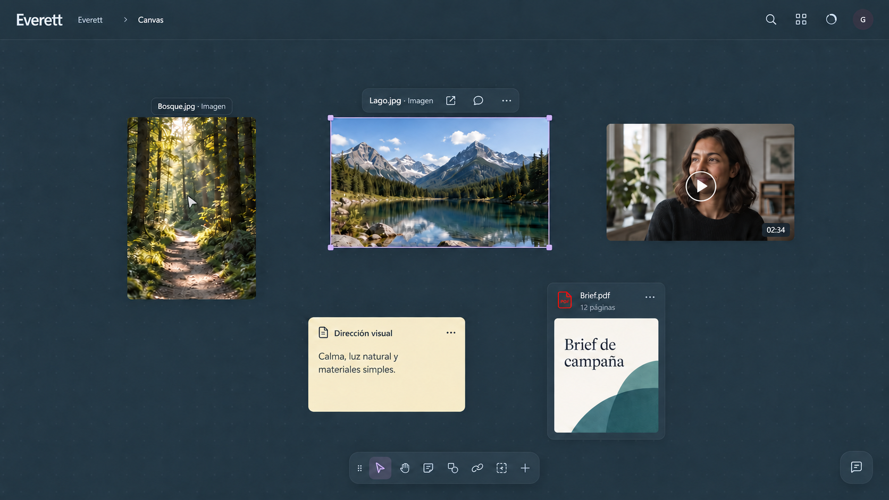
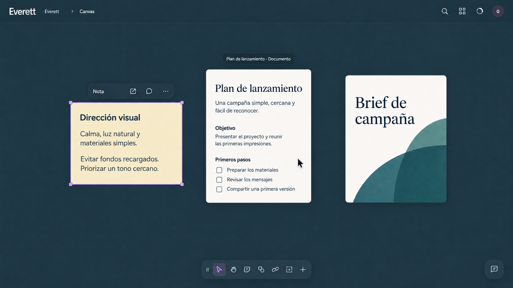

# Everett 0.8 — definición de Canvas

La organización de esta iteración sigue abierta. Este documento conserva las decisiones confirmadas
para preparar su implementación en otro chat. El alcance completo de materiales, herramientas,
zonas, propuestas y comentarios permanece en [Alcance del prototipo](../alcance-prototipo.md).

Base: reconstrucción oficial de 0.7.5 aprobada e integrada en `dev`. Aplicar
[Arquitectura](../arquitectura.md), [Desarrollo](../desarrollo.md) y el gate de
[Validación](../validacion-prototipo.md). La elección de una propuesta visual no inicia la
implementación ni cierra la definición de toda la iteración.

## Conversaciones: decisiones confirmadas

| Requisito   | Decisión                                                                                                                                                                                                                                           |
| ----------- | -------------------------------------------------------------------------------------------------------------------------------------------------------------------------------------------------------------------------------------------------- |
| C08-CHAT-01 | Conservar Quick Chat y chat anclado. Retirar Room como modo de Canvas.                                                                                                                                                                             |
| C08-CHAT-02 | Cada conversación conserva su identidad al cambiar de presentación o superficie. Una sesión transversal no obliga a reunir todo el proyecto en una única conversación.                                                                             |
| C08-CHAT-03 | Incorporar historial local real: crear varias conversaciones, guardar su registro y recuperar las anteriores entre visitas. Las respuestas de los agentes pueden seguir simuladas.                                                                 |
| C08-CHAT-04 | Abrir el historial mediante el título de la conversación y un chevron reconocible. El historial aparece en un desplegable y conserva visible la superficie del chat. El acceso debe ser claro y operable por teclado.                              |
| C08-CHAT-05 | Mantener un único botón para crear una conversación nueva, en el encabezado del chat. No repetirlo dentro del historial.                                                                                                                           |
| C08-CHAT-06 | Resaltar la conversación activa mediante el fondo de su fila. Eliminar el chip «Actual». Conservar la legibilidad del texto.                                                                                                                       |
| C08-CHAT-07 | Mantener el desplegable compacto y acotado al espacio disponible. Los nombres largos permanecen en una línea y terminan en puntos suspensivos; no ensanchan el menú. El nombre completo debe ser consultable y tener un nombre accesible completo. |

### Inicio de una conversación — C08-CHAT-08

Una conversación nueva comienza únicamente con el usuario que la inicia y el agente. No hereda los
demás participantes de la conversación anterior. Incorporar otras personas requiere una acción
explícita desde el chat anclado, según el alcance vigente.

Este inicio se aplica a cualquier usuario; no está ligado al nombre o identidad del perfil de
ejemplo. Cambiar a una conversación existente recupera los participantes de esa conversación.

### Alcance del historial — C08-CHAT-09

El desplegable muestra todas las conversaciones del Mundo actual, cualquiera sea la superficie
desde la que se iniciaron o utilizaron. La conversación conserva su misma identidad e historial
cuando se retoma desde Canvas. No se filtra la lista por conversaciones originadas o utilizadas en
Canvas ni se incluyen las de otros Mundos.

### Dirección visual elegida

El usuario eligió el desplegable de la segunda propuesta revisada después de retirar el botón
duplicado y el chip y de reducir su ancho. La imagen es una referencia de composición; los tamaños
finales deben comprobarse en Quick Chat y en el chat anclado con sus dimensiones reales.

### Continuidad y conservación local

El historial debe conservar la identidad y el contenido de cada conversación. Anclar, desacoplar o
abrirla desde otra superficie conserva mensajes, participantes, referencias y borradores, como
exige el alcance vigente. Guardar el registro de una conversación no debe dejar referencias rotas
cuando se recupera: delimitar y conservar los datos del Mundo necesarios para recuperar sus
materiales.

La base anterior mantiene el estado en memoria y lo reinicia al recargar. El historial acordado
requiere un cambio real de conservación local. El mecanismo y la extensión de los datos guardados
se concretarán al terminar esta definición; no se incorpora por esta decisión colaboración real
entre dispositivos ni inferencia de proveedores.

### Comprobaciones que debe incorporar la implementación

- Abrir y cerrar el desplegable desde el control visible y con teclado, conservando conversación y
  borrador. Elegir otra conversación recupera su propio registro sin mezclar mensajes.
- Comprobar un único acceso a nueva conversación y la fila activa resaltada sin un chip adicional.
- Desde un hilo con varias personas, iniciar otra conversación y comprobar que solo contiene al
  usuario que la inicia y al agente. Recuperar el hilo anterior conserva sus propios participantes.
- Recuperar desde Canvas una conversación del mismo Mundo iniciada en otra superficie, con su
  identidad y contenido originales. Comprobar que no aparecen conversaciones de otros Mundos.
- Probar nombres largos, nombres con el mismo prefijo, listado extenso y ventanas estrechas. Los
  títulos no ensanchan el menú; todas las conversaciones permanecen alcanzables.
- Crear dos conversaciones distintas, recargar y recuperar ambas. Contrastar sus identidades,
  mensajes, referencias y borradores; verificar también los materiales de esas referencias.
- Comprobar que los errores de guardado se muestran y no provocan un reinicio silencioso del
  historial. Los casos y contraejemplos se definen según el mecanismo adoptado.

## Materiales libres: dirección visual elegida

### Contenido visible y controles contextuales — C08-MAT-01

El usuario eligió la segunda alternativa de la comparación: imágenes y videos libres muestran
su contenido directamente sobre Canvas, conservando sus proporciones, sin una tarjeta con marco
y encabezado permanentes. Al seleccionar el material aparecen su identificación y los tiradores
o controles que correspondan a ese tipo, según C08-MAT-05. La selección utiliza un contorno fino,
sin relleno ni halo adicional, de acuerdo con el alcance vigente.

La referencia es un mockup generado para esta decisión, no una captura de una función implementada.
Se conserva una copia exacta de la segunda imagen presentada al usuario. Esta primera elección
define la presentación libre de imágenes y videos; la de notas, documentos y PDF se concreta más
abajo en C08-MAT-03. Las referencias no sustituyen la densidad dentro de zonas ni modifican la
navegación y las herramientas aprobadas por el alcance vigente.

### Identificación al pasar el puntero — C08-MAT-02

Mostrar nombre y tipo durante el hover mediante una etiqueta discreta, sin cambiar la selección
ni mostrar acciones. Al hacer clic, mantener nombre y tipo disponibles; la selección no exige
una barra genérica de botones. En reposo, imágenes y videos mantienen la presentación limpia
elegida; el video conserva sus indicadores propios de reproducción y duración cuando estén
disponibles.

El usuario aprobó una demora breve antes de mostrar la etiqueta, ajustada mediante pruebas en el
Canvas. Debe evitar apariciones fugaces al recorrer materiales sin hacer esperar al usuario que
se detiene sobre uno. Cancelar la aparición pendiente al salir del material: una etiqueta no
puede aparecer tarde cuando el puntero ya está en otra parte. El tiempo concreto queda para el
ajuste de la implementación; no se fija una duración final desde el mockup.

Esta referencia desarrolla los estados acordados. Comprobar que el nombre completo pueda
consultarse sin ensanchar indefinidamente el control, que la misma información sea accesible con
teclado y que, cuando haya controles de selección, se pueda mover el puntero hacia ellos sin
que desaparezcan.
Verificar también el tránsito rápido entre materiales y el abandono antes de cumplirse la demora,
con distintos niveles de zoom y cerca de los límites visibles del Canvas. La imagen estática no
acredita estos comportamientos.

### Notas, documentos y PDF: el mismo patrón — C08-MAT-03

El usuario eligió la revisión que elimina los pies permanentes de identificación de documentos
y PDF. Aplicar el mismo patrón de reposo, hover y selección acordado para imágenes y videos:
contenido en reposo, nombre y tipo al pasar el puntero con la demora de C08-MAT-02, e identificación
y selección discreta al hacer clic. Los controles visibles dependen del tipo según C08-MAT-05.

Las notas muestran su texto y título, si tienen. Los documentos muestran una vista previa de su
contenido y los PDF, su portada o primera página cuando esté disponible. Los títulos escritos
dentro del contenido siguen visibles: forman parte de la nota, documento o portada. Los nombres
de archivo, tipos y demás metadatos no necesitan un encabezado o pie permanente adicional.

La imagen conserva la composición elegida; sus botones no constituyen una lista aprobada de
acciones. Los iconos de entrar y comentar quedan descartados de la barra del material según
C08-MAT-04 y C08-COM-01. La selección por sí sola no justifica agregar un botón de tres puntos;
las acciones del menú contextual se distinguen de los controles visibles según C08-MAT-05.
La creación de notas corresponde al dock y su edición directa permanece en el alcance.

### Entrada y salida mediante el zoom de Everett — C08-MAT-04

Conservar el zoom acoplado existente para entrar y salir de materiales y superficies donde se
aplica esta navegación. El regreso debe recuperar el contexto espacial de origen, con su posición
y escala. No incorporar un botón de entrar, abrir o ampliar en la barra de cada material. El doble
clic ya conectado a esta navegación se conserva; no se propone como una función nueva.

El usuario precisó el mecanismo como un **embrague**, según [Producto](../producto.md):

- Sin zoom ni otra acción propia de la rueda en la superficie, zoom in entra y zoom out sale
  directamente por la navegación de Everett.
- Cuando la superficie tiene una acción propia de rueda, conservarla normalmente. Mientras se
  mantiene Alt, desacoplarla y acoplar el gesto a la navegación espacial de Everett.
- Al soltar Alt, recuperar el comportamiento local. El modificador no inicia un segundo sistema
  de navegación ni queda activado como un modo persistente.

Comprobar que un gesto con el embrague no ejecute además el zoom o desplazamiento local, que la
salida recupere el contexto de origen y que el gesto local vuelva a funcionar al soltar Alt.

En la base reconstruida, [Application.wheel](../../src/app/application.ts) resuelve la navegación
de escala con Alt + rueda sobre materiales; la rueda sin modificador ajusta la cámara de Canvas.
[CanvasView](../../src/features/canvas/view.ts) conecta el doble clic al destino del material y
[navegación](../../src/domain/navigation.ts) conserva los contextos y cámaras de regreso. Se
comprobó en el HTML reconstruido de 0.7.5 la entrada por zoom a un documento desde Canvas y el
regreso al mismo contexto con la misma transformación de cámara.

Esta comprobación no extiende la navegación automáticamente a tipos que aún no tengan destino.
Al desarrollar sus representaciones, aplicar el mecanismo de Everett según el tipo y conservar
los comportamientos vigentes. Las imágenes del antiguo producto independiente sirven de referencia
visual; no introducen rutas, botones ni gestos por encima de la navegación aprobada de Everett.

### Controles al seleccionar y menú contextual — C08-MAT-05

Distinguir los controles que aparecen al seleccionar del menú contextual del material.
Asignar a una zona de agente y quitar del Canvas corresponden al menú contextual; esas acciones
no justifican botones en una barra de selección. La [referencia 02](../referencias/0.8/infinity-canvas/02-context-menu-assign-to-zone.png)
muestra ambas acciones en ese menú. La base reconstruida las presenta en la barra de selección
de [CanvasView](../../src/features/canvas/view.ts); esa ubicación no es la dirección acordada para 0.8.

La selección conserva la identificación y el contorno acordados. Mostrar tiradores para
redimensionar cuando corresponda. En imágenes y videos, cambiar el tamaño de la representación
conservando la relación de aspecto y el contenido completo; el gesto no deforma, recorta ni
modifica el archivo de origen. En notas, ajustar las dimensiones de su representación conservando
el contenido. Los límites y tamaños mínimos se concretan al desarrollar estas representaciones.

Los controles de estilo se aplican a formas y dibujo, ya incluidos en el alcance:

- **Formas:** partir del diseño de [relleno y borde de la referencia 31](../referencias/0.8/infinity-canvas/31-shape-style-toolbar-rest.png),
  incluidos sus selectores de color y grosor. Adaptar su presentación a Everett conservando el
  trabajo de interacción de esa referencia; cualquier alternativa debe responder a un problema concreto.
- **Dibujo a mano alzada:** partir del [selector de color y grosor de la referencia 30](../referencias/0.8/infinity-canvas/30-draw-color-thickness.png).
  Son propiedades del trazo; no requieren trasladar el conjunto de relleno y borde de las formas.

No incorporar una barra de estilo de forma a notas, documentos, PDF, imágenes o videos. La edición
del contenido de las notas se realiza al entrar en ellas mediante la navegación acordada.
La edición de nombres sigue el gesto y la continuidad definidos en C08-MAT-06.

Comprobar el redimensionado de imágenes y videos horizontales y verticales, la conservación del
contenido de las notas y la correspondencia entre el tipo seleccionado y sus controles. Verificar
que las acciones del menú contextual sigan accesibles y que operar un control o editar un nombre
no active además la navegación del material.

### Renombrado desde Canvas — C08-MAT-06

Un clic sobre el nombre visible, tanto en hover como al seleccionar, permite editarlo directamente.
Renombrar queda sin atajo predeterminado; el usuario puede asignarle uno según C08-KEY-01.
Mantener la etiqueta alcanzable al mover el puntero hacia ella y estable durante la edición.
El clic sobre el nombre no arrastra el material ni activa su navegación. El contenido y los
tiradores conservan sus interacciones propias; no hace falta un botón adicional de renombrar.

Aplicar este gesto a las notas y a las imágenes y videos incorporados al Canvas. En materiales
importados, cambiar el nombre del material dentro de Everett conserva el archivo original y su
nombre fuera del proyecto.

También permitir renombrar desde Canvas un documento referenciado de Docs. Actualizar el título
del mismo documento del Mundo: el cambio debe verse en Docs y en las demás representaciones de
ese documento. No crear un alias independiente en Canvas ni duplicar el documento. Conservar su
identidad, contenido y referencias. Renombrar desde Docs debe reflejarse igualmente en Canvas.
Para referencias a otras superficies, aplicar esta continuidad cuando el material admita cambiar
su nombre, respetando sus reglas de edición y disponibilidad.

La base ya obtiene el título de documentos referenciados mediante `nodeTitle` en
[el modelo](../../src/domain/model.ts), y [los materiales de Canvas](../../src/features/canvas/materials.ts)
lo presentan desde el mismo registro que usa Docs. El comando `document.edit` en
[documentos](../../src/domain/commands/documents.ts) modifica ese registro compartido. Falta
incorporar la edición del nombre desde Canvas; esta lectura confirma el modelo compartido,
no una interacción ya implementada. El renombrado debe modificar únicamente el nombre, sin
sobrescribir el cuerpo del documento ni otros datos con una copia anterior.

Comprobar el clic sobre nombres aparecidos por hover y por selección, la estabilidad del campo al
escribir y la conservación del nombre completo aunque la etiqueta se mostrase truncada. Renombrar
un documento desde Canvas, abrirlo en Docs y comprobar el nuevo nombre y el mismo contenido e
identidad; repetir en sentido inverso. Comprobar también notas y materiales importados sin
modificar sus contenidos, conexiones ni referencias.

### Enlaces y tareas de Board — C08-MAT-07

El usuario dio conformidad a la dirección visual del enlace con vista previa: mostrar una
representación reconocible del destino cuando esté disponible, siguiendo el patrón de contenido
visible de los demás materiales. La representación del enlace sin vista previa sigue en revisión;
la URL suelta de la primera exploración no fue elegida. Utilizar únicamente la información
disponible, sin inventar título, imagen o descripción del destino.

También confirmó incorporar tareas de Board como materiales referenciados en Canvas. La tarea
conserva la identidad del registro de Board; no se convierte en un documento ni se crea una copia
independiente. Esta decisión concreta las referencias a otras superficies del alcance vigente,
sin extender la iteración al rediseño de Board.

El usuario eligió para 0.8 la revisión de la segunda alternativa inspirada en el tablero de
Codroid. La tarjeta presenta título compacto, descripción breve y una fila agrupada de estado,
prioridad y responsable, con selección discreta e identificación contextual. Mostrar los datos
disponibles de la misma tarea referenciada. Esta es la dirección para implementar en 0.8;
revisar su coherencia visual al definir Board en 0.11.

Se conserva una copia exacta de la revisión elegida. La imagen incluye también los enlaces de la
comparación: el enlace con vista previa sigue la dirección aprobada y la representación sin vista
previa permanece en revisión.

El usuario aportó el tablero de Codroid como referencia de estructura y estética. Se inspeccionaron
su vista Kanban y el detalle de un ticket en el navegador, además de la interfaz en
`C:/Proyectos/codroid/tools/board/web` y la guía `C:/Proyectos/codroid/docs/TABLERO.md`.
La [captura conservada](../referencias/0.11/board-codroid.jpg) fundamenta la jerarquía compacta
adaptada a Everett en la tarjeta elegida. La dirección del Board y sus capacidades se recogen en
[el alcance de 0.11](../alcance-prototipo.md).

## Comentarios: prueba de ubicación en el dock — C08-COM-01

Probar comentar en el dock principal de Canvas con el atajo **C**, confirmado por el usuario.
La ubicación queda sujeta a evaluar la cantidad total de accesos: si vuelve el dock demasiado
grande o cargado, revisar dónde ubicarla. Evaluar el conjunto completo y su convivencia con el
chat anclado, sin reducir los controles hasta dificultar su uso para hacerlos caber.

No duplicar el botón de crear un comentario en la barra de cada material. Conservar comentarios
asociados al material, marcadores, consulta contextual y listado, respuestas y resolución desde
el chat anclado. Esta prueba sustituye la exigencia anterior de mantener comentarios fuera del dock.

La base reconstruida tiene el acceso de creación entre las acciones del material y no lo incluye
en el dock ni tiene un atajo de comentarios. Falta concretar cómo la herramienta del dock elige
el material destinatario; no se modifica el contenido al navegar o solo seleccionarlo.

### Comentarios sobre el material completo — C08-COM-02

En 0.8, los comentarios se asocian al material completo. El marcador identifica los comentarios
de ese material; la ubicación del clic no fija un punto ni una región de su contenido.

El usuario decidió conservar para una revisión posterior a 1.0 la idea de comentarios sobre un
punto concreto de una imagen. Está recogida en [Después de 1.0](../alcance-prototipo.md#después-de-10).
Las exploraciones visuales de marcadores puntuales no se incorporan a la implementación de 0.8.

### Atajos de Canvas — C08-KEY-01

Los atajos de Canvas en 0.7.5 eran provisionales para permitir probar las funciones. No fijan
las combinaciones de 0.8 ni impiden reasignarlas. Los valores predeterminados elegidos por el
usuario son **C para comentar**, **L para conectar materiales** y **N para crear notas**.
Renombrar queda sin atajo predeterminado y conserva el clic sobre el nombre de C08-MAT-06.
El usuario puede configurar los atajos, incluido asignar uno a renombrar. Los atajos de
herramienta no se activan al escribir en una nota, campo o composer ni interfieren con combinaciones
de edición de texto.

Conservar N para crear nota, como ya está en [Application.key](../../src/app/application.ts) y
en [el dock](../../src/features/canvas/view.ts). La creación de notas conserva ambos accesos.

La configuración de atajos es un criterio general de [Producto](../producto.md); en esta iteración
se aplica a las acciones de Canvas. Permitir cambiar las asignaciones, conservar la elección local
entre visitas y recuperar los valores predeterminados. Detectar colisiones entre acciones que
puedan estar activas en el mismo contexto antes de aceptar una asignación; una pulsación no puede
disparar ambas. Las indicaciones del dock, menús y ayuda deben mostrar el atajo configurado.
Queda por concretar el acceso y la presentación de estos ajustes dentro del alcance de Canvas.

Comprobar que N activa crear nota con la configuración predeterminada y no interfiere mientras se
escribe en un campo. Probar el renombrado por clic y mediante un atajo asignado por el usuario,
la conservación de las asignaciones al recargar y su reflejo en las indicaciones, una colisión
y la restauración de los valores predeterminados, incluido renombrar sin atajo.

La 0.8 utiliza los conectores curvos definidos en C08-LINK-01. Otros tipos de conector y sus
posibles atajos se decidirán si se incorporan posteriormente. Las referencias oficiales consultadas
el 2 de octubre de 2026, que sustentaron la propuesta de L, muestran convenciones distintas:

| Referencia                                                                                                           | Atajos documentados                                                |
| -------------------------------------------------------------------------------------------------------------------- | ------------------------------------------------------------------ |
| [Miro](https://help.miro.com/hc/en-us/articles/360017731033-Shortcuts-and-hotkeys)                                   | L para líneas de conexión y flechas; C para comentarios.           |
| [FigJam](https://help.figma.com/hc/en-us/articles/1500004414542-Create-diagrams-and-flows-with-connectors-in-FigJam) | L para conectores rectos; X o Shift + L para conectores con codos. |

Estas referencias no incorporan herramientas nuevas ni cambian la geometría acordada para Everett:
L activa sus conectores curvos, aunque otro producto utilice esa tecla para líneas rectas.

## Conexiones entre materiales

### Anclajes y recorrido — C08-LINK-01

Cada material conectable ofrece cuatro puntos de anclaje: arriba, abajo, izquierda y derecha.
El usuario elige los anclajes de salida y llegada. Son distintos de los controles para cambiar
el tamaño del material.

Las conexiones son curvas y su recorrido se puede manipular. Deben permitir desvíos y varias
vueltas alrededor de un material antes de alcanzar el destino, según el recorrido elegido por
el usuario. Una curva calculada únicamente entre los extremos no cubre este comportamiento.

Los extremos se ajustan a los anclajes elegidos al conectar, mover o redimensionar materiales.
Conservar el recorrido manual al reajustarlos, sin sustituirlo por un trazado automático directo
ni cambiar los anclajes por otros más cercanos. La interacción concreta para moldear el recorrido
se definirá visualmente; no se fija desde esta descripción una implementación geométrica.

### Hover, selección y texto — C08-LINK-02

Al pasar el puntero sobre una conexión, engrosar su trazo como señal de interacción. Mantener una
zona de clic invisible más amplia que la línea visible, accesible también antes del hover y con
distintos niveles de zoom. El texto de una conexión forma parte de esa conexión y no de un
comentario ni de una nota independiente.

Hacer clic en la línea permite escribir una etiqueta, por ejemplo «depende de» o «referencia»;
si ya tiene texto, permite editarlo. Conservar también la selección y eliminación explícita de
conexiones exigidas por el alcance, distinguiendo clic, arrastre para modificar el recorrido y
edición de texto. Las teclas de edición de una etiqueta no deben borrar la conexión ni activar
atajos de herramientas. Undo/Redo distingue la edición de texto de las operaciones del Canvas.

### Base y comprobaciones de implementación

La base ya contiene los cuatro anclajes en [el modelo](../../src/domain/model.ts), curvas calculadas
entre los extremos en [geometría](../../src/domain/geometry.ts) y un área de clic ampliada en
[los estilos de Canvas](../../src/features/canvas/styles.css). El modelo de conexión actual guarda
extremos y anclajes; aún falta incorporar el recorrido manual y el texto editable acordados aquí.

- Conectar distintos pares de anclajes, incluidos los del mismo lado, sin reemplazar la elección
  del usuario. Mantener el rechazo vigente de conexiones hacia zonas de agente.
- Crear un recorrido con varias vueltas y comprobar que se conserva al mover o redimensionar
  un material conectado, con los extremos adheridos a los anclajes elegidos.
- Alcanzar una línea fina con el puntero, ver su engrosamiento en hover y escribir o editar una
  etiqueta mediante clic. Repetir con distintos niveles de zoom.
- Distinguir selección, manipulación del recorrido y edición de texto. Borrar caracteres de una
  etiqueta no elimina la conexión; eliminar explícitamente la conexión elimina su etiqueta.
- Comprobar Undo/Redo de los cambios de recorrido y del texto, su conservación al navegar y los
  mismos estados al recuperar los datos cuando se concrete el mecanismo de persistencia local.

## Propuestas: barra de acciones y pedido de cambios — C08-PROP-01

Cada propuesta pendiente presenta una barra compacta con tres acciones agrupadas en un mismo
contenedor. El orden de izquierda a derecha es `Aceptar`, `Pedir cambios`, `Rechazar`;
`Pedir cambios` ocupa el centro. En reposo, el campo para escribir cambios permanece oculto.

Al pulsar `Pedir cambios`, el mismo contenedor se expande hacia abajo y revela el campo de texto
libre. El campo aparece junto a la propuesta, dentro de la barra expandida, con sugerencias
rápidas y los controles `Enviar` y `Cancelar`. Mostrar cuatro chips de sugerencias. La referencia
utiliza `Más breve`, `Más concreto`, `Más detalle` y `Otro enfoque`; estos textos son ejemplos
para la propuesta mostrada.

El campo tiene tamaño compacto y controlado. Desactivar su redimensionado manual y no mostrar
ningún tirador, ni en las imágenes de referencia ni en la interfaz implementada.

En la fila inferior, `Cancelar` aparece a la izquierda de `Enviar`. Ambos botones tienen las
mismas dimensiones, tipografía, radio, espaciado interior y alineación. `Enviar` mantiene la
jerarquía de acción principal mediante el énfasis visual y `Cancelar`, la secundaria. Aplicar
las convenciones de botones y campos compartidas de Everett.

`Cancelar` contrae el área de escritura y conserva la propuesta pendiente con sus tres acciones.
`Enviar` solicita una revisión dentro del mismo trabajo. La propuesta sigue requiriendo aceptación
explícita antes de modificar el contenido compartido.

El usuario dio conformidad a la dirección visual con estas correcciones. La imagen incorpora
el orden central de `Pedir cambios`, cuatro sugerencias rápidas, el campo sin tirador y los
botones inferiores con las mismas dimensiones y alineación.
La revisión de la experiencia continúa cuando se pueda usar la implementación.

Comprobar el reposo compacto, la expansión hacia abajo al pedir cambios, la escritura sin
activar atajos del Canvas y la cancelación sin rechazar ni aceptar la propuesta. Verificar
expresamente los cuatro chips, la ausencia de redimensionado manual del campo y la igualdad de
dimensiones y alineación de `Cancelar` y `Enviar` en la interfaz real, conservando su jerarquía visual.

## Referencias visuales recuperadas

El usuario aportó los diseños del producto anterior Infinity Canvas para revisar su utilidad en
Everett. Se recuperaron once imágenes relativas a materiales, zonas, propuestas, herramientas,
chat y comentarios, con [índice y diferencias respecto del alcance vigente](../referencias/0.8/infinity-canvas/indice.md).

La [referencia 32](../referencias/0.8/infinity-canvas/32-zone-material-density-states.png) recupera
el adjunto de densidad ya adoptado por el alcance de 0.8. Las referencias 30 y 31 son el punto de
partida acordado para los controles de dibujo y formas, según C08-MAT-05. Las demás imágenes son
antecedentes para la discusión; sus controles y decisiones no se trasladan automáticamente.
La presentación libre de imágenes, videos, notas, documentos y PDF sigue la dirección elegida en
este documento y se distingue de las tarjetas compactas dentro de una zona. C08-MAT-07 recoge la
dirección elegida para enlaces con vista previa y la tarjeta de tareas referenciadas de Board.
El enlace sin vista previa y las demás referencias siguen en revisión.

La asignación contextual, el inspector de zona y la propuesta pendiente tienen referencias en
las imágenes 02 y 03. El trabajo de 0.8 parte de ellas para adaptar, prototipar y comprobar el
recorrido en Everett, conservando las reglas vigentes de zonas y propuestas. El índice recoge
también la [definición textual de Pedir cambios](../referencias/0.8/infinity-canvas/indice.md#zonas-propuestas-y-pedido-de-cambios)
del proyecto original. Su campo abierto no aparece en las 32 imágenes revisadas. El usuario
confirmó para Everett la barra agrupada y su expansión hacia abajo, según C08-PROP-01.

## Límite del sistema de diseño

El usuario ubicó la consolidación transversal del sistema de diseño mediante Atomic Design en
0.12, según [Alcance del prototipo](../alcance-prototipo.md). La definición e implementación de
0.8 permanecen centradas en Canvas, usando los estilos y componentes compartidos vigentes y
construyendo las piezas que necesita esta superficie.

## Decisiones que siguen abiertas

- Concretar el recorrido de nueva conversación, título inicial, renombrado, búsqueda y recuperación
  de una conversación nueva que todavía contiene solo un borrador.
- Resolver si la conversación completa tendrá destino en Sessions y qué acceso necesita Canvas.
  Retirar Room no aprueba por sí mismo una sección llamada Rooms en Sessions.
- Delimitar la conservación local y sus estados de recuperación, incluido el trabajo de agentes
  que estaba en curso al cerrar la página.
- Concretar el acceso y la presentación de la configuración de atajos de Canvas, según C08-KEY-01.
- Concretar el contenido del menú contextual de materiales, conservando la distinción de
  C08-MAT-05. El renombrado por clic y su continuidad entre Canvas y Docs están definidos en C08-MAT-06.
  No agregar una barra genérica de acciones por selección.
  Evaluar comentarios en el dock y concretar su interacción. Elegir la representación del enlace
  sin vista previa, según C08-MAT-07, y concretar las demás referencias.
- Concretar visualmente la manipulación del recorrido de las conexiones y la edición de sus
  etiquetas, preservando los comportamientos de C08-LINK-01 y C08-LINK-02.
- Preparar el recorrido combinado material → zona → agente → propuesta → revisión para la
  implementación y validación, partiendo de las referencias y comportamientos ya definidos.
  Resolver las diferencias concretas con Everett que aparezcan durante su adaptación.
