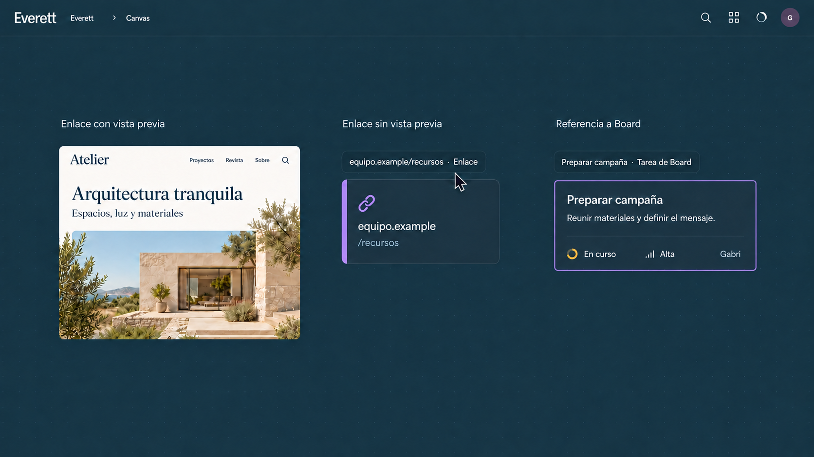
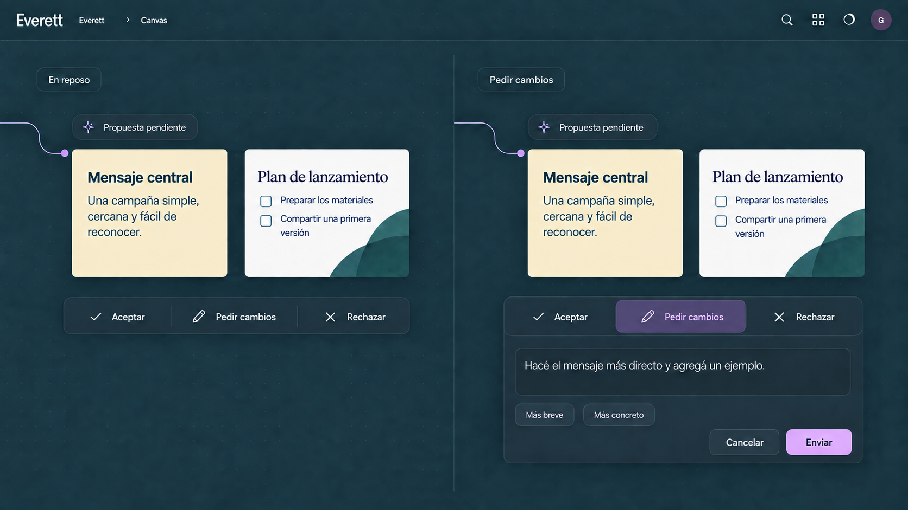

# Everett 0.8 — definición de Canvas

La organización de esta iteración sigue abierta. Este documento conserva las decisiones confirmadas
para preparar su implementación en otro chat. El alcance completo de materiales, herramientas,
zonas, propuestas y comentarios permanece en [Alcance del prototipo](../alcance-prototipo.md).

Base: reconstrucción oficial de 0.7.5 aprobada e integrada en `dev`. Aplicar
[Arquitectura](../arquitectura.md), [Desarrollo](../desarrollo.md) y el gate de
[Validación](../validacion-prototipo.md). La elección de una propuesta visual no inicia la
implementación ni cierra la definición de toda la iteración.

## Conversaciones: decisiones confirmadas

| Requisito   | Decisión                                                                                                                                                                                                                                           |
| ----------- | -------------------------------------------------------------------------------------------------------------------------------------------------------------------------------------------------------------------------------------------------- |
| C08-CHAT-01 | Conservar Quick Chat y chat anclado. Retirar Room como modo de Canvas.                                                                                                                                                                             |
| C08-CHAT-02 | Cada conversación conserva su identidad al cambiar de presentación o superficie. Una sesión transversal no obliga a reunir todo el proyecto en una única conversación.                                                                             |
| C08-CHAT-03 | Incorporar historial local real: crear varias conversaciones, guardar su registro y recuperar las anteriores entre visitas. Las respuestas de los agentes pueden seguir simuladas.                                                                 |
| C08-CHAT-04 | Abrir el historial mediante un chevron reconocible junto al nombre de la conversación. El historial aparece en un desplegable y conserva visible la superficie del chat. El acceso debe ser claro y operable por teclado.                          |
| C08-CHAT-05 | Mantener un único botón para crear una conversación nueva, en el encabezado del chat. No repetirlo dentro del historial.                                                                                                                           |
| C08-CHAT-06 | Resaltar la conversación activa mediante el fondo de su fila. Eliminar el chip «Actual». Conservar la legibilidad del texto.                                                                                                                       |
| C08-CHAT-07 | Mantener el desplegable compacto y acotado al espacio disponible. Los nombres largos permanecen en una línea y terminan en puntos suspensivos; no ensanchan el menú. El nombre completo debe ser consultable y tener un nombre accesible completo. |

### Inicio de una conversación — C08-CHAT-08

Una conversación nueva comienza únicamente con el usuario que la inicia y el agente. No hereda los
demás participantes de la conversación anterior. Incorporar otras personas requiere una acción
explícita desde el chat anclado, según el alcance vigente.

Este inicio se aplica a cualquier usuario; no está ligado al nombre o identidad del perfil de
ejemplo. Cambiar a una conversación existente recupera los participantes de esa conversación.

### Alcance del historial — C08-CHAT-09

El desplegable muestra todas las conversaciones del Mundo actual, cualquiera sea la superficie
desde la que se iniciaron o utilizaron. La conversación conserva su misma identidad e historial
cuando se retoma desde Canvas. No se filtra la lista por conversaciones originadas o utilizadas en
Canvas ni se incluyen las de otros Mundos.

### Nombre y búsqueda — C08-CHAT-10

Cada conversación muestra su nombre en el encabezado y en el historial. Un clic sobre el nombre
del encabezado permite editarlo, según la indicación del usuario. Separar ese objetivo del chevron,
que abre y cierra el historial. Durante la edición, conservar la identidad de la conversación,
sus mensajes, participantes, referencias y borrador; actualizar el mismo nombre en el listado y
en las demás presentaciones de la conversación. Una conversación recién creada presenta un
nombre provisional editable.

Conservar el buscador dentro del desplegable, como aparece en la referencia elegida. Filtrar por
nombre las conversaciones del Mundo actual y permitir retomar una desde sus resultados. Buscar
no cambia la conversación activa ni su borrador. Mostrar un estado sin resultados y permitir
limpiar la búsqueda para recuperar el listado completo.

### Continuidad con Sessions en 0.8 — C08-CHAT-11

La navegación entre superficies ya existe. Al pasar entre Canvas y Sessions mediante la navegación
vigente de Everett, retomar la misma conversación activa del Mundo, con su nombre, mensajes,
participantes, referencias y borrador. Cambiar de superficie conserva la identidad de la
conversación y el contexto espacial de regreso; no inicia otra conversación.

Aplicar esta continuidad en 0.8: Quick Chat, chat anclado y Sessions comparten un único registro
para cada conversación. El Mundo puede conservar muchas conversaciones, cada una con su propio
historial y participantes.

En la base actual de 0.7.5, [el chat de Canvas](../../src/features/chat/controller.ts) presenta
`world.chat` y [Sessions](../../src/features/session/view.ts) presenta `world.messages` como
registros separados. Ese es el estado actual que debe sustituirse por la continuidad acordada
para 0.8. Reutilizar la navegación existente para este recorrido. El rediseño y la organización
interna de Sessions permanecen en 0.10. Retirar Room de Canvas no aprueba por sí mismo una
sección llamada Rooms en Sessions.

Comprobar el recorrido en ambos sentidos: elegir una conversación, escribir sin enviar, cambiar
de superficie y recuperar el mismo hilo y borrador. Enviar y volver debe mostrar el mensaje en
esa conversación, una sola vez, conservando sus referencias y el contexto de Canvas.

### Dirección visual elegida

El usuario eligió el desplegable de la segunda propuesta revisada después de retirar el botón
duplicado y el chip y de reducir su ancho. La imagen es una referencia de composición; los tamaños
finales deben comprobarse en Quick Chat y en el chat anclado con sus dimensiones reales.

### Continuidad, guardado y recuperación — C08-STATE-01

El historial debe conservar la identidad y el contenido de cada conversación. Anclar, desacoplar o
abrirla desde otra superficie conserva mensajes, participantes, referencias y borradores, como
exige el alcance vigente. Cerrar Quick Chat o el chat anclado oculta el panel y conserva la
conversación; no cancela el trabajo del agente.

Guardar automáticamente los cambios en almacenamiento local, sin una acción obligatoria de
guardar. Conservar el contenido del Canvas y los datos del Mundo necesarios para recuperar sus
referencias: identidad y contenido de materiales, archivos incorporados, posiciones, tamaños,
conexiones y etiquetas, notas, nombres, zonas, asignaciones y comentarios. Recuperar los mismos
materiales referenciados, sin reemplazarlos por copias ni dejar referencias rotas.

Separar el contenido del Mundo del contexto personal de cada usuario. Al regresar a Canvas,
recuperar cámara, zoom, selección válida, conversación activa y presentación del chat. Conservar
los borradores por usuario y conversación, incluso antes de enviar el primer mensaje, y los
borradores de comentarios por usuario y material. Recuperar también las propuestas pendientes y
el texto todavía no enviado de un pedido de cambios, que
continúan esperando la decisión del usuario. La recuperación no acepta ni envía esos contenidos.

Reiniciar las interacciones transitorias: un arrastre, paneo, redimensionado o gesto de selección
que estaba en curso no se reanuda al recargar. Restaurar los datos guardados y dejar terminada
esa interacción; cada usuario conserva su propio contexto espacial.

Mostrar un aviso accionable si falla el guardado o la recuperación. Conservar el estado disponible
y los datos guardados; no sobrescribirlos silenciosamente con los datos iniciales ni presentar un
Canvas vacío como si la recuperación hubiera sido correcta.

La base anterior mantiene el estado en memoria y lo reinicia al recargar. El historial acordado
requiere un cambio real de conservación local. El mecanismo de almacenamiento se concreta durante
la implementación según Arquitectura y Desarrollo. Esta iteración mantiene las respuestas de
agentes simuladas y no incorpora colaboración real entre dispositivos ni inferencia de proveedores.

### Recuperación de trabajos — C08-STATE-02

Al regresar, recuperar el estado actual del mismo trabajo: procesando, propuesta lista, esperando
intervención o interrumpido, según corresponda. Recargar o cerrar la interfaz no convierte por sí
solo un trabajo en interrumpido. Conservar su identidad, instrucción, contexto, materiales y
resultados registrados, y comprobar su estado antes de presentar acciones de recuperación.

La ejecución simulada de 0.8 puede representar continuidad durante la ausencia del usuario.
Su conservación y recuperación deben ser coherentes y reproducibles; la condición de simulación
permanece identificada según Validación. No exigir una ejecución remota real para prototipar este
comportamiento ni reiniciar el trabajo únicamente por recuperar la página.

Cuando se confirme una interrupción, mostrar `Interrumpido` y ofrecer `Reintentar` y `Cancelar`.
Antes de repetir acciones, comprobar los efectos y resultados ya registrados para evitar
duplicaciones. Reintentar utiliza la instrucción, contexto y materiales conservados del mismo
trabajo. Cancelar devuelve los materiales según las reglas vigentes de zonas y propuestas.
Una propuesta recuperada continúa requiriendo aceptación explícita antes de modificar el contenido
compartido.

Esta dirección adopta los comportamientos consultados el 10 de octubre de 2026:

- [Figma](https://help.figma.com/hc/en-us/articles/360040328553-What-can-I-do-offline-in-Figma) y
  [Excalidraw](https://github.com/excalidraw/excalidraw#excalidrawcom): guardado automático y
  conservación local.
- [Persistencia de tldraw](https://tldraw.dev/docs/persistence) y
  [estado de instancia](https://tldraw.dev/sdk-features/instance-state#session-persistence):
  separar contenido y contexto personal, recuperar cámara y selección y reiniciar gestos temporales.
- [Slack](https://slack.com/help/articles/201457107-Send-and-read-messages): guardar automáticamente
  mensajes no enviados como borradores.
- [Cursor](https://prod.cursor.com/help/ai-features/background-agents): una ejecución remota puede
  continuar con la interfaz cerrada.
- [Claude Code](https://code.claude.com/docs/en/sessions#what-a-resumed-session-restores): recuperar
  la conversación no repite automáticamente una herramienta interrumpida; comprobar efectos antes
  de volver a ejecutarla.
- [Visibilidad del estado del sistema](https://www.nngroup.com/articles/visibility-system-status/):
  comunicar el estado y el resultado de las interacciones mediante feedback oportuno.

Estas referencias fundamentan el comportamiento acordado; no incorporan sus productos, SDK ni
servicios a las dependencias de Everett.

### Comprobaciones que debe incorporar la implementación

- Abrir y cerrar el desplegable desde el control visible y con teclado, conservando conversación y
  borrador. Elegir otra conversación recupera su propio registro sin mezclar mensajes.
- Comprobar un único acceso a nueva conversación y la fila activa resaltada sin un chip adicional.
- Renombrar mediante clic sobre el nombre del encabezado sin abrir el historial ni cambiar de
  conversación. Comprobar el mismo nombre e identidad en el listado y en las demás presentaciones.
- Buscar por nombre desde el desplegable, retomar un resultado y comprobar la búsqueda sin
  coincidencias y su limpieza. Escribir en el buscador no activa atajos del Canvas ni altera el
  borrador del chat.
- Desde un hilo con varias personas, iniciar otra conversación y comprobar que solo contiene al
  usuario que la inicia y al agente. Recuperar el hilo anterior conserva sus propios participantes.
- Recuperar desde Canvas una conversación del mismo Mundo iniciada en otra superficie, con su
  identidad y contenido originales. Comprobar que no aparecen conversaciones de otros Mundos.
- Probar nombres largos, nombres con el mismo prefijo, listado extenso y ventanas estrechas. Los
  títulos no ensanchan el menú; todas las conversaciones permanecen alcanzables.
- Crear dos conversaciones distintas, recargar y recuperar ambas. Contrastar sus identidades,
  mensajes, referencias y borradores; verificar también los materiales de esas referencias.
- Recuperar una conversación que solo tiene un borrador, sin enviarlo ni crear un duplicado.
- Editar y organizar materiales, importar un archivo, conectar elementos y dejar comentarios;
  recargar y comprobar los mismos contenidos, identidades, referencias, posiciones y tamaños.
- Recuperar por usuario cámara, zoom, selección válida y estado del chat. Recargar durante un
  gesto y comprobar que no sigue arrastrando, paneando o redimensionando después de volver.
- Recuperar una propuesta pendiente y un pedido de cambios sin enviar. No aplicar la propuesta ni
  enviar el borrador por recargar.
- Cerrar un campo de comentario con Esc, recargar y recuperar su borrador sobre el mismo material,
  sin publicarlo ni convertirlo en un comentario vacío.
- Cerrar el panel de chat durante un trabajo y comprobar que no lo cancela. Recuperar de forma
  controlada un trabajo que sigue procesando, uno que terminó durante la ausencia y otro que
  espera intervención; no marcarlos como interrumpidos por la sola recarga.
- Recuperar una interrupción confirmada, reintentar sin duplicar efectos o resultados registrados
  y cancelar devolviendo los materiales. Conservar la identidad y el contexto del trabajo.
- Comprobar que los errores de guardado se muestran y no provocan un reinicio silencioso del
  historial ni del Canvas. Probar también una recuperación fallida sin sobrescribir los datos
  guardados. Los casos y contraejemplos se definen según el mecanismo adoptado.

## Materiales libres: dirección visual elegida

### Contenido visible y controles contextuales — C08-MAT-01

El usuario eligió la segunda alternativa de la comparación: imágenes y videos libres muestran
su contenido directamente sobre Canvas, conservando sus proporciones, sin una tarjeta con marco
y encabezado permanentes. Al seleccionar el material aparecen su identificación y los tiradores
o controles que correspondan a ese tipo, según C08-MAT-05. La selección utiliza un contorno fino,
sin relleno ni halo adicional, de acuerdo con el alcance vigente.

La referencia es un mockup generado para esta decisión, no una captura de una función implementada.
Se conserva una copia exacta de la segunda imagen presentada al usuario. Esta primera elección
define la presentación libre de imágenes y videos; la de notas, documentos y PDF se concreta más
abajo en C08-MAT-03. Las referencias no sustituyen la densidad dentro de zonas ni modifican la
navegación y las herramientas aprobadas por el alcance vigente.

### Identificación al pasar el puntero — C08-MAT-02

Mostrar nombre y tipo durante el hover mediante una etiqueta discreta, sin cambiar la selección
ni mostrar acciones. Al hacer clic, mantener nombre y tipo disponibles; la selección no exige
una barra genérica de botones. En reposo, imágenes y videos mantienen la presentación limpia
elegida; el video conserva sus indicadores propios de reproducción y duración cuando estén
disponibles.

El usuario aprobó una demora breve antes de mostrar la etiqueta, ajustada mediante pruebas en el
Canvas. Debe evitar apariciones fugaces al recorrer materiales sin hacer esperar al usuario que
se detiene sobre uno. Cancelar la aparición pendiente al salir del material: una etiqueta no
puede aparecer tarde cuando el puntero ya está en otra parte. El tiempo concreto queda para el
ajuste de la implementación; no se fija una duración final desde el mockup.

Esta referencia desarrolla los estados acordados. Comprobar que el nombre completo pueda
consultarse sin ensanchar indefinidamente el control, que la misma información sea accesible con
teclado y que, cuando haya controles de selección, se pueda mover el puntero hacia ellos sin
que desaparezcan.
Verificar también el tránsito rápido entre materiales y el abandono antes de cumplirse la demora,
con distintos niveles de zoom y cerca de los límites visibles del Canvas. La imagen estática no
acredita estos comportamientos.

### Notas, documentos y PDF: el mismo patrón — C08-MAT-03

El usuario eligió la revisión que elimina los pies permanentes de identificación de documentos
y PDF. Aplicar el mismo patrón de reposo, hover y selección acordado para imágenes y videos:
contenido en reposo, nombre y tipo al pasar el puntero con la demora de C08-MAT-02, e identificación
y selección discreta al hacer clic. Los controles visibles dependen del tipo según C08-MAT-05.

Las notas muestran su texto y título, si tienen. Los documentos muestran una vista previa de su
contenido y los PDF, su portada o primera página cuando esté disponible. Los títulos escritos
dentro del contenido siguen visibles: forman parte de la nota, documento o portada. Los nombres
de archivo, tipos y demás metadatos no necesitan un encabezado o pie permanente adicional.

La imagen conserva la composición elegida; sus botones no constituyen una lista aprobada de
acciones. Los iconos de entrar y comentar quedan descartados de la barra del material según
C08-MAT-04 y C08-COM-01. La selección por sí sola no justifica agregar un botón de tres puntos;
las acciones del menú contextual se distinguen de los controles visibles según C08-MAT-05.
La creación de notas corresponde al dock y su edición directa permanece en el alcance.

### Entrada y salida mediante el zoom de Everett — C08-MAT-04

Conservar el zoom acoplado existente para entrar y salir de materiales y superficies donde se
aplica esta navegación. El regreso debe recuperar el contexto espacial de origen, con su posición
y escala. No incorporar un botón de entrar, abrir o ampliar en la barra de cada material. El doble
clic ya conectado a esta navegación se conserva; no se propone como una función nueva.

El usuario precisó el mecanismo como un **embrague**, según [Producto](../producto.md):

- Sin zoom ni otra acción propia de la rueda en la superficie, zoom in entra y zoom out sale
  directamente por la navegación de Everett.
- Cuando la superficie tiene una acción propia de rueda, conservarla normalmente. Mientras se
  mantiene Alt, desacoplarla y acoplar el gesto a la navegación espacial de Everett.
- Al soltar Alt, recuperar el comportamiento local. El modificador no inicia un segundo sistema
  de navegación ni queda activado como un modo persistente.

Comprobar que un gesto con el embrague no ejecute además el zoom o desplazamiento local, que la
salida recupere el contexto de origen y que el gesto local vuelva a funcionar al soltar Alt.

En la base reconstruida, [Application.wheel](../../src/app/application.ts) resuelve la navegación
de escala con Alt + rueda sobre materiales; la rueda sin modificador ajusta la cámara de Canvas.
[CanvasView](../../src/features/canvas/view.ts) conecta el doble clic al destino del material y
[navegación](../../src/domain/navigation.ts) conserva los contextos y cámaras de regreso. Se
comprobó en el HTML reconstruido de 0.7.5 la entrada por zoom a un documento desde Canvas y el
regreso al mismo contexto con la misma transformación de cámara.

Esta comprobación no extiende la navegación automáticamente a tipos que aún no tengan destino.
Al desarrollar sus representaciones, aplicar el mecanismo de Everett según el tipo y conservar
los comportamientos vigentes. Las imágenes del antiguo producto independiente sirven de referencia
visual; no introducen rutas, botones ni gestos por encima de la navegación aprobada de Everett.

### Controles al seleccionar y menú contextual — C08-MAT-05

Distinguir los controles que aparecen al seleccionar del menú contextual del material.
Asignar a una zona de agente y quitar del Canvas corresponden al menú contextual; esas acciones
no justifican botones en una barra de selección. La [referencia 02](../referencias/0.8/infinity-canvas/02-context-menu-assign-to-zone.png)
muestra `Assign to zone`, con un submenú de zonas de destino, `Duplicate`, `Rename` y `Delete`.
Partir de ese menú para su adaptación a Everett. La referencia es una base visual revisable;
sus elementos y atajos no constituyen una lista definitiva. Asignar a una zona ofrece los destinos
disponibles en el Mundo; las dos zonas de la imagen son ejemplos, no una cantidad fija de agentes.
Quitar del Canvas una referencia a Docs o Board retira únicamente su representación del Canvas;
el documento o la tarea conserva su identidad, contenido y existencia en su superficie de origen.
Las acciones de eliminar y duplicar materiales siguen C08-MAT-08. La base reconstruida presenta
asignar y eliminar
en la barra de selección de [CanvasView](../../src/features/canvas/view.ts); esa ubicación no es
la dirección acordada para 0.8.

El menú de la referencia 02 corresponde al material, no a la zona. Seleccionar una zona abre el
inspector, tomando como base la [referencia 03](../referencias/0.8/infinity-canvas/03-zone-inspector-pending-output.png),
para consultar su agente, instrucciones, contexto, actividad y acciones. El usuario prefiere
gestionar la zona y sus materiales desde ese inspector y confirmó esa distribución para 0.8:
menú contextual para materiales e inspector para zonas.
Retirar un material de una zona y devolverlo al Canvas es distinto de quitarlo del Canvas.

La selección conserva la identificación y el contorno acordados. Mostrar tiradores para
redimensionar cuando corresponda. En imágenes y videos, cambiar el tamaño de la representación
conservando la relación de aspecto y el contenido completo; el gesto no deforma, recorta ni
modifica el archivo de origen. En notas, ajustar las dimensiones de su representación conservando
el contenido. Los límites y tamaños mínimos se concretan al desarrollar estas representaciones.

Los controles de estilo se aplican a formas y dibujo, ya incluidos en el alcance:

- **Formas:** partir del diseño de [relleno y borde de la referencia 31](../referencias/0.8/infinity-canvas/31-shape-style-toolbar-rest.png),
  incluidos sus selectores de color y grosor. Adaptar su presentación a Everett conservando el
  trabajo de interacción de esa referencia; cualquier alternativa debe responder a un problema concreto.
- **Dibujo a mano alzada:** partir del [selector de color y grosor de la referencia 30](../referencias/0.8/infinity-canvas/30-draw-color-thickness.png).
  Son propiedades del trazo; no requieren trasladar el conjunto de relleno y borde de las formas.

No incorporar una barra de estilo de forma a notas, documentos, PDF, imágenes o videos. La edición
del contenido de las notas se realiza al entrar en ellas mediante la navegación acordada.
La edición de nombres sigue el gesto y la continuidad definidos en C08-MAT-06.

Comprobar el redimensionado de imágenes y videos horizontales y verticales, la conservación del
contenido de las notas y la correspondencia entre el tipo seleccionado y sus controles. Verificar
que las acciones del menú contextual sigan accesibles y que operar un control o editar un nombre
no active además la navegación del material. Quitar una referencia a Docs o Board debe conservar
el documento o la tarea original y las demás referencias a ese contenido.

### Renombrado desde Canvas — C08-MAT-06

Un clic sobre el nombre visible, tanto en hover como al seleccionar, permite editarlo directamente.
También ofrecer Renombrar en el menú contextual del material, según la elección del usuario.
Ambos accesos editan el mismo nombre. Renombrar queda sin atajo predeterminado; el usuario puede
asignarle uno según C08-KEY-01. Mostrar esa combinación en el menú cuando esté asignada;
el atajo `Enter` de la imagen antigua no se adopta como valor predeterminado.
Mantener la etiqueta alcanzable al mover el puntero hacia ella y estable durante la edición.
El clic sobre el nombre no arrastra el material ni activa su navegación. El contenido y los
tiradores conservan sus interacciones propias; no hace falta un botón adicional de renombrar.

Aplicar este gesto a las notas y a las imágenes y videos incorporados al Canvas. En materiales
importados, cambiar el nombre del material dentro de Everett conserva el archivo original y su
nombre fuera del proyecto.

También permitir renombrar desde Canvas un documento referenciado de Docs. Actualizar el título
del mismo documento del Mundo: el cambio debe verse en Docs y en las demás representaciones de
ese documento. No crear un alias independiente en Canvas ni duplicar el documento. Conservar su
identidad, contenido y referencias. Renombrar desde Docs debe reflejarse igualmente en Canvas.
Para referencias a otras superficies, aplicar esta continuidad cuando el material admita cambiar
su nombre, respetando sus reglas de edición y disponibilidad.

La base ya obtiene el título de documentos referenciados mediante `nodeTitle` en
[el modelo](../../src/domain/model.ts), y [los materiales de Canvas](../../src/features/canvas/materials.ts)
lo presentan desde el mismo registro que usa Docs. El comando `document.edit` en
[documentos](../../src/domain/commands/documents.ts) modifica ese registro compartido. Falta
incorporar la edición del nombre desde Canvas; esta lectura confirma el modelo compartido,
no una interacción ya implementada. El renombrado debe modificar únicamente el nombre, sin
sobrescribir el cuerpo del documento ni otros datos con una copia anterior.

Comprobar el renombrado desde el menú y mediante clic sobre nombres aparecidos por hover y por
selección, la estabilidad del campo al escribir y la conservación del nombre completo aunque la
etiqueta se mostrase truncada. Renombrar
un documento desde Canvas, abrirlo en Docs y comprobar el nuevo nombre y el mismo contenido e
identidad; repetir en sentido inverso. Comprobar también notas y materiales importados sin
modificar sus contenidos, conexiones ni referencias.

### Enlaces y tareas de Board — C08-MAT-07

El usuario dio conformidad a la dirección visual del enlace con vista previa: mostrar una
representación reconocible del destino cuando esté disponible, siguiendo el patrón de contenido
visible de los demás materiales. Utilizar únicamente la información disponible, sin inventar
título, imagen o descripción del destino.

Para el enlace sin vista previa, el usuario eligió la representación del centro de la misma
imagen: pieza compacta con icono de enlace, dominio y ruta, y un acento lateral. Conservar esa
composición cuando no haya preview disponible. El dominio y la ruta son su contenido visible;
la identificación adicional sigue los estados de hover y selección de C08-MAT-02.

También confirmó incorporar tareas de Board como materiales referenciados en Canvas. La tarea
conserva la identidad del registro de Board; no se convierte en un documento ni se crea una copia
independiente. Esta decisión concreta las referencias a otras superficies del alcance vigente,
sin extender la iteración al rediseño de Board.

El usuario eligió para 0.8 la revisión de la segunda alternativa inspirada en el tablero de
Codroid. La tarjeta presenta título compacto, descripción breve y una fila agrupada de estado,
prioridad y responsable, con selección discreta e identificación contextual. Mostrar los datos
disponibles de la misma tarea referenciada. Esta es la dirección para implementar en 0.8;
revisar su coherencia visual al definir Board en 0.11.

Se conserva una copia exacta de la revisión elegida. Las tres representaciones de la imagen son
las referencias acordadas para 0.8; la tarjeta de Board se revisará junto con esa superficie en 0.11.

El usuario aportó el tablero de Codroid como referencia de estructura y estética. Se inspeccionaron
su vista Kanban y el detalle de un ticket en el navegador, además de la interfaz en
`C:/Proyectos/codroid/tools/board/web` y la guía `C:/Proyectos/codroid/docs/TABLERO.md`.
La [captura conservada](../referencias/0.11/board-codroid.jpg) fundamenta la jerarquía compacta
adaptada a Everett en la tarjeta elegida. La dirección del Board y sus capacidades se recogen en
[el alcance de 0.11](../alcance-prototipo.md).

### Duplicar y eliminar materiales — C08-MAT-08

Duplicar crea otro elemento del mismo tipo con el contenido y la apariencia del seleccionado.
Una nota produce otra nota; una imagen o un video, otra copia de ese material sobre Canvas;
una forma, otra forma. El nuevo elemento tiene identidad propia y puede moverse, renombrarse y
editarse según las capacidades de su tipo sin modificar el material original. No agrega
capacidades de edición nuevas al tipo de material.

Duplicar un documento referenciado crea un documento nuevo en Docs, con identidad propia y el
mismo contenido inicial, y coloca en Canvas una referencia a esa copia. La copia pertenece a
Docs. Editar o renombrar la copia desde Canvas o Docs se refleja en ambas representaciones de
ese nuevo documento y conserva intacto el original.

Para 0.8, omitir Duplicar en las referencias a tareas de Board, siguiendo la dirección del usuario.

Eliminar un material propio del Canvas retira ese elemento y admite Deshacer. La operación
conserva los archivos importados fuera de Everett y las demás copias presentes en Canvas.
Para referencias a Docs o Board, utilizar Quitar del Canvas, conservando el documento o la
tarea original según C08-MAT-05. Deshacer restaura el elemento retirado con su identidad,
contenido y vínculos. La gestión de materiales asignados corresponde al inspector y respeta
las reglas de exclusividad y devolución vigentes.

Comprobar el duplicado de notas, imágenes, videos y formas, su independencia y la conservación
del original. Duplicar un documento desde Canvas debe crear la copia en Docs y referenciar ese
nuevo documento en Canvas. Editar su contenido y nombre debe conservar intacto el original.
Quitar su referencia conserva la copia en Docs; las referencias a tareas de Board no ofrecen
Duplicar. Comprobar Deshacer y Rehacer del duplicado y de la eliminación, incluidos contenido,
identidad y vínculos.

## Comentarios: prueba de ubicación en el dock — C08-COM-01

Probar comentar en el dock principal de Canvas con el atajo **C**, confirmado por el usuario.
La ubicación queda sujeta a evaluar la cantidad total de accesos: si vuelve el dock demasiado
grande o cargado, revisar dónde ubicarla. Evaluar el conjunto completo y su convivencia con el
chat anclado, sin reducir los controles hasta dificultar su uso para hacerlos caber.

No duplicar el botón de crear un comentario en la barra de cada material. Conservar comentarios
asociados al material, marcadores, consulta contextual y listado, respuestas y resolución desde
el chat anclado. Esta prueba sustituye la exigencia anterior de mantener comentarios fuera del dock.

La base reconstruida tiene el acceso de creación entre las acciones del material y no lo incluye
en el dock ni tiene un atajo de comentarios. El gesto acordado para elegir el material destinatario
se define en C08-COM-03; navegar o solo seleccionar un material no modifica su contenido.

### Comentarios sobre el material completo — C08-COM-02

En 0.8, los comentarios se asocian al material completo. El marcador identifica los comentarios
de ese material; la ubicación del clic no fija un punto ni una región de su contenido.

El usuario decidió conservar para una revisión posterior a 1.0 la idea de comentarios sobre un
punto concreto de una imagen. Está recogida en [Después de 1.0](../alcance-prototipo.md#después-de-10).
Las exploraciones visuales de marcadores puntuales no se incorporan a la implementación de 0.8.

### Destinatario y cancelación — C08-COM-03

Con un único material seleccionado, pulsar **C** o el botón de comentar del dock abre el campo
para comentar ese material completo. Sin selección, activar la herramienta y después hacer clic
en el material destinatario para abrir el campo. Si hay varios materiales seleccionados, permitir
elegir un único destinatario mediante ese mismo modo; no publicar sobre todos por una selección
múltiple. Hacer clic en el fondo mantiene la espera de un material y no crea un comentario libre.

**Esc** cancela la herramienta mientras espera un destinatario. Si el campo ya está abierto, Esc
lo cierra conservando el texto como borrador privado del usuario, asociado al mismo material.
Volver a comentar ese material recupera el borrador. Publicar requiere una acción explícita;
activar la herramienta, cerrar el campo o recargar no publica ni crea un comentario vacío.
Aplicar la conservación local de C08-STATE-01. Al escribir, C y los demás atajos de herramienta
no se activan, según C08-KEY-01.

La interacción acordada combina patrones documentados: [Miro](https://help.miro.com/hc/en-us/articles/360017730873-Comments)
activa comentar con C o su herramienta, permite elegir un objeto y conserva el texto no publicado
al abandonar el campo. [FigJam](https://help.figma.com/hc/en-us/articles/14477051168791-Use-FigJam-with-a-screen-reader)
documenta crear un comentario directamente sobre la selección mediante sus acciones de teclado;
no utiliza en ese recorrido exactamente el mismo atajo. [Figma](https://help.figma.com/hc/en-us/articles/360041547593-View-and-manage-comments)
documenta Esc para salir del modo de comentarios. Everett adopta C y el dock para ambos accesos
y mantiene comentarios sobre el material completo según C08-COM-02.

Comprobar C y el botón del dock con un material seleccionado y sin selección, la elección de un
destinatario con selección múltiple, el clic sobre el fondo y Esc antes de elegir un material.
Escribir, cerrar con Esc, reabrir y recargar conserva el borrador y el destinatario sin publicar.
Publicar crea un único comentario sobre el material elegido; C dentro del campo escribe texto.

### Atajos de Canvas — C08-KEY-01

Los atajos de Canvas en 0.7.5 eran provisionales para permitir probar las funciones. No fijan
las combinaciones de 0.8 ni impiden reasignarlas. Los valores predeterminados elegidos por el
usuario son **C para comentar**, **L para conectar materiales** y **N para crear notas**.
Renombrar queda sin atajo predeterminado y conserva el clic sobre el nombre de C08-MAT-06.
El usuario puede configurar los atajos, incluido asignar uno a renombrar. Los atajos de
herramienta no se activan al escribir en una nota, campo o composer ni interfieren con combinaciones
de edición de texto.

Conservar N para crear nota, como ya está en [Application.key](../../src/app/application.ts) y
en [el dock](../../src/features/canvas/view.ts). La creación de notas conserva ambos accesos.

La configuración de atajos es un criterio general de [Producto](../producto.md); en esta iteración
se aplica a las acciones de Canvas. Acceder desde **Perfil → Configuración → Atajos**, en la sección
Canvas. Mostrar la lista de acciones y su combinación actual; un clic sobre la combinación permite
cambiarla. Renombrar permanece en la lista con la combinación vacía hasta que el usuario le asigne
un atajo.

Avisar si la nueva combinación entra en conflicto con otra acción que pueda estar activa en el
mismo contexto y resolver la colisión antes de aceptar la asignación; una pulsación no puede
disparar ambas. Permitir restaurar un atajo o todos los valores predeterminados de Canvas. Guardar
automáticamente la configuración local y conservarla entre visitas. Las indicaciones del dock,
menús y ayuda deben mostrar el atajo configurado. El rediseño general de perfil y configuración
permanece en 0.12, según [Alcance del prototipo](../alcance-prototipo.md).

Comprobar que N activa crear nota con la configuración predeterminada y no interfiere mientras se
escribe en un campo. Probar el acceso a la sección Canvas y la edición de una combinación,
el renombrado por clic y mediante un atajo asignado por el usuario, la conservación de las
asignaciones al recargar y su reflejo en las indicaciones, y el aviso y resolución de una colisión.
Restaurar un atajo conserva las demás asignaciones; restaurar todos recupera los valores iniciales,
incluido Renombrar visible con su combinación vacía.

La 0.8 utiliza los conectores curvos definidos en C08-LINK-01. Otros tipos de conector y sus
posibles atajos se decidirán si se incorporan posteriormente. Las referencias oficiales consultadas
el 2 de octubre de 2026, que sustentaron la propuesta de L, muestran convenciones distintas:

| Referencia                                                                                                           | Atajos documentados                                                |
| -------------------------------------------------------------------------------------------------------------------- | ------------------------------------------------------------------ |
| [Miro](https://help.miro.com/hc/en-us/articles/360017731033-Shortcuts-and-hotkeys)                                   | L para líneas de conexión y flechas; C para comentarios.           |
| [FigJam](https://help.figma.com/hc/en-us/articles/1500004414542-Create-diagrams-and-flows-with-connectors-in-FigJam) | L para conectores rectos; X o Shift + L para conectores con codos. |

Estas referencias no incorporan herramientas nuevas ni cambian la geometría acordada para Everett:
L activa sus conectores curvos, aunque otro producto utilice esa tecla para líneas rectas.

## Conexiones entre materiales

### Anclajes y recorrido — C08-LINK-01

Cada material conectable ofrece cuatro puntos de anclaje: arriba, abajo, izquierda y derecha.
El usuario elige los anclajes de salida y llegada. Son distintos de los controles para cambiar
el tamaño del material.

Las conexiones utilizan curvas suaves y continuas con sensación de cable. Su recorrido se
calcula automáticamente entre los extremos. Los extremos se ajustan a los anclajes elegidos
al conectar, mover o redimensionar materiales, sin cambiarlos por otros más cercanos.

El usuario descartó la modificación manual del recorrido y las vueltas alrededor de materiales.
La 0.8 conserva la elección de anclajes y el ajuste automático de la curva.

### Hover, selección y texto — C08-LINK-02

Al pasar el puntero sobre una conexión, engrosar su trazo como señal de interacción. Mantener una
zona de clic invisible más amplia que la línea visible, accesible también antes del hover y con
distintos niveles de zoom. El texto de una conexión forma parte de esa conexión y no de un
comentario ni de una nota independiente.

Hacer clic en la línea permite escribir una etiqueta, por ejemplo «depende de» o «referencia»;
si ya tiene texto, permite editarlo. Mostrar el texto integrado en el cable, centrado sobre su
trazo. Interrumpir visualmente la línea bajo el texto con el fondo del Canvas para conservar la
legibilidad, como `supports` y `leads to` en la [referencia 03](../referencias/0.8/infinity-canvas/03-zone-inspector-pending-output.png).
La etiqueta no aparece flotando por encima o debajo de la conexión ni dentro de un chip separado.
Mantener su ubicación sobre el cable al mover los materiales o cambiar el zoom.

Esta imagen ilustra la colocación del texto corregida según la indicación del usuario. Aplicar
la curvatura suave definida en C08-LINK-01 al desarrollar la representación de los cables.

Conservar también la selección y eliminación explícita de conexiones exigidas por el alcance,
distinguiéndolas de la edición de texto. Las teclas de edición de una etiqueta no deben borrar
la conexión ni activar atajos de herramientas. Undo/Redo distingue la edición de texto de las
operaciones del Canvas.

### Base y comprobaciones de implementación

La base ya contiene los cuatro anclajes en [el modelo](../../src/domain/model.ts), curvas calculadas
entre los extremos en [geometría](../../src/domain/geometry.ts) y un área de clic ampliada en
[los estilos de Canvas](../../src/features/canvas/styles.css). El modelo de conexión actual guarda
extremos y anclajes; aún falta incorporar el texto editable y ajustar la representación de los
cables según la dirección acordada aquí.

- Conectar distintos pares de anclajes, incluidos los del mismo lado, sin reemplazar la elección
  del usuario. Mantener el rechazo vigente de conexiones hacia zonas de agente.
- Mover y redimensionar un material conectado y comprobar el reajuste de la curva, con los
  extremos adheridos a los anclajes elegidos y el aspecto de cable acordado.
- Alcanzar una línea fina con el puntero, ver su engrosamiento en hover y escribir o editar una
  etiqueta mediante clic. Repetir con distintos niveles de zoom y comprobar que el texto permanece
  integrado en el trazo al mover los materiales, con la línea interrumpida únicamente bajo el texto.
- Distinguir selección y edición de texto. Borrar caracteres de una etiqueta no elimina la
  conexión; eliminar explícitamente la conexión elimina su etiqueta.
- Comprobar Undo/Redo de la creación y eliminación de conexiones y de la edición de texto,
  su conservación al navegar y los mismos estados al recuperar los datos guardados.

## Propuestas: barra de acciones y pedido de cambios — C08-PROP-01

Cada propuesta pendiente presenta una barra compacta con tres acciones agrupadas en un mismo
contenedor. El orden de izquierda a derecha es `Aceptar`, `Pedir cambios`, `Rechazar`;
`Pedir cambios` ocupa el centro. En reposo, el campo para escribir cambios permanece oculto.

Al pulsar `Pedir cambios`, el mismo contenedor se expande hacia abajo y revela el campo de texto
libre. El campo aparece junto a la propuesta, dentro de la barra expandida, con sugerencias
rápidas y los controles `Enviar` y `Cancelar`. Mostrar cuatro chips de sugerencias. La referencia
utiliza `Más breve`, `Más concreto`, `Más detalle` y `Otro enfoque`; estos textos son ejemplos
para la propuesta mostrada.

El campo tiene tamaño compacto y controlado. Desactivar su redimensionado manual y no mostrar
ningún tirador, ni en las imágenes de referencia ni en la interfaz implementada.

En la fila inferior, `Cancelar` aparece a la izquierda de `Enviar`. Ambos botones tienen las
mismas dimensiones, tipografía, radio, espaciado interior y alineación. `Enviar` mantiene la
jerarquía de acción principal mediante el énfasis visual y `Cancelar`, la secundaria. Aplicar
las convenciones de botones y campos compartidas de Everett.

`Cancelar` contrae el área de escritura y conserva la propuesta pendiente con sus tres acciones.
`Enviar` solicita una revisión dentro del mismo trabajo. La propuesta sigue requiriendo aceptación
explícita antes de modificar el contenido compartido.

El usuario dio conformidad a la dirección visual con estas correcciones. La imagen incorpora
el orden central de `Pedir cambios`, cuatro sugerencias rápidas, el campo sin tirador y los
botones inferiores con las mismas dimensiones y alineación.
La revisión de la experiencia continúa cuando se pueda usar la implementación.

Comprobar el reposo compacto, la expansión hacia abajo al pedir cambios, la escritura sin
activar atajos del Canvas y la cancelación sin rechazar ni aceptar la propuesta. Verificar
expresamente los cuatro chips, la ausencia de redimensionado manual del campo y la igualdad de
dimensiones y alineación de `Cancelar` y `Enviar` en la interfaz real, conservando su jerarquía visual.

## Referencias visuales recuperadas

El usuario aportó los diseños del producto anterior Infinity Canvas para revisar su utilidad en
Everett. Se recuperaron once imágenes relativas a materiales, zonas, propuestas, herramientas,
chat y comentarios, con [índice y diferencias respecto del alcance vigente](../referencias/0.8/infinity-canvas/indice.md).

La [referencia 32](../referencias/0.8/infinity-canvas/32-zone-material-density-states.png) recupera
el adjunto de densidad ya adoptado por el alcance de 0.8. Las referencias 30 y 31 son el punto de
partida acordado para los controles de dibujo y formas, según C08-MAT-05. Las demás imágenes son
antecedentes para la discusión; sus controles y decisiones no se trasladan automáticamente.
La presentación libre de imágenes, videos, notas, documentos y PDF sigue la dirección elegida en
este documento y se distingue de las tarjetas compactas dentro de una zona. C08-MAT-07 recoge la
dirección elegida para enlaces con y sin vista previa y la tarjeta de tareas referenciadas de Board.
Las demás referencias siguen en revisión.

La asignación contextual, el inspector de zona y la propuesta pendiente tienen referencias en
las imágenes 02 y 03. El trabajo de 0.8 parte de ellas para adaptar, prototipar y comprobar el
recorrido en Everett, conservando las reglas vigentes de zonas y propuestas. El índice recoge
también la [definición textual de Pedir cambios](../referencias/0.8/infinity-canvas/indice.md#zonas-propuestas-y-pedido-de-cambios)
del proyecto original. Su campo abierto no aparece en las 32 imágenes revisadas. El usuario
confirmó para Everett la barra agrupada y su expansión hacia abajo, según C08-PROP-01.

## Límite del sistema de diseño

El usuario ubicó la consolidación transversal del sistema de diseño mediante Atomic Design en
0.12, según [Alcance del prototipo](../alcance-prototipo.md). La definición e implementación de
0.8 permanecen centradas en Canvas, usando los estilos y componentes compartidos vigentes y
construyendo las piezas que necesita esta superficie.

## Estado de la definición

La definición sigue en revisión con el usuario. Las decisiones y criterios de implementación
permanecen en este documento; la aprobación del alcance para iniciar la implementación
corresponde al usuario.

## Adaptación y validación durante la implementación

- Adaptar el menú contextual de materiales de la referencia 02 y el inspector de zonas de la
  referencia 03, según la distribución confirmada en C08-MAT-05. Conservar el renombrado por clic,
  menú contextual o atajo configurado y su continuidad entre Canvas y Docs, según C08-MAT-06.
  Mantener los controles pertinentes al tipo sin agregar una barra genérica de acciones por selección.
- Evaluar la densidad de comentarios en el dock y su convivencia con el chat anclado. Su interacción
  está definida en C08-COM-03. Ajustar la demora del hover, los tamaños y límites de los materiales,
  y aplicar los patrones acordados a las referencias restantes y a los previews no disponibles.
- Preparar el recorrido combinado material → zona → agente → propuesta → revisión para la
  implementación y validación, partiendo de las referencias y comportamientos ya definidos.
  Resolver las diferencias concretas con Everett que aparezcan durante su adaptación.
