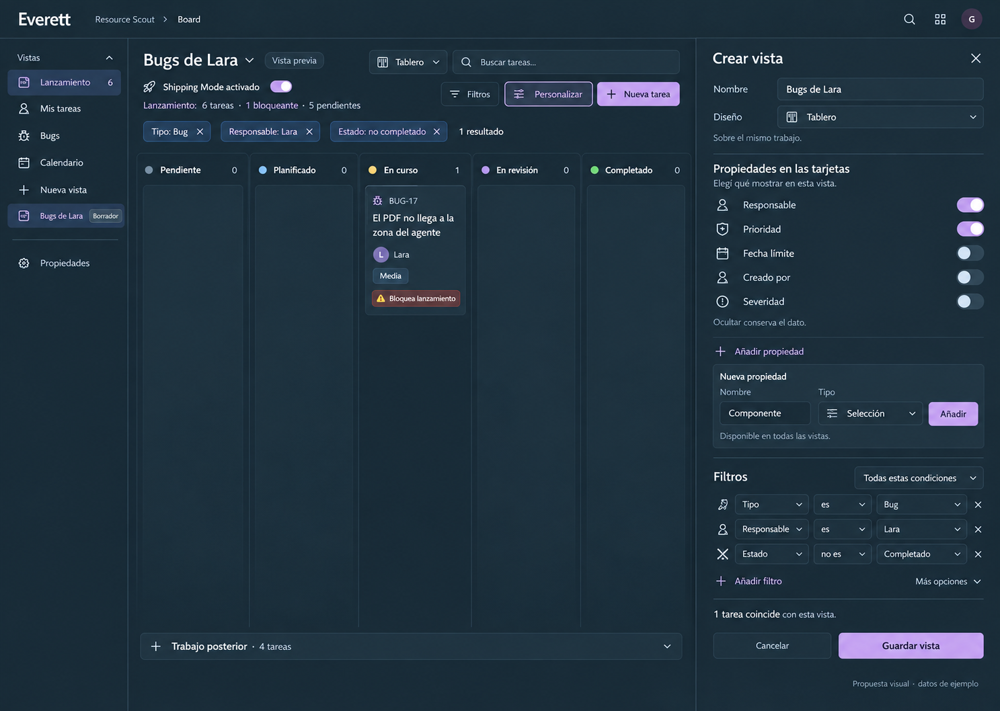

# Board — personalizar propiedades y vistas

Estado de la propuesta visual del 12 de octubre de 2026, basado en
[la ficha y el tablero revisados](propuesta-board-02.md). Imagen estática con datos de ejemplo;
su presentación y sus mecanismos siguen pendientes de evaluación del usuario.

## Organización propuesta

El panel Crear vista reemplaza al inspector de tarea durante la personalización, conservando
el tablero visible como vista previa. Reúne nombre, diseño, propiedades y filtros; Guardar
vista conserva esa configuración sobre el mismo trabajo. La creación de una vista no duplica
las tareas ni cambia su identidad.

- **Mostrar u ocultar:** Responsable y Prioridad aparecen en las tarjetas; Fecha límite,
  Creado por y Severidad están ocultos en esta vista. Sus valores permanecen en la tarea y
  se pueden consultar desde su ficha o mostrar en otras vistas.
- **Añadir propiedad:** el editor de ejemplo contiene nombre Componente y tipo Selección,
  con la acción Añadir. La propiedad se incorpora al trabajo compartido y queda disponible
  para las demás vistas; su visibilidad se configura por vista. En la imagen todavía no se
  añadió, por lo que no aparece un valor de Componente en la tarjeta.
- **Crear una vista:** Bugs de Lara combina Tipo es Bug, Responsable es Lara y Estado no es
  Completado. Todas las condiciones deben cumplirse; combinaciones adicionales quedan detrás
  de Más opciones. El nombre y los filtros se conservan al guardar la vista.

La vista previa contiene un resultado, BUG-17, que pertenece al conjunto de seis tareas de
lanzamiento. El resumen de Shipping continúa representando seis tareas, una bloqueante y cinco
pendientes; ese total se identifica como contexto del lanzamiento. Los contadores de las
columnas corresponden al resultado filtrado: cero, cero, uno, cero y cero. Las cuatro tareas
posteriores continúan accesibles en la fila plegada correspondiente.

## Generación y referencia

Generada con ImageGen integrado, usando [la imagen revisada](board-propuesta-02.png) como
referencia adjunta para conservar estructura, lenguaje visual y datos del ejemplo.
El [prompt exacto](board-personalizacion.prompt.txt) conserva la especificación enviada.
Se verificaron la lectura de los controles, el resultado de los filtros y la correspondencia
entre las propiedades ocultas y la tarjeta. La imagen permite evaluar la organización;
la interacción real se verifica al implementar el alcance que se apruebe.
