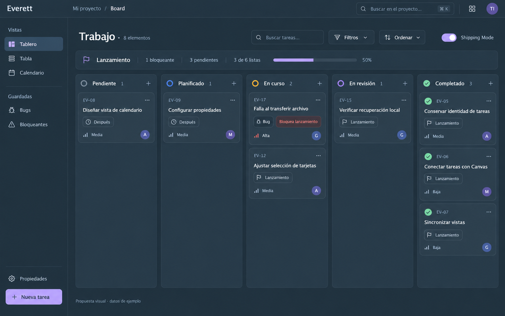
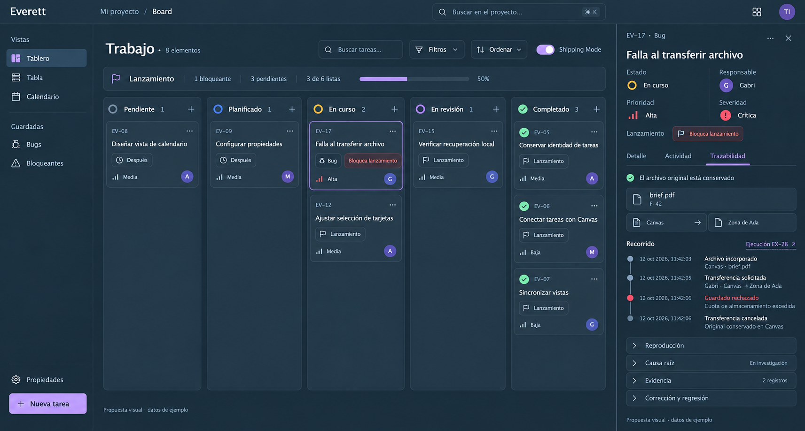

# Board — propuesta visual 1

Propuesta estática del 12 de octubre de 2026, pendiente de revisión y aprobación del usuario.
Las imágenes contienen datos ilustrativos. La distribución y los comportamientos descritos
son una propuesta de diseño; el alcance concreto se define antes de implementar Board.

## Uso cotidiano

- **Lateral contextual:** Tablero, Tabla y Calendario, vistas guardadas de Bugs y Bloqueantes,
  acceso a Propiedades y creación de tareas.
- **Centro:** búsqueda, filtros, orden y tarjetas compactas sobre las mismas tareas. Se conservan
  los cinco estados de Everett. Los bugs son elementos de ese mismo trabajo, con su tipo visible.
- **Shipping:** toggle discreto y resumen del lanzamiento, con bloqueantes, pendientes y tareas
  listas. El trabajo posterior sigue accesible. Los datos de ejemplo incluyen ocho tareas:
  seis para el lanzamiento, tres listas, tres pendientes y un bloqueante entre las pendientes.

## Detalle y trazabilidad

Abrir un elemento muestra su inspector lateral conservando el tablero visible. Estado,
responsable, prioridad, severidad e impacto en el lanzamiento son propiedades diferentes.
Detalle, Actividad y Trazabilidad organizan la información del mismo elemento.

La trazabilidad muestra identidad del archivo, origen, destino y enlace a la ejecución.
El recorrido distingue solicitud, fallo observado y resultado de recuperación. En este ejemplo,
el guardado se rechaza por cuota excedida y el archivo original permanece en Canvas; la causa
raíz sigue en investigación. Reproducción, Causa raíz, Evidencia y Corrección y regresión se
despliegan a pedido. Cada referencia debe conducir al elemento o evidencia correspondiente.

## Brief visual

Imágenes generadas con ImageGen integrado. Una propuesta en dos estados, con la estructura de
trabajo de Codroid y los patrones de tarjetas y detalle lateral de Gr8r como referencias.
Se utilizaron sus capturas inspeccionadas y la paleta vigente de Everett: base azul grisácea,
superficies discretas, texto claro y acento lavanda. Tipografía legible, jerarquía y espacio
antes que ornamentación. La segunda imagen deriva de la primera para conservar el mismo
tablero, sus ocho tareas y sus cantidades, incorporando el inspector de trazabilidad.

La primera generación pidió una vista cotidiana con cinco columnas, lateral compacto y
resumen de Shipping. La segunda pidió abrir EV-17, diferenciar prioridad de severidad y mostrar
archivo F-42, recorrido Canvas → Zona de Ada, ejecución EX-28 y cuatro eventos cronológicos,
manteniendo plegadas las herramientas de investigación adicionales.

El roadmap vigente mantiene Code + Docs en 0.9 y Board + Shipping en 0.11. El usuario planteó
evaluar adelantar Board; esa reorganización permanece por decidir.

Fuentes y criterios: [alcance de Board](../../alcance-prototipo.md#011--board--shipping-mode)
y [concepto de producto](../../producto.md#trazabilidad-y-diagnóstico).
