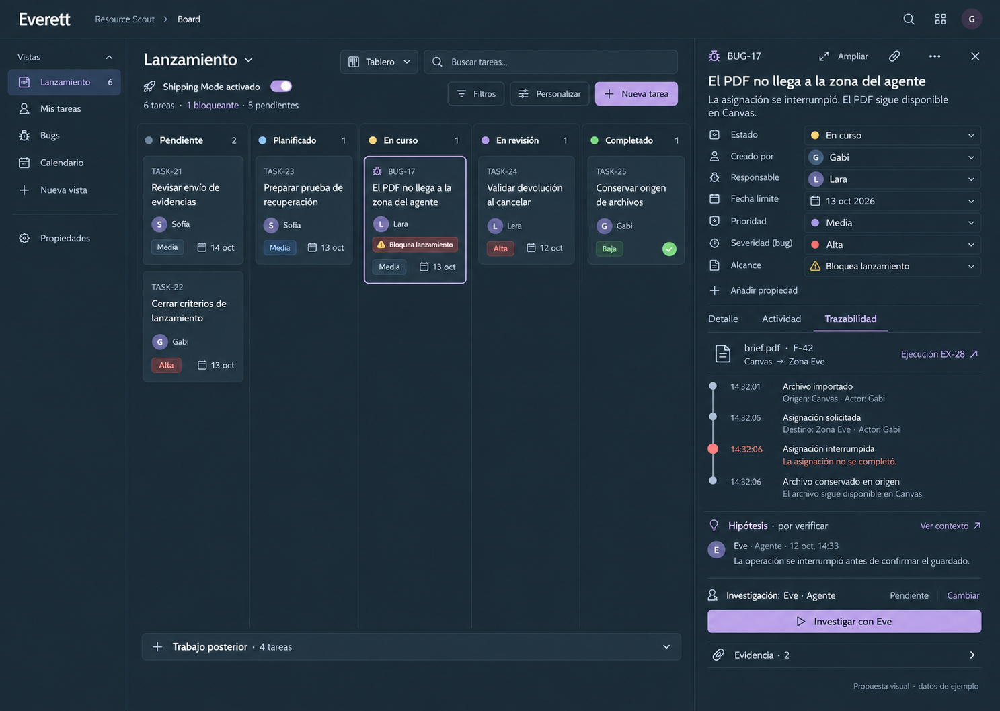

# Board — revisión de la base con inspector lateral

Propuesta estática del 12 de octubre de 2026, con datos de ejemplo. El usuario eligió la
disposición lateral como base y descartó el detalle inferior. Esta revisión visual permanece
pendiente de evaluación; no constituye aprobación de una implementación ni adelanta Board a 0.9.

## Dirección confirmada

- Inspector lateral por defecto; ampliar la misma ficha a pantalla completa mediante un botón.
  Al regresar, conservar vista, filtros, selección y posición del tablero.
- Claridad de tickets de Linear y flexibilidad de Notion: crear vistas, filtros, agrupaciones
  y propiedades según el trabajo, con acceso progresivo a personalización.
- Creador y responsable distintos. Asignación a uno mismo, a otra persona o a un agente y fecha
  límite disponible. La prioridad expresa el orden de atención; la severidad expresa el impacto
  del bug. Ambas conservan su identidad aunque Shipping cambie la prioridad de presentación.
- Hipótesis atribuida a una persona o agente, con fecha, contexto y estado de verificación.
  La investigación identifica también a su responsable; los dos autores pueden ser distintos.
- Shipping prioriza el trabajo del lanzamiento, con bloqueantes destacados y trabajo posterior
  accesible en un nivel secundario. Sus cantidades corresponden al mismo conjunto de tareas.

## Mecanismos propuestos en la imagen

El lateral contiene vistas configurables y accesos a Nueva vista y Propiedades. Personalizar
reúne las opciones de cada vista; Añadir propiedad permite extender la ficha. El catálogo de
tipos debe contemplar personas, fechas y las demás propiedades que se definan para el alcance.

La ficha del bug muestra creador Gabi, responsable Lara y fecha límite. En el ejemplo, Eve
formuló una hipótesis que permanece por verificar. La investigación está asignada a Eve como
agente y ofrece Cambiar e Investigar con Eve. Se propone preparar el pedido con el ejecutor y
el contexto explícitos antes de iniciarlo. Si se elige una persona, la investigación se expresa
como trabajo asignado a esa persona. Esta acción y su relación con la tarea original se definen
antes de implementarse; abrir la ficha no ejecuta trabajo.

La imagen muestra seis tareas de lanzamiento: una completada y cinco pendientes, incluido un
bug bloqueante. Hay cuatro tareas posteriores plegadas. El estado, la fecha y la prioridad
permanecen consultables. Las referencias a personas y agentes son datos ilustrativos; la
colaboración e inferencia reales conservan las etapas previstas en el alcance del prototipo.

## Fuentes y generación

Se utilizó ImageGen integrado, editando la [base seleccionada](board-base-inspector.png), primera
imagen de la serie de tres alternativas mostrada en este chat, con referencias visuales
oficiales de Linear y Notion inspeccionadas:
[tablero de proyectos de Linear](https://webassets.linear.app/images/ornj730p/production/2218608e9b124509700f975fb56df7af95e424dc-2560x1440.png) y
[vistas de Notion](https://images.ctfassets.net/spoqsaf9291f/2KRCKUbMb1AYfqJUWafwSr/03dfbdd1149dfbc3525543d373925722/Group_158.png).
El [prompt exacto](board-propuesta-02.prompt.txt) conserva la especificación enviada.

- [Linear: organización del tablero](https://linear.app/docs/board-layout).
- [Linear: propiedades visibles, agrupación y orden](https://linear.app/docs/display-options).
- [Notion: propiedades y personas](https://www.notion.com/help/database-properties).
- [Notion: vistas, filtros, agrupación y apertura lateral](https://www.notion.com/help/views-filters-and-sorts).

Los criterios funcionales de referencia se adaptan a Everett; la imagen es una propuesta,
con texto generado que puede necesitar ajustes de nombres, densidad y espaciado. El alcance
vigente permanece en [Board](../../alcance-prototipo.md#011--board--shipping-mode).

## Personalizar una vista

La [imagen de personalización](personalizacion-board.md) continúa esta misma base. Muestra
propiedades visibles por vista, creación de una propiedad compartida y guardado de una vista
con filtros sobre las mismas tareas. El usuario pidió esta exploración visual sin prototipo;
su presentación y los mecanismos descritos permanecen pendientes de evaluación.

## Preparar el cierre de una entrega

La [propuesta de Shipping](shipping-board.md) explora cómo cambia la organización de Board
para orientar las decisiones hacia una entrega: desbloquear, completar el alcance y verificar
el cierre. Conserva las tareas y su estado propio, con inspector lateral y evidencia contextual.
