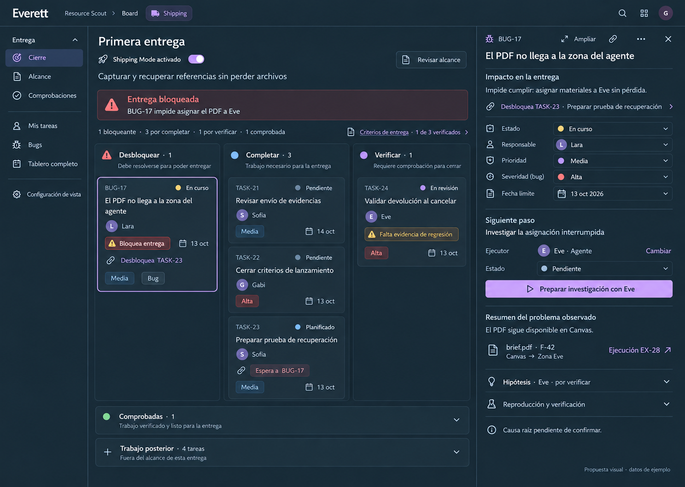

# Board — Shipping como cierre de una entrega

Propuesta estática del 13 de octubre de 2026, con datos de ejemplo. El usuario confirmó que
Shipping debe orientar el Mundo entero y afectar el fundamento del trabajo. Esta imagen
concreta su efecto en Board; la organización y los mecanismos propuestos siguen pendientes
de evaluación y definición antes de implementar.

## Trabajo de Board durante Shipping

La vista de cierre se organiza alrededor de una entrega concreta y sus criterios. Debe permitir
identificar qué impide entregar, cuál es el siguiente trabajo pertinente y qué resultado queda
por comprobar. Los elementos conservan su identidad, sus propiedades y su estado de trabajo.
Las agrupaciones Desbloquear, Completar y Verificar representan su función en el cierre;
no crean estados que sustituyan Pendiente, Planificado, En curso, En revisión o Completado.

- **Desbloquear:** relacionar el impedimento con el criterio de entrega afectado y el trabajo
  que depende de resolverlo. La prioridad de cierre puede colocar un bug por delante de otra
  tarea de prioridad ordinaria Alta, conservando sus propiedades de prioridad y severidad.
- **Completar:** mostrar el trabajo necesario del alcance, distinguiendo acciones disponibles
  de tareas que esperan una dependencia. El responsable y las fechas siguen accesibles.
- **Verificar:** mostrar las comprobaciones pendientes y la evidencia que falta. La existencia
  de una implementación o de un estado Completado necesita contrastarse con los criterios y
  la evidencia de cierre correspondientes antes de considerar ese trabajo listo para entregar.
- **Comprobadas y posterior:** mantener accesibles el trabajo ya verificado y las tareas
  posteriores en un nivel secundario. Los filtros personales no deben ocultar un bloqueante
  del resumen global ni cambiar por sí solos el alcance de la entrega.

La ficha muestra impacto en la entrega, dependencia, siguiente paso y ejecutor elegido,
con acceso progresivo a reproducción, hipótesis y evidencia. Consultar el problema conserva
el contexto; preparar una investigación mantiene la elección explícita de persona o agente.

## Ejemplo y condiciones propuestas

La entrega de ejemplo es capturar y recuperar referencias sin perder archivos. Contiene seis
tareas: un bloqueante, tres por completar, una por verificar y una comprobada. Las cuatro
tareas posteriores permanecen fuera de ese alcance y accesibles desde su grupo plegado.

BUG-17 afecta la asignación del PDF y bloquea TASK-23. TASK-24 está En revisión y espera
evidencia de regresión. El resumen indica Entrega bloqueada y un criterio verificado de tres;
la conservación de archivos está comprobada, la asignación está bloqueada y la comprobación
de recuperación permanece pendiente. Estas relaciones son datos ilustrativos de la propuesta.

Se propone que el estado de preparación se derive del alcance, los bloqueos, los criterios
y su evidencia vigente. Al cambiar un elemento que invalide una comprobación, actualizar ese
estado y mostrar qué requiere nueva verificación. La persona puede revisar el alcance y
debe poder distinguir trabajo pendiente, resultado comprobado e información todavía incierta.
La aprobación final conserva la autoridad del usuario.

El objetivo, los criterios de entrega, las relaciones de dependencia y el modelo de evidencia
se concretan antes de implementar. El estado de Shipping y su contexto de cierre pertenecen
al Mundo; las demás superficies deberán utilizar la misma orientación desde sus actividades.
El detalle de esas superficies queda fuera de esta exploración de Board.

## Implementación inspeccionada y generación

La implementación actual conserva Shipping como estado global y lo consulta en las respuestas
simuladas de agentes. Board ordena por rol de lanzamiento, muestra etiquetas y cantidades y
atenúa el trabajo posterior. Su cálculo de tareas listas usa el estado Completado. Las
relaciones y comprobaciones de cierre de esta propuesta no se dan por implementadas.
Fuentes inspeccionadas: [cálculos de Shipping](../../../src/domain/shipping.ts),
[Board](../../../src/features/board/view.ts), [presentación](../../../src/features/board/shipping.css)
y [respuestas simuladas](../../../src/app/agent-service.ts).

Imagen generada con ImageGen integrado y [la base revisada](board-propuesta-02.png) como
referencia adjunta. El [prompt exacto](board-shipping.prompt.txt) conserva la especificación.
Se inspeccionaron agrupaciones, estados y cantidades; la interacción y los contratos se
verificarán sobre la implementación del alcance que se apruebe.
